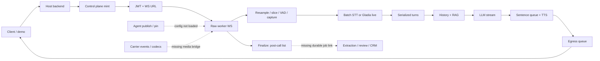

# Wavia / UCVE codebase audit

Audit date: 2026-10-10. Workspace: `D:/PROJECTS/PASSION PROJECTS/VERTEX_voiceai`.

## Scope, method, and evidence status

Read-only static audit of the current working tree; the sole authorized write is this report. No application imports, live calls, provider requests, dependency installs, builds, migrations, commits, or deployments are authorized or performed. Environment values and raw API-key files are excluded. Existing modified files are preserved: `core/fsm/transitions.yaml`, `core/language/profiles/en.yaml`, `core/listening/config.py`, `core/providers/interfaces/vad.py`, `core/vad/silero_adapter.py`, `examples/web-client/index.html`, `worker_raw/orchestration/pipeline.py`, `worker_raw/ws_session.py`.

Documentation read first: root README, SDK overview/API reference, developer SDK engine documentation, product blueprint overview, telephony integrator guide, Studio README/outbound deferral, and SDK versioning. Source-tree inventory followed. Historical reports describe earlier snapshots and are not accepted as proof of current behavior. Findings will distinguish executable implementation, disconnected scaffolding, documented intent, and unverified runtime hypotheses.

## Architecture map

The intended product owns the conversation loop and delegates STT/LLM/TTS/carrier functions to replaceable adapters. Clients obtain short-lived session credentials from a host backend/control plane, send PCM audio to the raw WebSocket worker, receive transcripts/control events/audio, and produce post-call intelligence for downstream systems.

| Major area | Tree | Intended role | Initial status |
|---|---|---|---|
| Shared engine | `core/` | Audio types, listening/VAD, FSM, provider selection, language, RAG/MCP, tenancy, compliance, latency, metering | Source modules present; runtime wiring under review |
| Management service | `control_plane/` | Mint/refresh, agents, knowledge, telephony, usage, audit, credentials | FastAPI entry point and routes present |
| Raw audio worker | `worker_raw/` | Native WS admission and duplex voice orchestration | Primary path to trace |
| Managed worker | `worker_managed/` | Optional managed media integration | Small package; implementation to assess |
| Telephony | `telephony_gateway/`, `core/transport/` | Carrier events, DID resolution, transcoding, transport, failover | Adapter files present; end-to-end connectivity unverified |
| Post-call | `post_call/` | Assemble records, extract/verify/summarize, review and dispatch | Modules present; lifecycle connection to assess |
| Client SDKs | `sdk/python`, `sdk/typescript`, `sdk/typescript-livekit`, `sdk/flutter`, `sdk/shared` | Public integration APIs and shared event schema | Multiple packages; Flutter explicitly names a stub |
| Studio / demo | `agent-studio/`, `examples/web-client/` | Nontechnical builder and developer voice console | Studio tree inventory shows README only; demo has HTML/worklet |
| Infrastructure | `infra/docker`, `infra/db`, `infra/scaling` | Service composition, migrations, resource profiles | Artifacts present; production parity unverified |
| Reference material | `legacy_codebases/`, `docs/archive/` | Harvested implementations and historical audits | Outside primary runtime scope |

Documentation conflicts already visible: blueprint says implementation has not started, while current runtime exists; SDK overview claims five microservices but its table includes a shared library; public descriptions imply inbound/outbound telephony while integrator and Studio documents explicitly defer outbound campaigns. These must be reconciled before commercial promises.

Additional mapped areas: `worker_jobs/` contains knowledge ingestion, retention purge, monthly quota reset, stale-session and DLQ sweep jobs; none is deployed by default compose. `schemas/agent-config-v1.json` is a separate config contract. `control-plane/` and `worker-raw/` are compatibility layouts. `scripts/ping_provider_apis.py` is a live-network utility and was not executed. `hamza_local/` returned no files in the filtered code inventory; no purpose or deletion recommendation inferred.

Architecture verdict: the strongest implementation is the raw browser conversation runtime and reusable audio/FSM primitives. Management, telephony and intelligence have substantial domain scaffolding but important execution/persistence gaps. This snapshot does not establish a production-ready, carrier-grade, resilient self-serve SDK product; it also does not mean every browser turn fails.

## SDK inventory

Source-complete inventory for the current client packages (legacy SDKs excluded):

| Package / public symbol | Function or capability | Documentation / reality |
|---|---|---|
| Python `UCVEVoiceClient` | Constructor: ephemeral token, WS URL, provider choices, transcript/audio/metric callbacks, manifest | Implemented; rejects named secret kwargs but does not establish token type cryptographically |
| Python `connect()` | Open socket and background receiver | Implemented; concatenates query values without URL encoding; no readiness handshake, reconnect or refresh |
| Python `send_audio(bytes)` | Send caller-supplied 16 kHz mono PCM16 | Implemented; no capture, framing or playback utility |
| Python `emit_playback_started()` | Report speaker start timestamp | Implemented; sends wall-clock timestamp |
| Python `send_barge_in(rms)` | Request interruption | Implemented sender, incompatible receiver name (F03) |
| Python `disconnect()` | Cancel receiver, close socket | Implemented |
| Python exports | `SDK_VERSION_MANIFEST`, `__version__` | Exported; manifest not negotiated with server |
| TS `UCVEVoiceClient` | Constructor token/options; readonly token, URL, options; static versionManifest | Implemented; callback API also has `onError` |
| TS `connect()` | Open WS, decode audio to Int16Array and route transcript/metric/error | Implemented; no close handler, refresh, reconnect, readiness or playback cancellation callback |
| TS `sendAudioChunk()` | Send ArrayBuffer/Uint8Array | Implemented; no capture or playback utility |
| TS `emitPlaybackStarted()` | Report speaker start | Implemented; wall clock |
| TS `sendBargeIn()` | Request interruption | Same incompatible event as Python |
| TS `disconnect()` | Clear handlers and close | Implemented |
| React `useUCVEVoice()` | Returns isConnected, isSpeaking, transcript, connect, disconnect, sendBargeIn | Implemented partial wrapper: isSpeaking never set true; transcript callback overwrites caller callback; no sendAudio API, unmount cleanup or remote-close state update |
| LiveKit `UCVELiveKitAdapter` | Constructor(options), connect(), disconnect(); roomName/participantToken options | Methods are empty; not functional transport integration |
| Flutter `UCVEVoiceClientStub` | Constructor(token, wsUrl), connect(), disconnect() | Explicit stub; methods do nothing |
| Shared contract | `sdk/shared/event_schema.json` | Present; validation/code generation not yet assessed |

Evidence: `sdk/python/ucve/{client,__init__}.py`, `sdk/typescript/src/{client,index}.ts`, `sdk/typescript/src/hooks/useUCVEVoice.ts`, `sdk/typescript-livekit/src/index.ts`, `sdk/flutter/lib/ucve_voice_client_stub.dart`.

**S01 — Python distribution blocker (high):** public modules import `sdk.python.ucve.*`, which ties them to the repository namespace rather than a standalone `ucve` installation. The Python package manifest references a README absent from its enumerated directory and supplies no explicit wheel package mapping despite distribution name `ucve-voice-sdk` differing from directory `ucve`. Verify an installed wheel in an isolated consumer before claiming distribution works; no build performed.

**S02 — TS distribution incomplete (high):** package scripts call tsc/jest without declaring development dependencies; `module` points to `dist/index.mjs` while build only invokes tsc. Entry point eagerly exports a hook importing React despite an optional React peer. Verify emitted artifacts, non-React import, declarations, and package installation outside the repo.

The client SDK is a thin realtime transport API. There is no public current client API for agent CRUD, mint/HMAC signing, provisioning business onboarding, telephony dialing, transcript history, extraction/review/webhook configuration, or knowledge ingestion. Those capabilities must be separately exposed through a management client or documented REST API.

Management/API capability inventory (actual registered source surface):

| Surface | Actual operations | Reality / discrepancy |
|---|---|---|
| Session | POST `/v1/session`, `/mint`, `/v1/session/mint`, `/v1/session/refresh` | Mint/refresh; 120-second ttl_sec and WS URL versus docs' expires_in=3600 |
| Agent builder | POST/GET `/v1/agents`; GET `/{id}`; PATCH `/{id}/autosave`; POST `/{id}/publish`; GET `/{id}/versions`, `/{id}/versions/{version}`; POST `/{id}/pin` | In-memory drafts/validation/snapshots/pin; generic PATCH and DELETE advertised in docs absent |
| Usage/audit/secrets | GET `/v1/usage`, GET `/v1/audit`, POST `/v1/secrets/rotate` | API-key identity/RBAC on these routes; fixed usage/local audit/separate vault defaults |
| Knowledge | GET `/v1/knowledge-bases/status/{tenant_id}` | Fixed ready/count stub; upload/list/delete API missing |
| Extraction | POST `/v1/extraction-schemas` | Validation/metadata response only; list/persistence missing |
| Alerts | POST `/v1/alerts/config/{tenant_id}` | Echo; documented list/create-rule endpoints absent |
| Telephony control plane | POST `/v1/telephony/telnyx/webhook` | Empty verifier config by default; no call answer/media session |
| Gateway | POST `/v1/telephony/webhook/{carrier}` | Unsigned JSON normalization |
| Worker | WS `/ws/audio`, GET `/health`, GET `/` | PCM/control/audio; text_turn/user_turn, set_prompt, barge_in, ping/pong and playback metrics |
| Developer surfaces | `/demo`, `/docs`, `/redoc`, `/openapi.json`, `/metrics`, `/health`, root/probes | Docs routes duplicate FastAPI defaults; static schema partial; metrics bearer required |
| OIDC hook | register/get provider, authenticate_token | Stub blocked in production; not integrated with agent routes |

Domain capability inventory beyond client SDK: AgentConfig covers persona/languages/provider chains/tools/MCP/knowledge/extraction/pronunciation/telephony/compliance; core supplies audio/transcript/chunk contracts, FSM/cancellation, queues, language routing/normalization, providers, compliance/redaction/legal hold/retention/erasure, tenant DB helpers, JWT/HMAC/replay, encrypted credential resolution/rotation, usage/quota/admission, latency/errors/alerts. These are internal library/service primitives with uneven wiring, not working client features by default.

No hypercode/hyper-code reference found in searched current docs, schemas, SDKs, core, services, examples and plans. Clarify terminology/source. Inventory is complete for visible current client exports and registered management operations, not every internal helper or legacy package.

## Deployment-model gap analysis

| Deployment model | Implemented foundation | Blocking gaps / necessary improvement |
|---|---|---|
| Package distributed through website docs; customers request credentials | Python/TS voice clients, session mint/refresh primitives, hash-at-rest API key helper, developer docs | Packaging blockers S01/S02; protocol F03; no demonstrated persistent key provisioning/revocation/rotation workflow; published agent not bound to session; authenticated management client missing; license/IP boundary needs decision |
| Done-for-you enterprise builds | Raw voice loop, language profiles, agent templates/config validators, compliance/secrets/RAG/tools/post-call modules, compose | Build each client as configuration after connecting F01; live telephone media path T01/T02 missing; durable tenant/config/credentials/records and tested isolation required; local STT/LLM/TTS advertised in blueprint absent from current adapter list; recording metadata cannot substitute for evidence |
| Nontechnical self-serve dashboard / web and calling makers | Domain model, draft/publish/version/pin API, Studio screen and acceptance specs, developer demo | No runnable current Studio frontend; no business/signup/onboarding workflow found in current Studio tree; authenticated persistent agents, testing quota/accounting, knowledge upload, DID provisioning, transcript/history/review UIs and credential issuance needed; outbound boundary must be explicit |

**A01 — Agent management authorization absent (critical):** every route in `control_plane/routes/agents.py` derives identity from unauthenticated `X-Tenant-Id`, defaulting to the demo tenant. App mounts this router with no auth dependency; global middleware only records request/tenant IDs. Any caller able to reach these endpoints can list/create/read/patch/publish/pin under a supplied tenant identifier. Keyed dictionaries isolate storage only after trusting an attacker-controlled tenant value.

**A02 — Agent and credential durability absent from app defaults (high):** AgentConfigRepo keeps drafts/versions/autosave in process dictionaries; SessionConfigPin is a separate engine; app lifespan creates a fresh in-memory APIKeyManager and leaves db_pool/redis None. Restarts lose those credentials and builder records; multiple processes disagree. Separately stored mint tenant agents are not automatically populated by AgentConfigRepo.create_agent. Production mint can therefore reject an agent created in the builder even before config wiring F01.

**A03 — API-key mint identity not bound (high):** app verifies required scope but discards the resulting key record, passing the caller's tenant/agent IDs to mint. Neither quick-mint nor signed mint checks that the API key's tenant equals the requested tenant. HMAC is still checked in signed mint, but quick-mint computes it server-side, so any accepted mint-capable key can request another known tenant's agent. Prove rejection in an offline two-tenant endpoint test.

## Flow findings

Trace so far: host/control-plane mint → JWT → `worker_raw/main.py:ws_audio` → default PipelineSessionConfig and chosen adapters → runner session admission → optional persistent Gladia live STT → mic receive/resample/slice → bounded ingress queue → VAD/capture → batch transcription or live-final turn queue → serialized `run_turn` → Redis history and RAG → LLM stream → sentence queue → TTS → bounded audio queue → browser → teardown and post-call enqueue.

**F01 — Saved agent config is disconnected (critical product gap):** `_load_session_config` reads identity/session/compliance but does not load saved persona, provider chains, knowledge bindings, tools or language. Language remains English; prompt is the dataclass default; greeting is process environment; provider/model/voice choices come from URL parameters. Studio/API agent configuration therefore cannot be assumed to affect a real session.

**F02 — Failover retries the same adapter (high):** PipelineOrchestrator constructs `FailoverRouter(priority=["primary", "secondary"])`; both LLM and TTS callbacks ignore their `_pid` and invoke the same selected instance. STT buffer transcription bypasses this router. Live STT is always Gladia when its flag is enabled, even if the session selects Deepgram. Unknown provider IDs silently normalize to defaults. Provider abstraction exists, but actual independent-vendor fallback is absent from this path.

**F03 — SDK protocol breaks (high):** both SDKs send `control.barge_in`; worker receive loop handles only `barge_in`. Both SDK receivers omit application ping/pong handling; runner closes sessions after its pong deadline. Both omit server barge-in handling needed to stop already-buffered client playback. Raw demo behavior cannot establish SDK parity.

**F04 — Retrieved text elevated into system prompt (high):** `run_turn` appends `[Knowledge DATA]` content directly to the system-role message. The label does not implement the blueprint promise to keep retrieved tenant text as data outside the privileged prompt. Add role separation and adversarial retrieval tests.

**F05 — Operational failures become fake success (high):** LLM exhaustion produces a canned “I heard you say” reply; TTS exhaustion emits NullTTS audio; ingress STT exceptions and turn-worker exceptions are swallowed. A bad key/provider outage can look like a working but nonsensical or silent agent. Testing providers are permitted by default in the orchestrator constructor. Production needs explicit failure/degradation events and separate offline test mode.

**F06 — Post-call metadata overstates captured evidence (high):** finalize creates a recording URI without recording/upload code on this path, sets dual_channel true, and sets started_at and ended_at to the same finalization timestamp. It redacts transcripts, enqueues, clears hot state, then records call_record_created even when enqueue failed. Persistence and downstream success remain under review.

**F07 — Audio drain is not client playback completion (high):** run_turn triggers TTS_DRAINED when sentence synthesis finishes, while egress/client queues can still contain audio. FSM listening state can resume before the caller hears the end. Egress sender can hold a dequeued chunk while paused; queue flushing alone does not prove that chunk will never play after a committed interruption. Test this race with deterministic barriers.

**F08 — Startup cleanup boundary incomplete (medium):** runner.start opens live STT and sends readiness before entering its try/finally; earlier adapter selection also precedes runner teardown. Failures during these stages can leave provider/task resources unclosed. Session establishment needs a single cleanup boundary.

**F09 — RAG scaffolding (high):** default PgVectorRetriever has no DB pool. Its DB query orders by `text <-> query`, without an embedding/vector comparison, and swallows errors into lexical mock retrieval. IngestionWorker stores chunks in a local list; pdf_upload stringifies input instead of extracting PDF bytes. Knowledge status returns ready and fixed count 42 without auth. A durable upload→embedding→index→agent-scoped search path is missing.

**F10 — MCP/tool loop incomplete (high):** HTTP/SSE/stdio transports echo dictionaries without protocol/network/subprocess execution. MCPHost lists one hardcoded inventory tool; allowed_tools/credentials are unused on inspected execution. ToolOrchestrator returns from its first host without selecting the owner of a tool; worker defaults to no tenant hosts. Tool results are appended/spoken rather than passed through complete model continuation with tool_call_id. Builtin escalation/summary still needs real handoff/hangup integration.

**F11 — Post-call enqueue is not a durable job (high):** default PostCallPipeline has no repo/queue and appends to a per-instance list without invoking PostCallWorkerProcessor. Separate extraction returns fabricated `extracted_<field>_val`; summary truncates text and hardcodes positive sentiment/success takeaways. WebhookDispatcher succeeds with no HTTP client. Connect a durable queue/repo, evidence-based extraction and review, and real HTTP dispatch before claiming CRM delivery.

## Latency findings

**L01 — Timeout names do not match semantics:** failover wraps the entire callback in wait_for(first_chunk_timeout); it is 20 seconds for a whole LLM response and 15 seconds for a whole TTS sentence. `subsequent_chunk_timeout` is unused. A long healthy response may timeout after already speaking, then retry and duplicate content. These bounds also cannot enforce a subsecond first-byte SLA.

**L02 — Hot path waits and accumulates:** batch STT is awaited inside the sole ingress worker, so VAD/audio processing stops during transcription while the 100-frame drop-oldest mic queue accumulates (~3.2 seconds for canonical frames). Live STT send_audio uses nonblocking put_nowait/drop-oldest at 256 frames; its network sender is separate, but drops can silently lose words and its transcript queue is unbounded. Sentence queue is unbounded, outbound audio queue blocks at 200 chunks, and turns serialize behind the previous complete synthesis. Track queue age and drops, not just counts.

**L03 — First speech waits for punctuation:** actual stream chunking uses ASCII sentence punctuation, or a clause after >=9 words, then flushes at response completion. Configured small first-word limits and the constructed SentenceChunker are not used on this branch. Urdu/Arabic punctuation and long punctuation-free responses can wait for the full LLM response.

**L04 — Normalization occurs after speaking:** streaming speech pieces reach TTS before the normalizer runs on the completed reply. Spoken markdown, numerals and pronunciation can differ from stored transcript. Normalize incrementally before TTS with language-aware chunking.

**L05 — Waterfall can misrepresent latency:** run_turn fabricates VAD end as STT time minus 220 ms when no VAD timestamp exists, and uses one mutable current waterfall for late client playback events. Some TTFB state resets per synthesis call. Browser wall-clock and server monotonic-clock alignment must be verified before trusting reported E2E values. Published targets are not measured evidence.

Clock detail for L05: PlaybackMetricHandler converts browser Date.now to server monotonic acknowledgment receipt. This avoids direct clock mixing, but measures receipt rather than exact speaker start; small client timestamps may still be trusted without synchronization. Correlate acknowledgments by turn and distinguish estimates from measurements.

**L06 — Uplift buffers full response:** client.post/resp.content complete before the first yielded audio chunk; downloaded-byte chunking is not network-streaming TTS. Cartesia/ElevenLabs use stream/aiter_bytes. Uplift also strips a fixed 44-byte WAV header rather than parsing RIFF data/format chunks.

**L07 — Endpoint timing drift:** current ListeningPipelineConfig defaults to 160 ms onset and 960 ms silence, unlike generated docs' 100/380 ms. VADConfig also defaults to five onset/thirty silence frames, so canonical 32 ms frames imply 160/960 ms even with flags empty. Without slicing, frame-counter timing depends on client packet sizes. Nearly a second of batch endpoint silence exceeds published total latency targets. Measure acoustic-end→audible-response as well as detected-end→response.

**L08 — Resampling/quality risk:** 24→16 kHz egress discards each middle sample in groups of three and drops incomplete groups per chunk without anti-alias filtering/carry. Other rates use stateless chunk interpolation. Ingress carries one sample but lacks fractional phase across arbitrary packet sizes. Browser capture decimates with gain 2.2 and no low-pass filter. Use streaming filtered resampling with sample-count/spectral tests; unsupported sample-rate query values currently get tagged 16 kHz without conversion.

**L09 — Demo metrics incompatible (high):** worker sends kind=latency_waterfall with stt_ms/total_e2e_ms; demo recognizes kind=latency and renders stt_final_ms/e2e_playback_ms. Demo schedules AudioBufferSource nodes with 50 ms initial buffering but sends no playback_started in inspected playIncomingPcm. Worker sets playback_start at enqueue; STT metric caps positive delay at 800 ms or substitutes 220 ms. Correct schema/timestamps before trusting UI latency.

**L10 — Cancellation/verification nuance (high):** only TTS consumer tasks are registered in current run_turn; inline LLM stream checks cancellation when another chunk arrives. Barge verify waits the full 700 ms, can confirm via still_speaking under long VAD silence hysteresis, and server pause does not pause scheduled client audio. Verify task is not explicitly canceled/awaited in teardown; flush callbacks persist and are re-registered each turn. Test producer/sender/client stop, not only cancel_tts().

**L11 — Per-session VAD cost (medium):** each orchestrator creates an ONNX inference session and optional dedicated executor; profile silero_pool_size does not implement a shared pool here. Measure startup memory/CPU/thread count and event-loop lag. asyncio.to_thread uses a bounded default executor, despite VADWorker docstring claiming unbounded thread spawning.

## Telephony assessment + test plan

No live calls permitted. Inbound is the documented v1 priority; outbound campaigns are explicitly deferred in `docs/developer/TELEPHONY_INTEGRATOR.md` and `docs/agent-studio/OUTBOUND_UI_DEFERRED.md`.

**T01 — No live SIP/RTP bridge in audited current path (critical delivery gap):** DirectSIPTransport is a codec/rebuffer wrapper with callbacks; it does not establish SIP signaling, bind RTP sockets, handle SDP, sequence/jitter, or pace RTP packets. TelnyxDirectSIPAdapter.connect simply sets connected true, receive_audio returns None, and constructor does not supply a real egress callback. No actual carrier answer/media connection is made by webhook handlers. This is a useful media primitive, not a complete telephone service.

**T02 — Phone handler does not run conversation turns (high):** `worker_raw/telephony/inbound_handler.py` passes decoded frames to process_frame_async, but does not perform SESSION_ADMITTED, attach a runner, apply provider choices, transcribe pending buffers, enqueue/run turns, or start persistent STT. close only closes transport/meters time, without finalizing orchestrator/post-call/tasks. Confirm repository reference search before selecting this class as a production entry point.

**T03 — Inconsistent webhook security and wiring (high):** `/v1/telephony/telnyx/webhook` creates TelnyxWebhookHandler with empty keys/resolver defaults and therefore rejects signatures until explicitly wired. Handler returns IDs/context, not a persisted minted JWT session or carrier command, despite its docstring. The separate gateway `/v1/telephony/webhook/{carrier}` does no signature verification at all and only normalizes JSON. Do not expose that endpoint as trusted call admission.

**T04 — Call identity/replay handling missing (high):** webhook normalizer assigns a fresh UUID on every event, as does the Telnyx handler; no carrier event-ID deduplication or stable call-control-ID lifecycle mapping is shown. Started/answered/ended events can become separate sessions. Timestamp freshness checks do not prevent replay within the validity window. Unknown Telnyx event strings default to CALL_STARTED.

**T05 — Secondary transports are placeholders (high):** TwilioSIPAdapter and GenericPTAAdapter return healthy/connected while send_audio is pass and receive_audio returns None. Twilio Media Streams is explicitly abstract; TelnyxLiveKitAdapter has empty media methods. `worker_managed/main.py` exposes health/root only. Failover router selects configs but does not implement carrier recovery; unknown health defaults healthy and an empty DB trunk table fabricates a primary trunk. Existing calls and new-call rerouting require different recovery contracts.

**T06 — REST documentation mismatch (medium):** SDK API reference advertises `/v1/telephony/trunks` GET/POST and `/v1/telephony/inbound`; audited control-plane router defines only `/telephony/telnyx/webhook`. Carrier gateway is a different app. Publish actual endpoint contracts and mark planned routes.

Offline test plan (not executed; no dialing and no provider requests):

1. Build a network-denied test fixture with fake carriers/providers, disposable in-memory stores, generated test-only signing material and prerecorded/synthetic PCM. Never use real credentials or real phone destinations.
2. Verify signatures on exact raw bytes; missing/invalid signatures, stale/future/nonfinite timestamps, tampered payload and invalid key encodings must reject. Separate Ed25519 carrier verification from internal HMAC tests. Replay one event 100 times and assert one session/action/charge record.
3. Replay started→answered→DTMF→ended plus reordered/duplicate events under one carrier call ID. Unknown DID, missing caller ID, spoofed tenant and unsupported carrier must fail predictably. Assert tenant-agent ownership and one session across the lifecycle.
4. Test μ-law known vectors, silence, clipping, 8→16→8 kHz durations, 160-byte/20 ms packets, arbitrary fragments and canonical 1024-byte frames. Require bounded buffering, correct leftover flush, no sample loss/drift and spectral checks for downsampling aliasing.
5. Attach a fake RTP/socket sink and source. Assert actual receive→VAD→STT→LLM→TTS→μ-law egress; nonempty output; packet sizing and realtime pacing; no dependency on LiveKit. Current implementation should fail this integration gate until T01/T02 are addressed.
6. Deterministically pause each stage, barge in, and assert cancel/flush/client-stop and retained interrupting words. Inject loss, jitter, reordered packets, slow sinks, disconnect and hangup during every stage. Assert no tasks/sockets/provider sessions remain after cleanup.
7. Simulate primary down, secondary up, both down, health unknown and credentials missing. Verify new-call selection, bounded retries, explicit degradation and no stub reported healthy. Test established-call failure separately; do not promise transparent mid-call trunk migration.
8. Assert one durable post-call record, correct start/end times, real recording availability state, transcript/history visibility, per-tenant access and idempotent telephony/agent billing. Fractional seconds and retries must not silently distort usage.
9. Review existing phase 18/19 tests and E2E fixtures for mocked connect/health success: a passing primitive test is not a phone conversation test. Paid staging calls require a later, separately authorized run with spend cap and destination allowlist; none are authorized in this audit.

## Provider strategy recommendation

Current adapter inventory: Silero ONNX plus energy fallback VAD; Gladia batch and separate live session; Deepgram batch HTTP behind a streaming-shaped interface; Groq/OpenAI/Gemini chat streaming; Uplift/ElevenLabs/Cartesia TTS; Null providers including S2S. No local Whisper/Piper/Ollama adapters appear in the current provider tree. Native vendor request implementations exist, but live correctness is unverified.

**P01 — Mock/live mode silently permissive:** adapters mock when keys are absent OR RUN_LIVE_PROVIDERS != 1 OR RUN_MOCK_PROVIDERS == 1. Deepgram can fabricate a fixed transcript without explicit mock text; LLMs fabricate replies and TTS emits tones. OpenAI catches status/network/serialization errors and emits mock text, hiding failure from routing. Most health_check methods always return True. Production needs explicit live mode, credential readiness and typed failures; test doubles belong in a visibly separate test runtime.

**P02 — Tools not normalized across LLM adapters:** Groq converts ToolDefinition objects to JSON schemas; OpenAI assigns config.tools directly to JSON payload. Dataclass objects need serialization; errors currently become mock responses. Check Gemini separately. Standardize tool schemas and fragment accumulation, then contract-test multiple calls and arguments.

**P03 — Language policy disconnected:** LanguageRouter is constructed but current run_turn does not route detected language. Gladia live forces code_switching=True and four languages, contrary to blueprint Urdu default-off policy; it labels transcripts with configured rather than vendor-detected language. Cartesia classifies all Arabic-range text as Urdu. Use pinned language policy and actual per-language capabilities.

**P04 — Tenant vault not used by main adapters:** factories resolve process-wide environment credentials, without tenant/key-tier context. SecretVault has encrypted in-memory storage but rotation does not update this runtime's active provider credentials. Inject tenant-aware resolution and distinguish platform-paid and customer-paid keys.

Recommended strategy:

1. One versioned registry with provider/model/region/languages, real streaming/tool capabilities, audio encoding/rate, credential references, compliance constraints and measured health. Reject unknown IDs rather than silently aliasing them.
2. Compile each published agent into an immutable session plan. Filter by tenant authorization, language, residency/BAA, voice, capability, budget and credential readiness. Validate independent fallback candidates where resilience is promised.
3. Invoke the actual provider named by routing. Key circuit health by category/provider/model/region; share evidence across sessions. Current primary/secondary router health mixes LLM/TTS and resets per session. Bound half-open probes and propagate auth/quota/transient/timeout/config errors.
4. Separate first-output, inter-chunk-idle and overall deadlines. Switch safely before output commitment; define repair after partial audio to avoid duplicate speech and tool side effects. Never transparently replay a completed booking/payment tool.
5. Route use cases by evidence: low-TTFT conversational LLM separately from schema extraction; Urdu/mixed STT by WER/CER; English/Urdu/Arabic voices by intelligibility; local providers for offline/residency only once real adapters exist. No permanent fastest-vendor claims without measurements.
6. Test with network-denied recorded HTTP/SSE/WS fixtures: missing key, 401/429/5xx, invalid JSON, empty/slow/partial streams, cancellation and encoding mismatch. Expose mock/live/degraded state. Real provider benchmarking is a later authorized step.

## Infrastructure, configuration and security findings

**I01 — Default compose cannot establish documented live mode (high):** it forwards only primary Gladia/Groq/Uplift credentials, omits RUN_LIVE_PROVIDERS and UCVE_PIPELINE_V2, and does not deploy post-call/jobs. Adapters therefore mock by default regardless of forwarded keys. Telephony is only an optional staging service; that service does not receive signature verification config. Control-plane docs alternate 8000/8080. Use one tested deployment contract with explicit mode, complete provider config and pinned feature rollout.

**I02 — Database path inconsistent (high):** primary repos use synchronous psycopg inside async methods (event-loop blocking, connection per operation), while RAG/failover expect asyncpg-style acquire/fetch/$1 APIs not supplied by app lifespan. RLS migrations split `app.tenant_id` and `app.current_tenant_id`; TenantScopedDBSession sets only the former. RAG query uses text distance against a schema with vector embedding. Compose uses plain postgres:16-alpine while migration 013 requires the vector extension. Verify fresh install and all tables with the actual unprivileged app DB role.

**I03 — Migration crash consistency (medium):** migration runner autocommits SQL and then separately records filename. A crash can apply schema without bookkeeping, and reruns can fail on non-idempotent CREATE POLICY. Two migration filenames share prefix 009, sorted by filename. Use transactional, uniquely ordered migrations with a lock; no migrations were executed.

**I04 — Production auth default guard incomplete (high):** exact production mode checks a finite insecure-default list, but compose's development signing defaults are not in that list. Staging is not production and is not checked. UCVE_DEMO_MODE can explicitly enable unauthenticated mint independent of environment. Require safe mode policy, high-entropy signing keys and rejection of every shipped default. No actual configured value was read.

**I05 — Capacity and quota drift/leaks (high):** mint passes current_concurrent=0/current_monthly_minutes=0 defaults, overriding quota's own counts. It acquires admission before persisting/issuing JWT without rollback, then quota, but worker teardown never releases the control-plane admission/quota instances. Reference search found release methods only at definitions in current runtime. Unused mints leak slots; separate processes cannot coordinate them. Use atomic distributed reservation with TTL, actual worker admission, durable usage and teardown reconciliation.

**I06 — Replay check is non-atomic (high):** mint separately tests nonce existence then sets it. Concurrent identical requests may both pass. Use one atomic Redis SET NX with expiry; test requests racing at the same nonce. JWT verifies exp/iat/sub/action but does not require tenant/agent claims, issuer/audience or persisted active session. Worker allows a missing session lookup to continue and does not prevent concurrent reuse of a token. Define token reuse, refresh/revocation and active-socket expiry policy.

**I07 — Metering/reporting mostly in memory (high):** UsageMeter appends to a local event list; worker records agent seconds, not durable STT seconds, LLM tokens, TTS characters and actual carrier fees. GET usage returns fixed limits/zero totals. Billing/free-test quota claims cannot rely on these defaults. Connect ledger events with idempotency, tenant plan limits, reconciliation and honest dashboard state.

**I08 — Management stubs unauthenticated (high):** knowledge status, extraction-schema creation and alert config routes also have no auth dependency. Extraction creation validates and returns created but saves nothing; alert update echoes input. API reference lists CRUD/read endpoints absent from these routers. Document these as planned rather than operational.

**I09 — Privacy/compliance wiring incomplete (high):** logger redacts a few regex patterns and URL parameters in top-level strings, but nested dict/list extras bypass recursive filtering. Gladia logs transcript snippets, TTS logs speech preview, vendor errors log response bodies. Regex is not broad PHI/PII redaction (names, addresses, international numbers and medical context remain). Strict-tier user text is redacted before LLM, but platform logging/provider processing still needs policy enforcement. Avoid raw transcript/response logging by default and apply recursive structured redaction.

**I10 — Retention/storage evidence incomplete (high):** S3StorageClient stores bytes in a dict and has no real S3 backend/delete API. RetentionScheduler can count purged records when delete callbacks are absent; ErasureOrchestrator mixes sync API with run_until_complete, which is incompatible inside a running event loop. AuditWriter defaults to shared in-process list and swallows failed writes. Scheduler/job invocation, durable retention/legal holds and complete erasure need integration proof. This audit does not establish legal compliance.

**I11 — Observability claims exceed implementation (medium):** Tracer collects spans locally; enabling OTEL flag does not export them. Histogram metric has count/sum but no buckets, preventing percentile calculation as a histogram. LatencyCollector compares each turn against a p50 target, not aggregate percentile, and does not apply its constructed demotion rule. Health endpoints return ok without dependency readiness.

**I12 — Control-plane image import blocker (critical):** Dockerfile copies core/post_call/control_plane but omits telephony_gateway, imported by its telephony routes on app load. It also omits examples/openapi.yaml. Static finding; no image built. Fix fresh-install artifacts before treating compose as deployable.

**I13 — Jobs broken/no-op (high):** KBIngestionJob passes unsupported args to EmbedderPolicy and KnowledgeBaseSource, calls nonexistent IngestionWorker.ingest and embed_text. Monthly reset returns zero; stale sweeper creates fresh local tracker; DLQ sweeper only increments attempts. Memory embedder sets COMPLETE without embedding. Retention job queries without tenant RLS context/recording URI and only deletes session rows. No default deployment schedules these jobs.

**I14 — Integration sample drift (high):** host-backend/app.py has neither user auth nor bearer/HMAC for production mint; caller_id/test_call inputs are ignored by QuickMintBody. Local HMAC proxy accepts caller-supplied tenant/agent and must remain restricted demo. API reference describes colon-separated signature input, but expected_signature uses periods. Gemini converts tools like Groq; OpenAI directly serializes ToolDefinition and also references nonexistent LLMConfig.tool_choice when tools are supplied.

Configuration names from source only: UCVE_ENV, UCVE_DEMO_MODE, RUN_LIVE_PROVIDERS, RUN_MOCK_PROVIDERS, UCVE_PIPELINE_V2, UCVE_JWT_SECRET, UCVE_MINT_HMAC_SECRET, UCVE_METRICS_BEARER, UCVE_ALLOWED_ORIGINS, UCVE_WS_PUBLIC_URL, DATABASE_URL, REDIS_URL, UCVE_MASTER_KEY, AWS_KMS_KEY_ID, AWS_REGION, PLATFORM_<PROVIDER>_API_KEY and provider aliases, provider voice/model/format options, UCVE_INITIAL_GREETING, UCVE_VAD_*, UCVE_NOISE_GATE_*, UCVE_BARGE_*, UCVE_GLADIA_*, UCVE_TTS_*, UCVE_CHUNKER_*, prebuffer/debug knobs, UCVE_ENABLE_LIVEKIT, UCVE_ENABLE_LIVEKIT_SIP, UCVE_MCP_ALLOW_STDIO, UCVE_RUNTIME_PROFILE, OTEL_EXPORTER_ENABLED/OTLP_ENDPOINT and test gates. Actual `.env` was not needed or read. Optional dotenv import is undeclared in inspected root/core dependencies, so auto-loading can differ between installations.

## Dead-code cleanup list

Identify only; no deletion. A reference tree or unreferenced plugin is not automatically dead code.

| Candidate | Classification / evidence | Decision before removal |
|---|---|---|
| pipeline self.chunker, _llm_task, first-word/prebuffer options | Constructed/declared but unused in active speech branch | Integrate or simplify after regression coverage |
| core/providers/chain_resolver.py | No caller in searched current runtime | Wire into immutable session plan rather than remove resilience intent |
| worker_raw/handlers/session_lifecycle.py | Parallel helper; current WS uses runner; disconnect just pops dict | Consolidate after external/plugin reference checks |
| worker_raw/telephony/inbound_handler.py | Definition-only in searched current runtime; incomplete lifecycle | Integrate or explicitly quarantine as unfinished |
| worker_managed, LiveKit SDK, Twilio/PTA/Qdrant/WhatsApp stubs | Intentional placeholders/roadmap | Keep outside advertised usable paths; not automatically dead |
| quota/KB/DLQ jobs | Broken/no-op (I13) | Implement or disable scheduling; never count fake success |
| control-plane/ and worker-raw/ | Compatibility/layout artifacts | Check phase tests/consumers before consolidation |
| tests/latency-benchmarks and tests/latency_benchmarks | Parallel layouts | Establish harness owner and consolidate with approval |
| legacy_codebases and docs/archive | Explicit reference material | Preserve evidence; exclude from distribution |
| .pytest_cache, __pycache__, virtualenv | Regenerable local artifacts | Exclude shipping; delete only with separate permission |
| hamza_local/editor/agent folders | Purpose not verified | No removal recommendation without owner review |

Textual reference absence cannot prove global unreachability for public imports/plugins. Missing .dockerignore allows large/unnecessary build context, though explicit COPY limits current image contents. No code/files/workflows were changed, removed or moved.

## Prioritized backlog

Suggested acceptance gates are future offline work, not tests passed in this audit.

| Priority | Work | Acceptance gate |
|---|---|---|
| P0 | Management auth/tenant-bound mint (A01/A03/I08) | Two-tenant endpoint matrix rejects no auth/wrong tenant/scope/role |
| P0 | Container and SDK packaging (S01/S02/I12) | Fresh wheel/npm consumer and compose build boot without repo namespace tricks |
| P0 | Unified SDK/worker/demo/schema protocol (F03/L09/I14) | Real clients survive >40 s; interrupt, text turn, close and metrics agree |
| P0 | Durable credentials/config and session compilation (F01/A02/P04) | Builder agent mints in production; published persona/language/provider/tools affect pinned sessions after restart |
| P0 | Real failover, explicit production errors (F02/F05/P01) | Distinct secondary invoked on failure; both-down fails visibly; no mock replies/tones |
| P0 for phone release | Full carrier signaling/media/lifecycle (T01–T05) | Complete offline fake-carrier conversation and telephony plan; paid staging later authorized |
| P1 | DB/RLS/migrations/distributed quota/replay (I02–I07) | Non-superuser fresh pgvector install; tenant isolation; nonce race; idle reservation expiry and release |
| P1 | Turn/interruption/audio lifecycle (F07/F08/L10) | Barge at all stages; words retained; no ghost audio/tasks/provider sockets |
| P1 | Latency/audio quality (L01–L11) | Packet-invariant DSP; honest acoustic-end percentiles; bounded queues; Urdu/Arabic/punctuation-free speech |
| P1 | Recording/durable post-call/real extraction/review/dispatch (F06/F11/I10/I13) | Correct timestamps and recording availability; transcripts survive failures; delivery idempotency/replay |
| P1 | Actual RAG/MCP (F04/F09/F10) | Upload→embedding→agent-scoped search; injection tests; tool allowlist/ownership and model continuation |
| P1 for SaaS | Studio, business onboarding/provisioning/history/review | Nontechnical user creates/tests/publishes working agent without code/env edits |
| P2 | Real telemetry/readiness/alerts, local and optional adapters | Health/export/percentile evidence; implemented capability matches registry |
| P2 | Remove drift and consolidate unused mechanisms | Runtime-derived API/event docs, consumer tests, honest roadmap/packaging/licensing |

Offline performance plan: instrument acoustic end, VAD end, STT final, retrieval, LLM first token, first normalized speech piece, TTS first byte, queue age/send, scheduled playback and acknowledged output with turn IDs. Replay English/Urdu-English/Arabic/noise at 8/16/24/48 kHz and varied packet sizes, flag combinations, missing credentials, slow first/inter-chunk fixtures and concurrency. Report p50/p95/p99, interruption-to-silence, dropped frames/underruns and lost words. Synthetic tests prove software overhead, not live vendor quality or latency.

Test evidence reviewed statically: phase 28 checks manifests/files and constructor, not installed packages/connections; telephony E2E checks normalization; failover E2E checks circuit state; post-call E2E constructs a record. Sovereign harness uses mocked LLM/TTS and manually assembles a teardown record. Real DB tests require RUN_LIVE_DB_TESTS. Keep unit/smoke coverage but add true integration gates. No current pass/fail status measured.

## Open questions for Hamzi

- Does “package, not source” mean a thin client library with the engine hosted by you, or a distributed engine binary? A Python wheel normally exposes Python code; these are different IP and deployment contracts.
- Is outbound calling required for the first release, or is the documented inbound-only v1 boundary still current?
- What exactly are hypercodes, and where is their implementation/documentation?
- Which deployment model/languages/carriers are first-release requirements?
- Must tenants supply provider credentials/BYOK, or use platform-paid keys? What provisioning/revocation happens outside this repo?
- Does the working deployment include a separate Studio, SIP/RTP bridge, post-call worker or infrastructure definition absent here?
- Can token holders change prompt/providers, or must these be fixed by published agent?
- Is latency promised from acoustic speech end, VAD end, server audio or audible playback? Which saved traces demonstrate current symptoms?
- Which retention/residency requirements and CRM actions are actually promised, and which require human review?

## Coverage and exclusions

Finalized prioritized static audit of the current working tree on branch `hamza`. About 600 nonlegacy files appeared in the filtered inventory; not every line was read. Current client exports/management routes were inventoried, WS turn/provider/phone/job wiring deeply inspected, docs/deployment compared and representative tests reviewed. Direct stubs/missing calls/contract mismatches are static evidence; race/quality/performance hypotheses need deterministic reproduction.

Useful evidence anchors: control_plane/routes/agents.py:54; control_plane/agents/repo.py:22; control_plane/app.py:179 and :217; worker_raw/main.py:60 and :116; worker_raw/orchestration/pipeline.py:317, :377, :915, :1011 and :1087; core/providers/failover.py:109. Per-area named modules provide the remaining source evidence.

Explicitly NOT audited deeply or NOT verified:

- Entire legacy codebases/SDKs, archived reports, every blueprint/phase document and every test assertion.
- Actual environment values, installed dependency versions, remote services, current vendor endpoint/model support, speech quality, pricing or live latency. Raw key files and `.env` were not read.
- Live SIP/RTP, carrier account/DID/trunk setup, outbound dialing, paid staging and real calls/provider requests.
- Runtime tests/builds/package installation, migrations, dependency CVE/license scans, load/soak/chaos runs, DSP measurements and Playwright screenshots. No build/test success claimed.
- External website/distribution/dashboard repos, deployed enterprise systems, DB role privileges, cloud IAM/KMS/storage policies, TLS/proxy/logging and billing reconciliation.
- Every compliance validator/review/verification rule, pronunciation/normalization edge case, secret cache/envelope internals and optional GCP/Vault KMS adapters. No legal compliance conclusion.
- Full static OpenAPI/config-schema parity, every error-code/internal helper and job scheduling consumer.

Findings were saved incrementally before moving between major areas. No application code was executed, no live calls/paid requests made, and no commits/deletions/moves/code changes performed. Only AUDIT.md was created. Runtime verification remains unperformed because of the read-only/no-charges boundary; that is not evidence of test success or failure.
