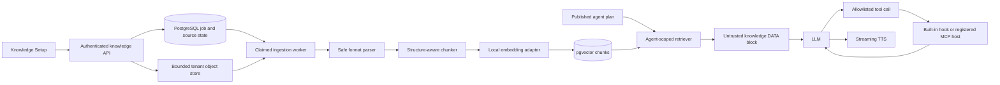

# Phase 10 — Business Knowledge and Safe Actions

**Status:** IN PROGRESS — 10A THROUGH 10E COMPLETE; NEXT 10F

**Goal:** Let an operator give an agent approved business knowledge through a guided setup flow, retrieve that knowledge quickly and safely during a conversation, and execute only explicitly enabled lifecycle or external actions.

**Depends on:** Phases 07 and 09.

**Audit coverage:** F04, F09, F10, P02 tool loop, I08 knowledge management, I13 durable knowledge jobs.

## Product decision

The term **hypercodes** is removed from the roadmap. It has no definition, documentation, schema, or implementation in this repository. Phase 10 will not invent a feature under that name.

Hamzi approved the recommended scope on 2026-10-23:

- make business knowledge easy to set up;
- support common business document formats;
- provide safe built-in conversation actions;
- prepare a secure MCP connection foundation;
- keep CRM, calendar, email, payments, and other external systems disabled until a later explicit configuration and approval;
- perform no paid/live-provider or live-business-system calls during implementation or verification.

No further product decision is required before Phase 10 implementation begins.

## What users receive

### Guided Knowledge Setup

The local management console receives a **Knowledge Setup** flow for operator testing. The final polished self-serve experience remains Phase 13, which must consume the same APIs and states.

1. Create or name a knowledge base.
2. Select the agent that may use it.
3. Drag in supported files or enter FAQ question/answer pairs.
4. See validation before upload: type, size, duplicate, encrypted/unsupported file, and estimated document size.
5. Watch honest states: `uploaded`, `queued`, `parsing`, `chunking`, `embedding`, `ready`, `failed`, or `deleting`.
6. Preview extracted text and citations without exposing raw binary data.
7. Ask a test question and inspect matching passages, source names, locations, and scores.
8. Activate the knowledge base for the selected agent only when every required source is ready.
9. Retry, replace, deactivate, or remove a source with clear consequences.

“Auto setup” means type detection, safe default chunking, duplicate detection, language metadata, and automatic indexing. It never means silent success, fabricated chunks, or enabling an external integration.

### Supported source formats for Phase 10

| Input | Parser behavior | Citation location | Default hard limit |
|---|---|---|---:|
| Text PDF `.pdf` | Extract text page by page; reject encrypted files and report image-only pages | page number | 20 MiB / 500 pages |
| Word `.docx` | Read paragraphs and tables; ignore macros, external relationships, comments and tracked-change metadata | heading/paragraph/table | 10 MiB / 500,000 extracted characters |
| Plain text `.txt` | Decode UTF-8, then an explicitly tested fallback; reject binary content | line range | 5 MiB / 500,000 characters |
| Markdown `.md` | Preserve heading hierarchy and plain text; do not execute HTML/scripts | heading/line range | 5 MiB / 500,000 characters |
| CSV `.csv` | Detect delimiter within a bound; preserve headers; bound rows, columns and cell length | row range | 10 MiB / 50,000 rows |
| Excel `.xlsx` | Read-only/data-only parsing; never evaluate formulas or macros; bound sheets, rows and cells | sheet/row range | 10 MiB / 50 sheets / 50,000 rows total |
| FAQ form | Validate question and answer lengths and store each pair as a traceable source item | FAQ item number | 1,000 items per source |

Legacy `.doc`, PowerPoint, ZIP archives, images, audio/video, OCR, URLs, and website crawling are deferred. The API returns an actionable unsupported-format error. URL ingestion remains deferred until it has SSRF controls, content freshness rules, robots/legal policy, and a separately tested fetcher.

Recommended parser libraries are `pypdf`, `python-docx`, and `openpyxl`, each version-locked after compatibility and license verification. They are not yet dependencies. Parsing runs outside the realtime voice process.

## Architecture and data flow



The realtime worker never parses files or calculates document embeddings. Ingestion is a durable background job. Retrieval uses only the authenticated tenant and the immutable `knowledge_base_ids` pinned into the published agent plan.

## Durable data contract

Add migration `022_knowledge_runtime.sql` with:

- `knowledge_bases`: tenant, name, lifecycle state, active revision, timestamps;
- `knowledge_sources`: knowledge base, type, safe display name, media type, byte count, SHA-256, object reference, state, parser version, language metadata, safe error code/message, timestamps;
- `knowledge_ingestion_jobs`: source/revision, state, attempt, lease owner/expiry, retry time, progress counters, idempotency key, last safe error;
- expanded `knowledge_chunks`: knowledge base/source/revision, ordinal, text, embedding, embedding model/version, token count, citation JSON, content hash;
- `agent_knowledge_bindings`: agent configuration version to active knowledge-base revision;
- tenant RLS, ownership constraints, uniqueness rules, foreign keys, indexes, and deletion behavior for every table.

Add migration `023_mcp_registry.sql` only in Phase 10F with:

- tenant-owned MCP server metadata;
- transport and HTTPS endpoint;
- credential **reference**, never a secret value;
- enabled tool names and cached schemas;
- availability and last safe health status;
- no server enabled by default.

Migrations must support clean install and upgrade from migration 021. They must not alter shared or production databases without separate approval.

Migration 013 created `vector(1536)`, while the recommended local model produces 384 dimensions. Migration 022 must not silently cast or discard existing rows. Its preflight records the row count and embedding profile. A non-empty legacy table blocks automatic conversion and requires an explicit re-ingestion migration; an empty scaffold may be replaced transactionally. The final table and HNSW index use one declared deployment embedding dimension, and startup fails clearly when code, model, and schema disagree.

## API contract for the wizard

Implement authenticated, tenant-derived routes under `/v1/knowledge-bases`:

- `POST /` — create a draft knowledge base;
- `GET /` and `GET /{knowledge_base_id}` — list/details with real counts and states;
- `POST /{knowledge_base_id}/sources` — bounded multipart upload;
- `POST /{knowledge_base_id}/faqs` — add validated FAQ items;
- `GET /{knowledge_base_id}/sources/{source_id}` — progress and safe error details;
- `POST /{knowledge_base_id}/sources/{source_id}/retry` — idempotent retry of a failed source;
- `DELETE /{knowledge_base_id}/sources/{source_id}` — authenticated removal and chunk cleanup;
- `POST /{knowledge_base_id}/preview-query` — top matches and citations for operator testing;
- `POST /{knowledge_base_id}/activate` — activate only a complete revision;
- `POST /{knowledge_base_id}/bind/{agent_id}` — bind through a new agent configuration version, never mutate an active version in place.

Write operations require `knowledge:write`; read/preview operations require `knowledge:read`. Tenant identity always comes from `AuthContext`. A tenant ID in a path or body is never authoritative.

## Retrieval and latency design

- Use an `EmbeddingProvider` contract with declared model ID, dimension, maximum input, and batch support.
- Use a free local embedding path by default. The planned default is an ONNX/FastEmbed MiniLM-class 384-dimensional model, pinned and pre-provisioned during build. Protected environments must never download a model at request time.
- Keep cloud embedding adapters optional and disabled unless compliance policy and tenant configuration explicitly permit them.
- Store the embedding model/version on each revision and reject dimension/model mismatches instead of mixing vectors.
- Query `embedding <=> query_embedding` through the Phase 09 tenant transaction helper. Never catch a database error and silently return mock or lexical results in production.
- Filter by tenant, the pinned agent ID/version, selected knowledge-base revisions, readiness, and bounded `top_k` before results reach the model.
- Return score, knowledge-base ID, source ID, safe source name, location, revision, and text for every result.
- Frame retrieval as untrusted data after the system instruction. Documents cannot replace system/developer instructions or define tools.
- Use a strict retrieval budget: default `top_k=4`, maximum `8`, bounded chunk/context size, 250 ms soft budget and 600 ms hard budget. A timeout emits a degraded event and continues without knowledge.
- Cache query embeddings and retrieval results by tenant, agent-plan hash, knowledge revision, normalized query, model version, and TTL. Revision changes invalidate cache keys.
- Speculative retrieval may overlap stable partial STT, but final-transcript reconciliation must preserve tenant/agent filters and cancellation.
- Record retrieval duration, result count, cache hit, timeout/error category, and revision without logging document text or user transcript content.

## File and ingestion security

- Stream uploads with size limits; never load an unbounded request into memory.
- Check extension, declared MIME, and file signature. A mismatch fails closed.
- Normalize display names and object keys; reject traversal, control characters, and unsafe Unicode forms.
- Calculate SHA-256 while streaming and deduplicate within one tenant/knowledge base.
- Give each source a tenant-scoped opaque object key. Never use a submitted path directly.
- Use a `KnowledgeObjectStore` interface: a bounded filesystem adapter for local/test and a real S3-compatible adapter for protected deployments. The production API refuses uploads when durable object storage is unavailable; it never falls back to process memory.
- Reject encrypted PDFs and macro-enabled/unsupported Office formats.
- For ZIP-based DOCX/XLSX, bound entry count, expanded bytes, compression ratio, nested archives, XML depth, rows, columns, and cell length.
- Never execute formulas, scripts, macros, external links, embedded objects, or remote resources.
- Parse in a background worker with CPU/time/memory deadlines. A timeout becomes a retryable or terminal typed error.
- Sanitize user-facing parser errors and logs; never log extracted text, binary data, secrets, or signed object URLs.
- Store source/chunk deletion as an idempotent job and remove both vectors and raw object. Report partial failure honestly.

## Safe action and MCP design

Phase 10 initially enables only lifecycle actions backed by real runtime hooks:

- `end_conversation` requests a graceful final response, stores disposition data, drains played audio, and ends the session once;
- `escalate_to_human` is advertised only when the active transport has a configured handoff target. Otherwise it is unavailable, not simulated.

External MCP servers are **disabled by default**. Phase 10 builds the registry and protocol boundary so later integrations do not require changes to the voice loop.

- Support MCP Streamable HTTP as the production transport.
- Permit stdio only in local development behind `UCVE_MCP_ALLOW_STDIO`; accept a structured executable/argument allowlist, never a shell command string.
- Do not advertise SSE as production-ready in Phase 10. Keep it disabled until a real compatibility requirement and protocol test exist.
- Require HTTPS in protected environments and block loopback, link-local, private-network, metadata-service, unsafe redirect, and DNS-rebinding targets unless an enterprise allowlist explicitly authorizes the destination.
- Resolve every tool name to exactly one owning server. Duplicate names make configuration invalid.
- Intersect server inventory, tenant server allowlist, and immutable agent tool allowlist before exposing definitions to the LLM.
- Validate arguments and results against bounded JSON Schema. Limit argument size, response bytes, nesting, strings, call count, redirects, and time.
- Resolve credentials server-side by reference. Never expose them to the LLM, browser, tool arguments, logs, or persisted response data.
- Default to a 3-second call timeout, three tool rounds, five calls per turn, 12-second total tool budget, and 16 KiB result. Each remains configurable only within platform caps.
- Use `session_id + turn_id + tool_call_id` as the logical idempotency key. Side-effecting tools also require a server-supported idempotency contract before they can be enabled.
- Send the assistant tool call and matching `tool_call_id` result back to the LLM. Only the model’s bounded continuation goes to TTS; raw tool output is never spoken directly.
- Cancel tool work on barge-in/session end and close every transport. Audit metadata and outcome without logging sensitive arguments/results.

No CRM, calendar, email, inventory, payment, webhook, or custom business action is enabled in this phase. Adding one later requires its own schema, credential reference, side-effect classification, idempotency behavior, test server, and operator approval.

## Implementation sequence

Each part ends with a focused commit and tracker update. Do not start the next part while its verification is red.

### 10A — Durable knowledge domain and wizard API — COMPLETE 2026-10-24 (`b2b75a7`)

**Create/modify:**

- `infra/db/migrations/022_knowledge_runtime.sql`
- `core/rag/models.py`
- `core/db/repos/knowledge_repo.py`
- `control_plane/routes/knowledge_bases.py`
- `control_plane/auth/route_policy.py`
- `tests/db/test_knowledge_migration.py`
- `tests/rag/test_knowledge_api.py`

**Work:** replace the fixed `ready/42` response; implement tenant-scoped entities, state transitions, CRUD, revision activation/binding, retry/idempotency, and honest counts/errors.

**Verification:** focused API/RLS tests plus fresh-install and upgrade migration tests against disposable pgvector PostgreSQL.

**Suggested commit:** `feat: add durable tenant knowledge workflow`

**Evidence:** [`../evidence/phase-10a/VERIFICATION.md`](../evidence/phase-10a/VERIFICATION.md). Migration 022, tenant-scoped repositories, truthful APIs, revision activation, idempotent retry, and new-version agent binding are implemented. Common-file upload/parsing remains 10B.

### 10B — Safe common-file ingestion — COMPLETE 2026-10-24 (`0c8ab9a`)

**Create/modify:**

- `core/rag/ingestion/parsers/{base,pdf,docx,text,markdown,csv,xlsx}.py`
- `core/rag/ingestion/validation.py`
- `core/rag/ingestion/chunkers/structured.py`
- `core/rag/ingestion/worker.py`
- `core/storage/knowledge_objects.py`
- project dependency lock files
- `tests/rag/fixtures/` with small generated, non-sensitive fixtures
- `tests/rag/test_file_validation.py`
- `tests/rag/test_ingestion_formats.py`
- `tests/rag/test_ingestion_limits.py`

**Work:** implement the format matrix and bounds above, durable claimed jobs, safe object lifecycle, structure-aware chunks/citations, duplicate handling, restart/retry behavior, and typed failures. Remove the binary `str(content_raw)` path.

**Verification:** fixtures for every supported/unsupported type; encrypted PDF, image-only PDF, MIME mismatch, traversal, malformed XML, archive bomb metadata, huge row/cell, parser timeout, duplicate, restart, retry, and cleanup.

**Suggested commit:** `feat: ingest common business documents safely`

**Evidence:** [`../evidence/phase-10b/VERIFICATION.md`](../evidence/phase-10b/VERIFICATION.md). Bounded PDF, DOCX, TXT, Markdown, CSV, XLSX, and FAQ parsing; tenant object storage; authenticated upload/delete APIs; leased durable jobs; typed failures; citations; duplicate suppression; retry/restart behavior; and dependency locking are implemented. Sources stop honestly at `embedding`; local embeddings and pgvector retrieval remain 10C.

### 10C — Local embeddings and real pgvector retrieval — COMPLETE 2026-10-24 (`5dc1c02`)

**Create/modify:**

- `core/rag/embedders/{base,local_onnx}.py`
- `core/rag/embedder_policy.py`
- `core/rag/repository.py`
- `core/rag/retriever.py`
- `core/rag/speculative.py`
- `worker_jobs/kb_ingestion.py`
- `tests/rag/test_embedding_policy.py`
- `tests/rag/test_pgvector_retrieval.py`
- `tests/rag/test_ingestion_restart.py`

**Work:** select and lock a compatible local embedding package/model, batch embeddings off the realtime loop, store real vectors, query pgvector correctly, enforce pinned KB/revision filters, remove production mock fallback, and expose citations/scores.

**Verification:** deterministic test embedder for units; local production-adapter contract test without network; disposable pgvector similarity, cross-tenant denial, unbound-agent denial, revision switch, dimension mismatch, cache invalidation, failure, and restart tests.

**Suggested commit:** `feat: add agent scoped pgvector retrieval`

**Evidence:** [`../evidence/phase-10c/VERIFICATION.md`](../evidence/phase-10c/VERIFICATION.md). An offline-only ONNX embedding boundary, durable parse-to-embed handoff, 384-dimensional pgvector persistence, exact tenant/agent/base/revision filtering, citations/scores, model-version matching, restart/retry behavior, and revision-aware speculative retrieval are implemented. Runtime prompt framing and retrieval deadlines remain 10D.

### 10D — Runtime RAG safety and latency — COMPLETE 2026-10-24 (`956c141`)

**Create/modify:**

- `worker_raw/orchestration/pipeline.py`
- `worker_raw/orchestration/session_config.py`
- `core/rag/prompt_context.py`
- `core/latency/` RAG event definitions as needed
- `tests/rag/test_prompt_boundary.py`
- `tests/rag/test_runtime_retrieval.py`
- `tests/latency/test_rag_budget.py`

**Work:** use pinned KB IDs, place knowledge in a separate untrusted data message, preserve citations, bound context, enforce soft/hard deadlines, make failures explicit but non-blocking, cancel stale retrieval, and measure/cache the path.

**Verification:** adversarial documents, system-prompt imitation, fake tool instructions, tenant/agent scope, timeout, cancellation, cache/revision, no-result behavior, and latency-budget tests.

**Suggested commit:** `feat: inject bounded untrusted knowledge context`

**Evidence:** [`../evidence/phase-10d/VERIFICATION.md`](../evidence/phase-10d/VERIFICATION.md). Published agent-version scope, separate untrusted knowledge messages, bounded citations/context, 250/600 ms retrieval budgets, cancellation, revision-aware caching, degraded continuation, and content-free RAG latency telemetry are implemented. Lifecycle actions and tool continuation remain 10E.

### 10E — Real lifecycle actions and bounded LLM continuation — COMPLETE 2026-10-25 (`dace427`)

**Create/modify:**

- `core/mcp/builtin_tools.py`
- `core/mcp/orchestrator.py`
- `worker_raw/orchestration/tool_handler.py`
- `worker_raw/orchestration/pipeline.py`
- `tests/mcp/test_builtin_lifecycle.py`
- `tests/mcp/test_tool_authorization.py`
- `tests/listening/test_tool_loop.py`

**Work:** replace placeholder status dictionaries with injected session lifecycle hooks; advertise only available actions; validate schemas; suppress replay by call ID; return tool results to the LLM; stream only its continuation; enforce call/time/output caps and cancellation.

**Verification:** graceful end once, configured/unconfigured escalation, wrong/duplicate call ID, invalid arguments, barge-in, timeout, model continuation, raw-output non-speech, resource cleanup, and audit redaction.

**Suggested commit:** `feat: complete safe voice tool continuation`

**Evidence:** [`../evidence/phase-10e/VERIFICATION.md`](../evidence/phase-10e/VERIFICATION.md). Runtime lifecycle tools are advertised only when allowed and available; graceful end drains the model's closing response before WebSocket or Direct SIP shutdown; human handoff uses only a server-pinned destination; tool calls have argument, timeout, round, call-count, total-budget, result-size, cancellation, replay, and error-redaction controls; and only the LLM continuation reaches TTS. External MCP registration and transport remain 10F.

### 10F — Secure MCP registry and Streamable HTTP

**Create/modify:**

- `infra/db/migrations/023_mcp_registry.sql`
- `core/mcp/host.py`
- `core/mcp/registry.py`
- `core/mcp/transports/streamable_http.py`
- `core/mcp/transports/stdio.py`
- `core/mcp/transports/sse.py` to fail closed/declare unavailable
- `tests/mcp/test_registry.py`
- `tests/mcp/test_streamable_http.py`
- `tests/mcp/test_ssrf_policy.py`
- `tests/mcp/test_stdio_policy.py`

**Work:** persist tenant server metadata and credential references, implement protocol-correct initialization/inventory/call/close against a local fake server, enforce ownership/allowlists/schema/timeouts/SSRF/idempotency, and remove echoed fake success.

**Verification:** local fake MCP server only; cross-tenant access, duplicate tool owner, unreachable server, malformed protocol, oversized result, redirect/private address, timeout, credential redaction, close/cancel, and stdio production denial.

**Suggested commit:** `feat: add secure mcp server boundary`

### 10G — Guided local setup surface and documentation

**Create/modify:**

- `examples/web-client/index.html` for a focused Knowledge Setup tab used in local verification
- generated/open API documentation for the knowledge endpoints
- SDK management helpers only if they belong to the existing public management clients
- `Codex Fix/EDUCATION.md`
- `Codex Fix/EXECUTION_TRACKER.md`
- Phase 10 evidence files

**Work:** expose the eight-step wizard, progress/errors, preview query, source citations, activation, and clear offline/live labels. Do not collect provider or MCP credentials in this surface. Phase 13 later turns this contract into the production Studio.

**Verification:** browser tests for keyboard/responsive/error/loading states; Playwright screenshots and visual critique as required by `AGENTS.md`; two-tenant API isolation; a nontechnical local walkthrough.

**Suggested commit:** `docs: complete phase 10 knowledge setup`

### 10H — Phase close and regression gate

Run the focused suite, disposable stores, full forced-offline suite, format/type checks, plan integrity, secret/mock scans, and source-control review. Update the tracker only from fresh evidence.

## Verification commands planned for implementation

Exact commands may gain file-specific targets as each part lands, but Phase 10 cannot close without all of these classes of evidence:

```powershell
$env:UCVE_ENV='test'
$env:RUN_MOCK_PROVIDERS='1'
$env:RUN_LIVE_PROVIDERS='0'

py -3.12 -m pytest tests/rag tests/mcp tests/listening/test_tool_loop.py -q -p no:cacheprovider --basetemp hamza_local/pytest-phase10-focused

# Use the Phase 09 disposable pgvector/Redis stack with generated local credentials.
py -3.12 -m pytest tests/db/test_knowledge_migration.py tests/rag/test_pgvector_retrieval.py -q -p no:cacheprovider --basetemp hamza_local/pytest-phase10-stores

py -3.12 -m pytest tests voice_engine_plan/tests/phase_tests -q -p no:cacheprovider --basetemp hamza_local/pytest-phase10-full
py -3.12 -m ruff check core/rag core/mcp control_plane/routes/knowledge_bases.py worker_jobs/kb_ingestion.py tests/rag tests/mcp
py -3.12 -m compileall -q core/rag core/mcp control_plane worker_jobs worker_raw
py -3.12 voice_engine_plan/scripts/verify_plan_integrity.py
git diff --check
git status --short
```

All verification is offline. Tests use generated documents and a local fake MCP server. They do not call an LLM/STT/TTS provider, external MCP server, carrier, CRM, calendar, email service, or cloud embedding API.

## Human intervention during implementation

No input is required to start Phase 10. When automated verification passes, Hamzi will receive one copy-ready offline command and a short checklist to:

1. upload sanitized sample PDF, DOCX, CSV/XLSX, TXT/MD, and FAQ content;
2. confirm progress/errors and citation locations make sense;
3. ask a few test questions with mock voice providers;
4. inspect the local Knowledge Setup screen.

This review costs nothing and uses no secrets. Shared-database migration, real external MCP integration, live providers, deployment, and publishing each remain separate approval gates.

## Exit criteria

- Every supported file either reaches `ready` through durable ingestion or reports a truthful typed failure.
- Restart/retry cannot lose a job, duplicate active chunks, or publish a partial revision.
- Retrieval uses real vectors and only the tenant/agent plan’s active knowledge revisions.
- Knowledge is untrusted data with traceable citations; injection tests pass.
- Retrieval stays within its bounded realtime budget and fails without blocking voice response.
- Built-in actions change real session lifecycle state exactly once.
- Tool output returns to the LLM with matching call IDs and is never spoken raw.
- External MCP servers remain off by default; the local fake-server protocol and security suite pass.
- The guided local setup flow is understandable without editing code or environment files.
- No live/paid call, secret exposure, shared migration, deployment, or publish occurs.

## Handoff to later phases

- Phase 11 consumes source/citation identifiers where post-call evidence needs them.
- Phase 12 supplies the real handoff/hangup hooks needed to advertise telephone escalation/end actions.
- Phase 13 builds the production Self-Serve Studio on this wizard API and state model.
- Phase 14 owns production job supervision, object-store operations, alerts, and compliance cleanup.
- Phase 15 packages optional parser/embedding assets and qualifies install size, licenses, and clean deployment.
