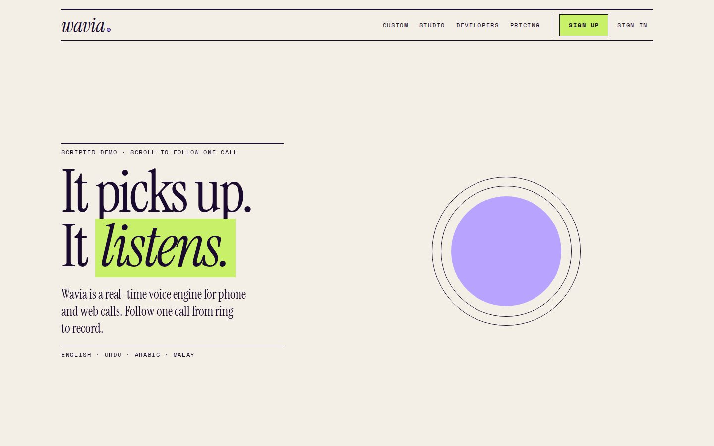
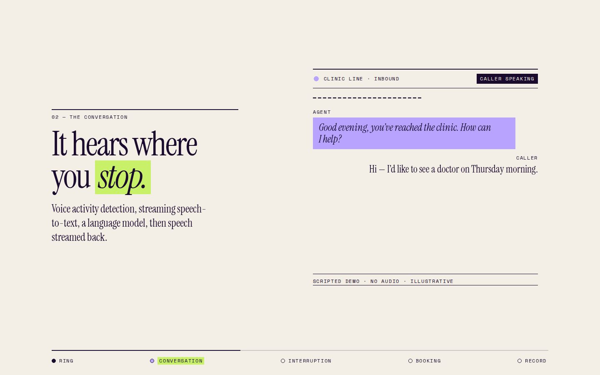
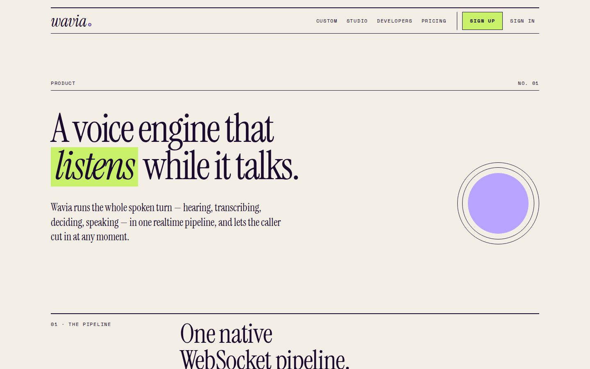
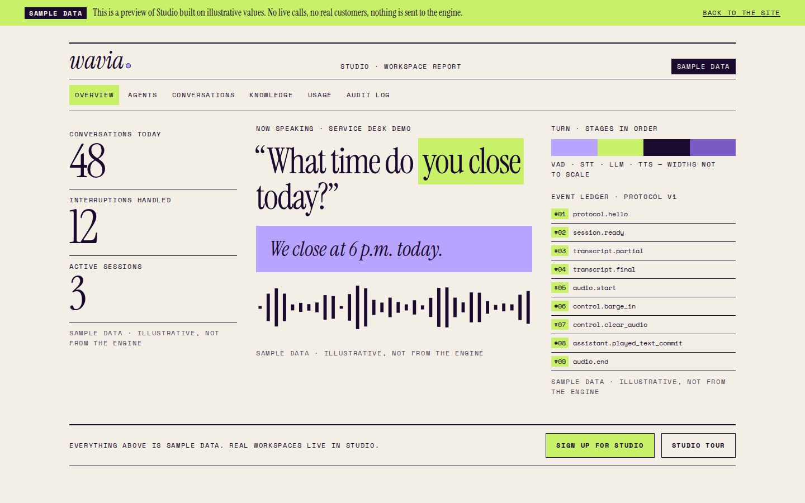
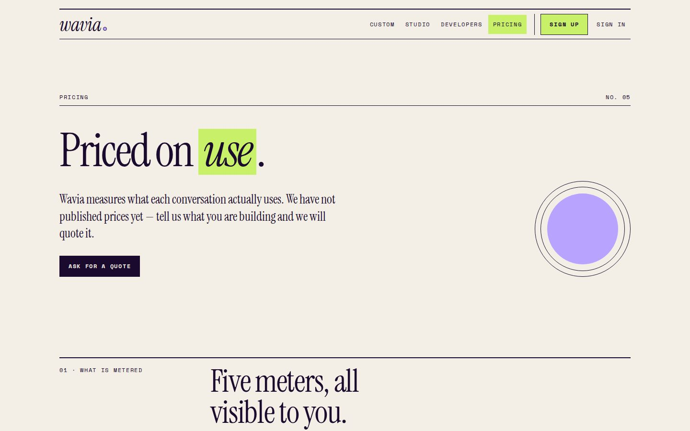
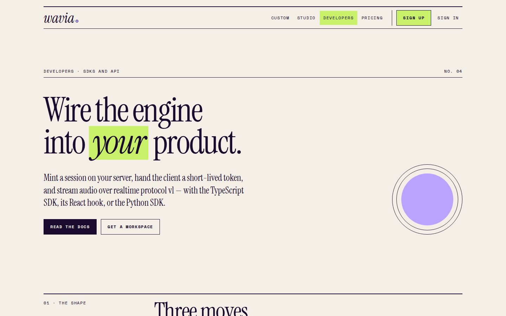
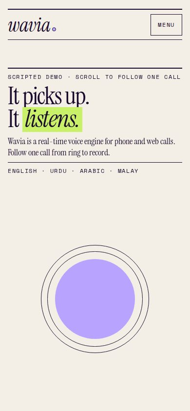
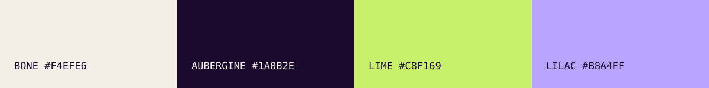

<h1 align="center">Wavia</h1>

<h3 align="center">It picks up. It <em>listens.</em></h3>

<p align="center">
  A real-time voice AI engine for phone and web calls, powered by the Unified Core Voice Engine (UCVE).<br>
  Multi-tenant · full-duplex and interruptible · English, Urdu, Arabic and Malay · from $29/mo.
</p>

<p align="center">
  
  
  
  
</p>

<p align="center">
  
</p>

---

## What this is

Wavia is a sovereign, multi-tenant voice AI platform: an agent answers a call, holds a real conversation — hearing interruptions, switching languages mid-sentence — and ends the call with the work done: a booking in the calendar, a record in the CRM, a summary in the dashboard. The pipeline runs voice activity detection → streaming speech-to-text → LLM with tools → neural text-to-speech, engineered for sub-second, full-duplex operation.

There are three ways in:

- **Developers** build on the SDKs — TypeScript (`@ucve/voice-sdk` plus a React hook), Python (`ucve`), Flutter on the roadmap.
- **Business owners** use **Agent Studio**, the self-serve console (screens SCR-01 to SCR-13): describe the agent, connect a number, take test calls — 30 minutes of free test calls a month, no code.
- **Custom setups** are sales-led and white-glove: telephony, CRM sync and failover configured per client.

Status of record lives in [HANDOVER.md](HANDOVER.md); the architecture is specified in [`docs/blueprint/`](docs/blueprint/README.md) and designed in [`docs/DESIGN.md`](docs/DESIGN.md).

---

## How a call flows

| Stage | What happens |
|---|---|
| **Ring** | The call lands over Telnyx telephony (or in the browser over streaming WebSocket audio) and a session opens against the tenant's workspace — Postgres row-level security keeps every tenant's data separate. |
| **Listen** | Streaming VAD and STT (Gladia, Deepgram) transcribe the caller in real time, in English, Urdu, Arabic or Malay, including code-switched speech. |
| **Think** | The LLM (Groq, Gemini, OpenAI) reasons over the conversation, the agent's knowledge base and its tools — calendars, CRMs, custom actions. |
| **Speak** | Neural TTS (Cartesia, ElevenLabs, Uplift) streams audio back while the caller is still being heard: the agent can be interrupted mid-sentence and recovers the thread. |
| **Record** | Post-call intelligence closes the loop: transcript, extracted fields, booking and summary land in Studio and fire signed webhooks to the client's systems. |

Three services carry the call: the **control plane** (API, tenants, agents, telemetry), the **raw audio worker** (the low-latency pipeline on `/ws/audio`), and the **telephony gateway** (carrier trunks and webhooks) — backed by PostgreSQL and Redis.

<p align="center">
  
</p>

---

## Screenshots

The marketing site and the Studio preview, in the C2 · Ripple Paper identity. The `/demo` page is a preview of Studio on clearly labelled sample data — real workspaces live in Studio itself.

<table>
  <tr>
    <td width="50%"></td>
    <td width="50%"></td>
  </tr>
  <tr>
    <td></td>
    <td></td>
  </tr>
</table>

<p align="center">
  
</p>

---

## Brand system

<p align="center"></p>

| Role | Choice |
|---|---|
| **Identity** | C2 · Ripple Paper — a paper surface, ink type, one lime highlight at a time. |
| **Display type** | Instrument Serif, with the one emotional word set italic and highlighted in lime. |
| **Labels** | Space Mono, uppercase — every structural label on the site and in Studio. |
| **Colour rules** | Bone ground, aubergine ink. Lime marks the living moment (listening, speaking, the call to action); lilac carries the agent's voice. No gradients on the paper, no second accent competing with lime. |

Full tokens: [`docs/design/ripple-c2/`](docs/design/ripple-c2/) and `design-tokens.json` (wavia-ripple v1.1.0).

---

## Stack

| Layer | What's used | Why |
|---|---|---|
| **Engine** | Python 3.12, FastAPI, WebSockets, `uv` | One async stack from audio frames to API; deterministic, testable pipeline stages |
| **Services** | Control plane · raw audio worker · telephony gateway · background job workers | The latency-critical audio path stays isolated from management traffic |
| **Data** | PostgreSQL with row-level security, Redis | Multi-tenancy enforced in the database, not in application promises |
| **Telephony** | Telnyx first | Carrier-grade trunks and webhooks; Twilio support is not yet qualified |
| **Providers** | STT: Gladia, Deepgram · LLM: Groq, Gemini, OpenAI · TTS: Cartesia, ElevenLabs, Uplift | Pluggable behind one abstraction, with failover — no single vendor is load-bearing |
| **Studio** | Next.js console, screens SCR-01…SCR-13 | The business owner's whole job — build, test, publish, review — in one place |
| **Website** | Vite + TypeScript (`website/`) | The scroll-driven call story: one call followed from ring to record |
| **SDKs** | TypeScript, Python, Flutter (`sdk/`) | The same session protocol everywhere a developer already works |
| **Infra** | Docker Compose stacks (`infra/docker/`), GitHub Actions CI + security audit | Identical stacks for development, staging and release qualification |

---

## Status

Release candidate **0.1.0-rc1** is qualified offline from a clean checkout. Live certification (H15) is in progress — each live step runs on explicit approval, test numbers only, with spend caps.

| Suite | Result |
|---|---|
| Python | 1204 passed, 23 skipped |
| Live PostgreSQL | 65 passed, 1 skipped |
| Studio | 232 unit tests, typecheck, lint, build, and 43 offline browser tests pass |
| Customer journey (mock providers) | 8/8 — sign-up → workspace → publish → browser voice test → conversations → API key + SDK → knowledge → signed webhook |
| L1 live provider pings | Passed: Gladia, Deepgram, Groq, Gemini, OpenAI, Cartesia, ElevenLabs |

Open, owner-gated: the Telnyx key in `.env` returns 401 and must be replaced before telephony; H15 live steps L2–L8; WorkOS staging redirect registration. The full, current list is in [HANDOVER.md](HANDOVER.md).

---

## Run it locally

Engine stack (copy the template, fill in your own keys — never commit a real `.env`):

```bash
cp .env.example .env
docker compose -f infra/docker/docker-compose.yml up
# control plane · worker-raw · worker-jobs · postgres · redis
```

The release qualification stack is `scripts/release/container_stack.sh`; live certification runs through `scripts/release/live_certification.sh` and stays off unless explicitly approved.

Website:

```bash
cd website
npm ci
npm run dev
```

## Project structure

```
core/               engine kernel: frame contracts, session state machines, provider adapters
control_plane/      management APIs, agent builder services, tenant RBAC, telemetry
worker_raw/         the low-latency audio pipeline (VAD / STT / LLM / TTS orchestration)
telephony_gateway/  carrier adapters (Telnyx) and telephony webhooks
post_call/          transcripts, extraction, summaries, CRM sync
agent-studio/       the Studio console (Next.js, SCR-01…SCR-13)
website/            the marketing site — the scroll-driven call story
sdk/                typescript · python · flutter client SDKs
examples/           in-browser developer console and voice testing apps
infra/              Docker compositions, scaling profiles, migrations
docs/               blueprint, design system, runbooks, handover
tests/              the engine test suites
scripts/            release qualification, live certification, ops
```

Architectural references: the [blueprint](docs/blueprint/README.md) (system topology, core FSM, provider abstractions, multilingual engine, telephony), the [execution plan](voice_engine_plan/README.md) (the phased build plan and trackers), and [`costing/`](costing/) (unit economics and commercial tiers).

---

<p align="center">
  <strong>Wavia</strong> · a real-time voice engine for phone and web calls<br>
  <a href="https://wavia.vertexdevstudio.tech">wavia.vertexdevstudio.tech</a> ·
  <a href="https://studio.wavia.vertexdevstudio.tech">Studio</a> ·
  <a href="https://docs.wavia.vertexdevstudio.tech">Docs</a> ·
  <a href="mailto:hamza@vertexdevstudio.tech">hamza@vertexdevstudio.tech</a>
</p>
