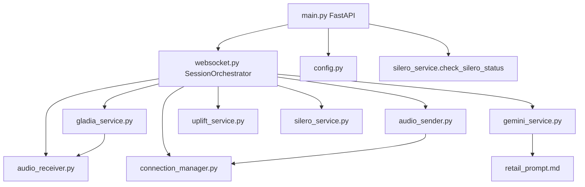
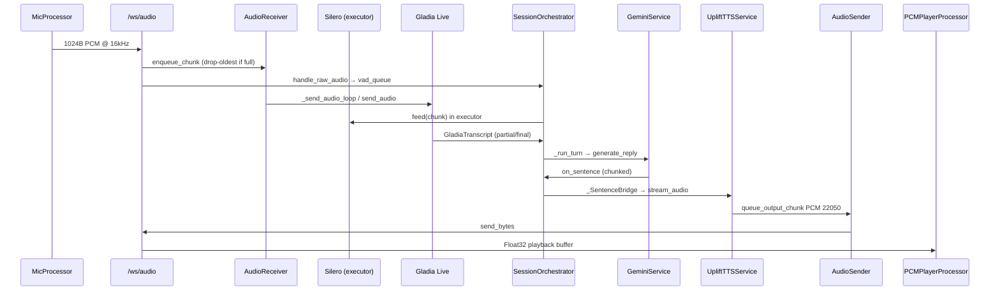

# AUDIT: AI_voice_agent_v3 - gemini

**Audit date:** 2026-08-14
**Auditor:** Cursor (static analysis only — code not executed)
**Repo path:** `d:\PROJECTS\PASSION PROJECTS\VERTEX_voiceai\AI_voice_agent_v3 - gemini`

## 1. Executive Overview & Architectural Topology

- **Core purpose & design philosophy:** A single-tenant, full-duplex FastAPI WebSocket voice loop for Urdu/Minglish retail support. Browser AudioWorklets capture 16 kHz PCM-16LE and play 22050 Hz PCM-16LE; the backend runs a local Silero VAD in a thread-pool executor in parallel with Gladia Live V2 STT, streams Gemini replies through a sentence/clause chunker, and synthesizes each sentence via Uplift HTTP streaming. The design is latency-first (sentence-level TTS start, bounded queues, shared `ws_lock`) and persona-locked to a hardcoded “Zara / Finova Computers” prompt. There is no provider abstraction, no auth, and no telephony.

- **Execution model:** Hybrid asyncio event loop + default thread-pool executor. Evidence: FastAPI/uvicorn ASGI app (`backend/app/main.py:20–49, 71–73`); per-session asyncio tasks for sender, pipeline, heartbeat, VAD worker, LLM, and turn (`backend/app/transport/websocket.py:105–108, 336–348, 379–386, 507–515`); Silero inference offloaded via `loop.run_in_executor(None, self._vad.feed, chunk)` (`backend/app/transport/websocket.py:347–348`); `torch.set_num_threads(1)` (`backend/app/services/silero_service.py:69`). **NOT IMPLEMENTED / ABSENT:** actor model, dedicated worker pool instantiation beyond the default executor.

### Directory tree (source only; `.git/`, `logs/`, `__pycache__` excluded)

```text
AI_voice_agent_v3 - gemini/
├── README.md                          # Intended architecture + stack table
├── requirements.txt                   # Pinned production deps (google-genai, numpy unpinned)
├── render.yaml                        # Render web service: uvicorn on $PORT, Python 3.11.9
├── .env.example                       # Required keys + optional VAD knobs
├── docs/
│   ├── HANDOFF.md                     # Pipeline race-condition notes (design doc, not runtime)
│   ├── project_scope.md
│   └── urdu_voice_agent_mvp_blueprint.md
├── frontend/
│   └── index.html                     # Mic capture, PCM player, telemetry UI, WS client
└── backend/
    ├── app/
    │   ├── main.py                    # Entrypoint: FastAPI lifespan, CORS, REST + WS router
    │   ├── core/
    │   │   ├── logging_config.py      # Rotating app/VAD/session file handlers
    │   │   ├── config/config.py       # pydantic-settings fail-fast env
    │   │   └── prompts/
    │   │       ├── retail_prompt.md   # LIVE system prompt (Zara)
    │   │       ├── old_retail_prompt.md   # unused successor prompt
    │   │       └── old2_retail_prompt.md  # unused predecessor prompt
    │   ├── services/
    │   │   ├── __init__.py            # Re-exports GladiaService only
    │   │   ├── silero_service.py      # Local Silero VAD state machine
    │   │   ├── gladia_service.py      # Gladia Live V2 streaming STT
    │   │   ├── gemini_service.py      # Gemini streaming + sentence chunker
    │   │   └── uplift_service.py      # Uplift TTS HTTP stream + retry
    │   └── transport/
    │       ├── websocket.py           # SessionOrchestrator + /ws/audio
    │       ├── audio_receiver.py      # Inbound bounded FIFO
    │       ├── audio_sender.py        # Outbound bounded FIFO + barge-in drop
    │       └── connection_manager.py  # In-memory session_id → WebSocket map
    └── tests/                         # Live-API integration scripts (not a pytest suite with fixtures in this tree)
        ├── test_gladia_pipeline.py
        ├── test_gemini_pipeline.py
        ├── test_uplift_pipeline.py
        ├── test_audio_server.py
        ├── audio_converter.py
        └── gemini_test_scenarios.json
```

**Dockerfile:** `NOT IMPLEMENTED / ABSENT` (glob of `Dockerfile*` returned 0). Deployment is Render via `render.yaml`.

### Dependency topology

| Consumer | Imports |
|---|---|
| `main.py` | `config.get_settings`, `transport.websocket.router`, `logging_config.setup_logging`, `silero_service.check_silero_status` (lifespan) |
| `transport/websocket.py` | `connection_manager`, `AudioReceiver`, `AudioSender`, `GladiaService`, `GeminiService`, `UpliftTTSService`, `SileroVADService`, `get_settings`, session log attach/detach |
| `gladia_service.py` | `AudioReceiver`, `get_settings`, `gladiaio_sdk.GladiaClient` |
| `gemini_service.py` | `get_settings`, `google.genai`, reads `core/prompts/retail_prompt.md` at construct time |
| `uplift_service.py` | `get_settings`, `aiohttp` |
| `silero_service.py` | `get_settings`, `torch`, `numpy` |
| `audio_sender.py` | `connection_manager` |



There is **no** STT/LLM/TTS interface layer. Concrete classes are constructed inside `SessionOrchestrator.__init__` (`backend/app/transport/websocket.py:68–71`).

---

## 2. Complete Tech Stack & Provider Inventory

### Libraries + versions

| Library | Version | Purpose | Source file |
|---|---|---|---|
| aiohttp | `3.13.5` (pinned) | Uplift HTTP client + connection pool | `requirements.txt:1`; used `uplift_service.py:10, 42–44` |
| fastapi | `0.139.0` (pinned) | ASGI app, CORS, WS router | `requirements.txt:2`; `main.py:21` |
| ffmpeg_downloader | `0.5.2` (pinned) | Test-only WAV conversion helper | `requirements.txt:3`; `backend/tests/audio_converter.py` |
| gladiaio_sdk | `1.0.4` (pinned) | Gladia Live V2 STT | `requirements.txt:4`; `gladia_service.py:6` |
| google-genai | **UNPINNED** (`google-genai` with no `==`) | Gemini streaming client | `requirements.txt:5`; `gemini_service.py:7–8` — resolved version **NOT VERIFIED** (no lockfile) |
| pydantic_settings | `2.14.2` (pinned) | Env validation | `requirements.txt:6`; `config.py:3` |
| pydub | `0.25.1` (pinned) | Test audio conversion | `requirements.txt:7`; `audio_converter.py` |
| python-dotenv | `1.2.2` (pinned) | Env loading (via pydantic-settings `env_file`) | `requirements.txt:8`; `config.py:10–14` |
| uvicorn | `0.51.0` (pinned) | ASGI server | `requirements.txt:9`; `main.py:20, 73` |
| websockets | `16.0` (pinned) | Transitive/WS stack (declared; FastAPI uses Starlette WS) | `requirements.txt:10` |
| torch | `2.11.0+cpu` (pinned, extra-index CPU wheel) | Silero VAD runtime | `requirements.txt:12–14`; `silero_service.py:4` |
| torchaudio | `2.11.0+cpu` (pinned) | Declared with torch; **direct import in app code NOT VERIFIED** (no `import torchaudio` in `backend/app/`) | `requirements.txt:15` |
| numpy | **UNPINNED** | PCM → float tensor | `requirements.txt:17`; `silero_service.py:3` — resolved version **NOT VERIFIED** |
| Python runtime (deploy) | `3.11.9` | Render `PYTHON_VERSION` | `render.yaml:8–9` |

**Lockfile:** `NOT IMPLEMENTED / ABSENT` (no `poetry.lock` / `package-lock.json` / `Pipfile.lock`).

### Audio transport

| Item | Finding | Citation |
|---|---|---|
| Transport | Raw binary PCM over FastAPI/Starlette WebSocket | `websocket.py:447–448, 523`; `index.html:376–377, 421` |
| WebRTC | **NOT IMPLEMENTED / ABSENT** (repo-wide grep `webrtc\|WebRTC\|webrtcvad` = 0 matches) | — |
| gRPC / SIP-RTP | **NOT IMPLEMENTED / ABSENT** | — |
| REST audio | **NOT IMPLEMENTED / ABSENT** (REST is health only) | `main.py:63–69` |

### Audio processing constants

| Constant | Value | Citation |
|---|---|---|
| Mic capture target | 16000 Hz mono PCM-16LE | `frontend/index.html:208`; Gladia init `gladia_service.py:35–38` |
| Mic chunk | 512 samples = 32 ms = 1024 bytes | `frontend/index.html:317–319` |
| Mic resampling | Worklet decimation `sampleRate / 16000` (browser native, typically 44.1/48 kHz) | `frontend/index.html:299–304` |
| Browser getUserMedia | `channelCount: 1`, echoCancellation/noiseSuppression/autoGainControl true | `frontend/index.html:412–414` |
| TTS output | `PCM_22050_16` (22050 Hz, 16-bit PCM) | `uplift_service.py:30`; duration math `websocket.py:151–152, 412–413`; player `index.html:209, 379` |
| TTS HTTP chunk read | 4096 bytes | `uplift_service.py:93` |
| TTS yield alignment | accumulate to ≥8192 bytes, even-byte aligned | `uplift_service.py:147–153` |
| TTS leading-pop skip | 2048 bytes | `uplift_service.py:111` |
| Client jitter prebuffer | 3 chunks (~280 ms comment) | `frontend/index.html:212` |

### VAD & turn-taking

| Parameter | Value | Citation |
|---|---|---|
| Engine | Silero VAD via `torch.hub.load(repo_or_dir="snakers4/silero-vad", model="silero_vad")` | `silero_service.py:48–53` |
| WebRTC VAD | **NOT IMPLEMENTED / ABSENT** | grep = 0 |
| Threshold | `0.55` default | `config.py:28`; `.env.example:17`; applied `silero_service.py:17, 103` |
| Min speech duration | `250` ms | `config.py:29`; `.env.example:18`; converted to frames `silero_service.py:22–28` |
| Min silence duration | `250` ms | `config.py:30`; `.env.example:19`; frames `silero_service.py:30–37` |
| Sample rate | `16000` | `config.py:31` |
| Window size | `512` samples | `config.py:32`; `silero_service.py:19` |
| Derived min_speech_frames | `max(1, int(0.250 * 16000 / 512))` = 7 | formula `silero_service.py:22–28` |
| Derived min_silence_frames | same formula = 7 | `silero_service.py:30–37` |
| Trigger semantics | returns `True` only on **speech-start transition** (not every speech frame) | `silero_service.py:113–121, 131–134` |
| Barge-in gate | trigger AND (`THINKING`/`SPEAKING` OR `time < _speaking_until`) | `websocket.py:356–358` |
| Turn commit | Gladia `is_final` transcript while `LISTENING` and outside `_speaking_until` | `websocket.py:265–279` |
| Gladia endpointing | `0.2` seconds | `gladia_service.py:39` |

### STT pipeline

| Item | Finding | Citation |
|---|---|---|
| Mode | Streaming (Live V2 websocket via SDK) | `gladia_service.py:139–152, 297–305` |
| Provider | Gladia, model `"solaria-1"` | `gladia_service.py:34` |
| Encoding | `wav/pcm`, 16 kHz, 16-bit, 1 channel | `gladia_service.py:35–38` |
| Languages | `["ur", "en"]`, `code_switching=True` | `gladia_service.py:41–44` |
| Partials | `receive_partial_transcripts=True` | `gladia_service.py:47` |
| Punctuation tuning | **NOT IMPLEMENTED / ABSENT** as an explicit Gladia punctuation config key in `_build_live_init_request` | `gladia_service.py:33–57` |
| UI throttle | partials sent at most once per 150 ms | `websocket.py:247–253` |

### LLM orchestration

| Item | Finding | Citation |
|---|---|---|
| Provider | Google Gemini via `google.genai` `Client` | `gemini_service.py:21–24` |
| Default model | `"gemini-3.1-flash-lite"` | `config.py:18`; `render.yaml:14–15` |
| Streaming | `client.aio.models.generate_content_stream` | `gemini_service.py:131–138` |
| System prompt | File-loaded `retail_prompt.md` into `GenerateContentConfig.system_instruction` | `gemini_service.py:29–36, 124–128` |
| Temperature | `0.7` hardcoded | `gemini_service.py:126` |
| max_output_tokens | `1000` hardcoded | `gemini_service.py:127` |
| History prune | keep last `gemini_max_history` (default `6`) list entries | `config.py:19`; `gemini_service.py:38, 163–166` |
| Sentence chunking | regex: `.?!۔؟`, clause `,،;؛:` (≥3 words), Urdu/EN conjunctions (≥4 words), fallback at 10th word | `gemini_service.py:48–92` |
| Tool-calling | **NOT IMPLEMENTED / ABSENT** (no `tools=` / function declarations in `GenerateContentConfig`) | `gemini_service.py:124–128` |
| `[END_CALL]` tag | intercepted in orchestrator, strips tag, sets `_closing_session` | `websocket.py:204–213`; prompt `retail_prompt.md:11` |

### TTS pipeline

| Item | Finding | Citation |
|---|---|---|
| Provider | Uplift AI HTTP POST `https://api.upliftai.org/v1/synthesis/text-to-speech` | `uplift_service.py:18, 70` |
| Voice | `settings.uplift_voice_id`; deploy default `"helpdesk-agent"` | `uplift_service.py:16–17, 29`; `render.yaml:20–21` |
| First-packet latency | Logged as `"Uplift TTS Latency"` = time from first LLM sentence dispatch to first audio byte; **NOT MEASURABLE VIA STATIC AUDIT** as a real-world number | `websocket.py:399–407` |
| Sentence strategy | one HTTP POST per LLM sentence; cancel Event aborts `iter_chunked` | `uplift_service.py:106–128, 93–97` |
| Timeouts | connect `3.0` s, sock_read `8.0` s | `uplift_service.py:31–32, 43` |
| Retries | `max_retries=1`; 429 uses `Retry-After` or `1.5` s; 5xx exponential `0.5 * 2**(attempt-1)` | `uplift_service.py:33, 73–84` |
| Connection pool | `aiohttp.TCPConnector(limit=20, ttl_dns_cache=300)` | `uplift_service.py:42` |

---

## 3. Detailed Workflow & Pipeline Lifecycle

### Handshake & session init

1. Client opens `ws://localhost:8000/ws/audio` (or hardcoded Render `wss://gemini-urdu-voice-agent.onrender.com/ws/audio`) (`frontend/index.html:202–204`).
2. **Auth:** **NOT IMPLEMENTED / ABSENT** — no token, cookie, or query-param check on `audio_endpoint` (`websocket.py:447–482`).
3. Parameter negotiation: **NOT IMPLEMENTED / ABSENT** — rates/codecs are hardcoded on both sides; no JSON hello/config exchange.
4. `connection_manager.connect` calls `websocket.accept()` and stores `{session_id: ws}` (`connection_manager.py:15–24`).
5. If `is_silero_healthy()` is false, server sends `{"type":"error",...}` and closes with code `1011` (`websocket.py:484–497`). Health flag is set once at process lifespan (`main.py:33–40`; `silero_service.py:151–166`).
6. Constructs `AudioReceiver(maxsize=100)`, shared `asyncio.Event` interrupt, `AudioSender(maxsize=200)`, `SessionOrchestrator`, starts `send_loop`, `orchestrator.run()`, heartbeat every 20 s (`websocket.py:499–515, 468–474`).
7. `orchestrator.run()` starts `_vad_worker`, fires proactive Urdu greeting via TTS, then `await self._gladia.start()` (`websocket.py:105–111, 122–164`).
8. Client `getUserMedia` + `mic-processor` Worklet posts 512-sample Int16 buffers as binary WS frames (`index.html:412–421`).

### Active conversation loop (mic-in → speaker-out)



Numbered runtime path of one audio frame:

1. Worklet emits 512 Int16 samples (`index.html:318–324`).
2. `ws.send(e.data)` (`index.html:421`).
3. `data = await websocket.receive_bytes()` (`websocket.py:523`).
4. `audio_receiver.enqueue_chunk(data)` — `put_nowait`, on `QueueFull` drop oldest (`audio_receiver.py:14–25`; `websocket.py:535`).
5. `orchestrator.handle_raw_audio(data)` — `vad_queue.put_nowait`, on full drop oldest then put (`websocket.py:360–367, 538`).
6. `_vad_worker` `run_in_executor(..., feed)` (`websocket.py:336–348`).
7. Parallel: `GladiaService._send_audio_loop` `get_next_chunk` → `publish_audio` (`gladia_service.py:297–305, 371–383`).
8. Gladia `on("message")` → `_transcript_queue` → `_receive_loop` → `_on_transcript` (`gladia_service.py:269–283, 315–353`; `websocket.py:100, 234`).
9. On `is_final` + `LISTENING` + not in `_speaking_until`: state `THINKING`, spawn `_run_turn` (`websocket.py:265–299`).
10. `_run_turn` flushes VAD queue, creates `_SentenceBridge`, starts `_llm_job` = `generate_reply` (`websocket.py:369–386`).
11. Gemini stream tokens → `_find_chunk_split` → `_dispatch_sentence` → `_on_sentence` → `bridge.put` (`gemini_service.py:137–154, 174–179`; `websocket.py:199–231`).
12. `uplift.stream_audio(bridge)` POSTs each sentence, yields aligned PCM (`uplift_service.py:106–153`).
13. First audio byte: state `SPEAKING`, emit TTS/total metrics (`websocket.py:399–408`).
14. `queue_output_chunk` → `send_loop` `send_bytes` under `ws_lock` (`audio_sender.py:21–53`; `websocket.py:410`).
15. Client `feedPlayback` Int16→Float32 into Worklet ring buffer after 3-chunk prebuffer (`index.html:461–482`).
16. After TTS iterator ends: `wait_until_drained()` then state `LISTENING` unless barge-in already claimed it (`websocket.py:418–445`).

### Barge-in / interruption protocol

**IMPLEMENTED.** Sequence in `_barge_in` (`websocket.py:301–334`):

1. `_interrupt_event.set()` (shared with `AudioSender`).
2. `_uplift.cancel()` sets TTS `_cancel_evt` (`uplift_service.py:50–52`).
3. Cancel and await `_llm_task` and `_turn_task`.
4. `audio_sender.flush()` drains outbound queue (`audio_sender.py:73–84`).
5. Send `{"type":"control","action":"barge_in"}`.
6. `_speaking_until = 0`, state `LISTENING`, `vad.reset()`.

Send loop drops already-dequeued chunks if interrupt is set (`audio_sender.py:38–45`). Client sets `bargeInActive`, Worklet `{flush:true}`, discards in-flight binary (`index.html:274–288, 461–466`).

**Gap:** `_on_transcript` ignores **final** transcripts during `_speaking_until` (`websocket.py:271–273`), so the barge-in utterance that triggered VAD is **not** used as the next turn’s user text. Next turn waits for a later Gladia final after the window. Partial transcripts still update UI.

### State management

| Item | Finding | Citation |
|---|---|---|
| Call FSM | `LISTENING` / `THINKING` / `SPEAKING` | `websocket.py:27–30, 127–128, 279, 376, 401, 333, 444–445` |
| Session memory | in-process `GeminiService.history: List[Dict[str,str]]` | `gemini_service.py:37` |
| Persistence | **NOT IMPLEMENTED / ABSENT** (no DB/redis) | — |
| Pruning | `history = history[-max_history_turns:]` after each reply; default 6 **messages**, not 6 turns | `gemini_service.py:163–166` |
| Context-window token guard | **NOT IMPLEMENTED / ABSENT** (only list-length prune + `max_output_tokens=1000`) | `gemini_service.py:124–128, 163–166` |
| Greeting | hardcoded Urdu string, not from LLM | `websocket.py:124` |
| Session close | `[END_CALL]` → wait remaining playout → `ws.close(1000)` | `websocket.py:423–430` |

---

## 4. API, Endpoint & WebSocket Directory

### REST endpoints

| Method | Path | Auth | Request schema | Response schema | Source |
|---|---|---|---|---|---|
| GET | `/` | none | none | `{"Status":"online","message":"Urdu Voice Agent Core Ingestion Layer Operational"}` | `main.py:63–65` |
| GET | `/healthz` | none | none | `{"status":"healthy"}` (does **not** check Silero/Gladia) | `main.py:67–69` |

No other `@app`/`@router` HTTP routes exist (grep of `@(app\|router).(get\|post|...)` returned only the three routes including WS).

### WebSocket event catalog

Endpoint: `GET` upgrade `/ws/audio` (`websocket.py:447`). Client→server is **raw binary only** (no JSON events from client). Heartbeat is server→client `ping` with **no client pong handler** in `index.html` (grep of frontend for `ping`/`pong`: **NOT VERIFIED** as handled — `handleTextData` ignores unknown types except transcript/metric/control/error).

| Event name | Direction | Payload shape | Source |
|---|---|---|---|
| (binary PCM) | client→server | Int16 LE 512 samples / 1024 bytes @ 16 kHz | `index.html:318–324, 421`; `websocket.py:523` |
| (binary PCM) | server→client | Int16 LE @ 22050 Hz, variable length ≥ aligned 8192 after first skip | `audio_sender.py:51–53`; `uplift_service.py:147–153` |
| `transcript` | server→client | `{type, speaker:"ai"\|"user", text, is_final?}` | `websocket.py:138, 226, 258–263` |
| `metric` | server→client | `{type, name, value, highlight?}` names: `"Gemini LLM Latency"`, `"Gladia STT Latency"`, `"Uplift TTS Latency"`, `"Total Response Time"` | `websocket.py:222, 284, 406–407` |
| `control` / `barge_in` | server→client | `{type:"control", action:"barge_in"}` | `websocket.py:328` |
| `error` | server→client | `{type:"error", message: str}` Gladia 429 text or VAD unavailable | `websocket.py:116–119, 490–492` |
| `ping` | server→client | `{type:"ping"}` every 20 s | `websocket.py:468–473` |

### Telephony-specific

**NOT IMPLEMENTED / ABSENT** — no TwiML, SIP, Media Streams, or call-status webhooks in `backend/app`. Dedicated grep of `twilio|sip|telnyx|asterisk` over `*.py`/`*.html`/`*.md`/`*.txt` hit only: (1) the word “asterisks” in prompt TTS-format rules (`retail_prompt.md:10`, `old2_retail_prompt.md:31`); (2) a blueprint env stub `TELEPHONY_PROVIDER=twilio` in `docs/urdu_voice_agent_mvp_blueprint.md:193` with **no corresponding code**.

---

## 5. Failure Modes, Edge Cases & Latency Bottlenecks

### Code-switching / phonetic hallucination

- Gladia is configured `languages=["ur","en"]` + `code_switching=True` (`gladia_service.py:41–44`) with **no** post-STT language validation before `generate_reply`.
- System prompt **forbids** Latin script in LLM output (`retail_prompt.md:4–5, 13`) while STT may emit mixed-script Minglish — mismatch can push Gemini to “correct” or hallucinate Urdu orthography.
- Unclear-speech instruction is prompt-only (`retail_prompt.md:13`); no confidence threshold from Gladia is consumed (`GladiaTranscript` has `language` but orchestrator never reads it — `websocket.py:234–299`).
- Aggressive 10-word TTS split (`gemini_service.py:78–82`) can cut mid-code-switch phrase.

### Network jitter / WS drop / underrun / reordering

| Concern | What exists | What’s missing |
|---|---|---|
| WS drop | `WebSocketDisconnect` → `orchestrator.shutdown()` + `connection_manager.disconnect` | `websocket.py:542–568` |
| Heartbeat | server ping 20 s | `websocket.py:468–473`. **Client pong / reconnect: NOT IMPLEMENTED / ABSENT** (`index.html:410` only logs disconnect) |
| Packet reorder | TCP WebSocket preserves order | no RTP sequence numbers |
| Receiver overflow | drop-oldest, log warning | `audio_receiver.py:20–25` |
| VAD overflow | drop-oldest, silent | `websocket.py:364–367` |
| Sender backpressure | `await queue.put` blocks TTS | `audio_sender.py:21–25` |
| Client underrun | Worklet silence-pads and `postMessage({underrun})` to console | `index.html:351–362, 384–385` |
| Client jitter | 3-chunk prebuffer | `index.html:212, 470–478` |
| Gladia send failure | log + continue loop (can spin if session None) | `gladia_service.py:308–309, 371–385` |

### Async event-loop blocking risks

| Site | Risk | Citation |
|---|---|---|
| `GeminiService.__init__` | **synchronous** `open(prompt_path)` on session create (on event loop) | `gemini_service.py:31–32` |
| `SileroVADService.__init__` | **synchronous** `torch.hub.load` per orchestrator instance (network/disk + model init) on the event loop at session start | `silero_service.py:47–53`; constructed `websocket.py:71` |
| `check_silero_status` | another full model load + `feed` at startup, sync in lifespan | `silero_service.py:153–158`; `main.py:36–38` |
| VAD `feed` | mitigated: `run_in_executor` | `websocket.py:347–348` |
| `torch.set_num_threads(1)` | called inside every VAD instance ctor | `silero_service.py:69` |

### Memory leak / buffer risk

| Site | Bound? | Citation |
|---|---|---|
| `AudioReceiver.queue` | maxsize 100, drop-oldest | `audio_receiver.py:9–12` |
| `AudioSender.queue` | maxsize 200, blocking put | `audio_sender.py:10, 16` |
| `_vad_queue` | maxsize 50, drop-oldest | `websocket.py:84` |
| `_transcript_queue` | **UNBOUNDED** `asyncio.Queue()` | `gladia_service.py:131` |
| `_SentenceBridge._q` | **UNBOUNDED** | `websocket.py:36` |
| Silero `_byte_buffer` | grows until window-aligned; `reset()` on barge-in/greeting end | `silero_service.py:61, 83, 144–149` |
| Client `PCMPlayerProcessor._buf` | unbounded merge until flush/play | `index.html:334–348` |
| `ConnectionManager.active_connections` | disconnected in `finally` | `websocket.py:568`; `connection_manager.py:26–32` |
| Session log files | one file per call under `logs/sessions/`; **no rotation/TTL in code** | `logging_config.py:63–77` |
| Gemini `history` | capped at 6 entries | `gemini_service.py:165–166` |
| aiohttp session | closed in `orchestrator.shutdown` → `uplift.aclose()` | `websocket.py:180–196`; `uplift_service.py:59–60` |

### Concurrency limits / multi-session contention

**NOT IMPLEMENTED / ABSENT** — `ConnectionManager` is an unbounded dict (`connection_manager.py:8–11, 21–24`). No max-sessions, no per-tenant quotas. Each session constructs its own Silero model (`websocket.py:71`) plus Gladia live session; error text mentions Gladia 429 concurrent session limit (`websocket.py:118`) but there is no local admission control. Uplift connector `limit=20` is per-service-instance, and there is one `UpliftTTSService` per session (`websocket.py:70`; `uplift_service.py:42`).

---

## 6. Technical Debt, Code Smells & Modularity Rating

### Dead code / hardcoded config / missing retry

| Item | Citation |
|---|---|
| `old_retail_prompt.md`, `old2_retail_prompt.md` | present under `backend/app/core/prompts/`; runtime loads only `retail_prompt.md` (`gemini_service.py:30`) |
| Hardcoded greeting | `websocket.py:124` |
| Hardcoded Uplift URL | `uplift_service.py:18` |
| Hardcoded production WS URL in frontend | `index.html:204` |
| Hardcoded CORS typo in Render | `https://udru-voice-agent-finova.vercel.app` (`render.yaml:23`; `.env.example:14`) |
| Hardcoded Gemini temperature / max_output_tokens | `gemini_service.py:126–127` |
| `google-genai` and `numpy` unpinned | `requirements.txt:5, 17` |
| TODO/FIXME/HACK | **ABSENT** (grep 0) |
| Bare `except:` | **ABSENT** (grep 0 in `*.py`) |
| STT retry/backoff | **NOT IMPLEMENTED / ABSENT** around `_create_session` / `publish_audio` (`gladia_service.py:232–257, 371–385`) |
| LLM retry/backoff | **NOT IMPLEMENTED / ABSENT** (`gemini_service.py:170–171` logs and returns) |
| TTS retry | present, `max_retries=1` (`uplift_service.py:33, 67–103`) |
| Gladia stop `asyncio.sleep(0.5)` handshake wait | `gladia_service.py:179` |
| `services/__init__.py` only exports Gladia | `backend/app/services/__init__.py:1` |
| Frontend does not handle `{type:"ping"}` | `index.html:230–292` |
| `_healthz` ignores Silero flag | `main.py:67–69` vs `silero_service.py:165–166` |
| Protocol claim “WebRTC VAD” | **NOT IMPLEMENTED / ABSENT** in this repo |

### Modularity Score: 3/10

Justification:

1. **Hard coupling at construction:** `SessionOrchestrator.__init__` instantiates `GladiaService`, `GeminiService`, `UpliftTTSService`, `SileroVADService` with no interfaces (`websocket.py:68–71`). Swapping STT/LLM/TTS requires editing the orchestrator.
2. **Prompt and persona baked in:** `retail_prompt.md` path is a relative filesystem join inside `GeminiService` (`gemini_service.py:30–32`); greeting string is inline Urdu (`websocket.py:124`).
3. **Partial decoupling that does exist:** callback observers (`on_transcript`, `on_sentence`) and bounded transport queues (`gladia_service.py:203–206`; `gemini_service.py:43–45`; `audio_receiver.py` / `audio_sender.py`) — but they are still one-pipeline, one-tenant.

### RAG & MCP Readiness

- Tool-calling / MCP client: **NOT IMPLEMENTED / ABSENT**.
- Retrieval: **NOT IMPLEMENTED / ABSENT**. Prompt says never invent price/stock (`retail_prompt.md:13`) with no catalog hook.
- Concrete injection points **if** extended (not present today):
  - Before `generate_reply` builds `gemini_contents` (`gemini_service.py:111–121`): retrieved facts could be appended as an extra `user`/`model` content part or concatenated into `system_instruction` (`gemini_service.py:124–125`).
  - At `_on_transcript` after `is_final` (`websocket.py:265–288`): transcript text is the last moment to attach retrieval context before `_run_turn`.
  - MCP tools would require adding `tools=` to `GenerateContentConfig` (`gemini_service.py:124–128`) — currently a closed config object with only system_instruction/temperature/max_output_tokens.

Distance from North Star: single hardcoded provider chain, browser-WS-only, no multi-tenant lifecycle, no MCP/RAG. Strongest portable pieces are Silero hysteresis VAD (`silero_service.py`), barge-in lock/flush protocol (`websocket.py:301–334` + `audio_sender.py:38–45`), and Urdu-aware sentence chunker (`gemini_service.py:48–92`).
