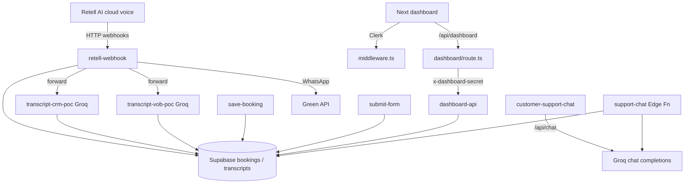

# AUDIT: awaazlabs (on-disk: `awaazlabs`)

**Audit date:** 2026-08-14
**Auditor:** Cursor (static analysis only — code not executed)
**Repo path:** `d:\PROJECTS\PASSION PROJECTS\VERTEX_voiceai\awaazlabs`

> **Scope note:** Protocol listed this directory as `awazlabs/` with known strength “Enterprise-grade VAD, turn-taking, barge-in, WebSocket session lifecycle.” On-disk name is `awaazlabs/` (double-a). Static search of `silero|barge.?in|VoiceActivity|turn.?taking|pcm|AudioWorklet` across this tree returned **0 matches**. This dossier audits what is actually present: a clinic operations dashboard, Retell post-call webhooks, Groq transcript extraction, and a text support-chat app. It does **not** silently expand into `habiba-sdk-agent/`.

## 1. Executive Overview & Architectural Topology

- **Core purpose & design philosophy:** A **Voice-AI operations CRM**, not a real-time speech pipeline. Inbound voice is owned by **Retell AI** (external). This repo receives Retell HTTP webhooks (`call_started`, `transcript_updated`, `call_ended`, `call_analyzed`), persists bookings/transcripts in Supabase, runs Groq JSON extraction for CRM and VOB (verification of benefits), and renders a Clerk-gated Next.js dashboard (plus a separate Groq text chat). Audio never enters this codebase as PCM; recordings are fetched by URL proxy for playback in the UI.

- **Execution model:** Hybrid of (a) **Next.js Node/edge request/response** for the dashboard and patient chat, and (b) **Supabase Edge Functions** (`Deno.serve`) for webhooks and APIs. Evidence: `Deno.serve` in `ali-Awaazlabs-client-dashboard-backend/supabase/functions/retell-webhook/index.ts:25` and `dashboard-api/index.ts:41`; Next App Router handlers `AwaazLabs-frontend-from-github/src/app/api/dashboard/route.ts:74,95`. Background work uses `EdgeRuntime.waitUntil` (`_shared/supa.ts:11–20`). **NOT IMPLEMENTED / ABSENT:** asyncio voice event loop, actor model, in-process audio worker pool.

### Directory tree (vendor/`.git`/`node_modules` excluded)

```text
awaazlabs/
├── .git/                                         # outer git wrapper
├── supabase/                                     # CLI link metadata only (.temp/*) — no functions
├── AwaazLabs-frontend-from-github/               # nested git: Clerk Next.js ops dashboard
│   ├── README.md                                 # "frontend-only" + fixtures; live API also wired
│   ├── package.json / package-lock.json
│   ├── .env.example
│   ├── vercel.json
│   └── src/
│       ├── middleware.ts                         # Clerk auth + org gate
│       ├── app/api/dashboard/route.ts            # same-origin proxy → dashboard-api
│       ├── app/api/recording/route.ts            # recording URL fetch proxy
│       ├── app/(dashboard)/                      # appointments, conversations, VOB, agents, …
│       ├── lib/dashboard-live.ts                 # live Supabase-backed client
│       ├── mock/                                 # fixture data-access (PHI gating)
│       └── shared/debug-auth.ts                  # DEBUG_BYPASS_AUTH flag
├── customer-support-chat/                        # nested git: standalone Groq text chat
│   ├── package.json
│   ├── .env.example
│   └── app/api/chat/route.ts                     # POST /api/chat → Groq
└── ali-Awaazlabs-client-dashboard-backend/
    ├── supabase/functions/                       # CANONICAL Edge Functions (cited below)
    │   ├── retell-webhook/index.ts               # Retell event ingress
    │   ├── save-booking/index.ts                 # mid-call custom-function persist
    │   ├── submit-form/index.ts                  # intake form GET/POST
    │   ├── crm-api/index.ts                      # staff CRM + WhatsApp actions
    │   ├── dashboard-api/                        # dashboard BFF (auth, queries, actions)
    │   ├── support-chat/index.ts                 # Groq chat + Supabase persistence
    │   ├── transcript-crm-poc/                   # Groq patient-field extraction
    │   ├── transcript-vob-poc/                   # Groq VOB extraction
    │   └── _shared/                              # booking, messaging, retell-transcript, …
    └── Agent-CRM-demo3/Agent-CRM-demo/           # DUPLICATE nested git of functions + scripts
        ├── package.json                          # supabase CLI ^2.109.1
        ├── supabase/functions/                   # near-copy of parent functions
        ├── intake-form-site/
        └── scripts/                              # Node scripts; imports `ws` but comment says unused
```

### Dependency topology



`Agent-CRM-demo3/Agent-CRM-demo/supabase/functions/` is a nested duplicate of `ali-Awaazlabs-client-dashboard-backend/supabase/functions/` (same filenames and `Deno.serve` entrypoints). Citations below use the **non-nested** `ali-Awaazlabs-client-dashboard-backend/supabase/functions/` copy unless noted.

---

## 2. Complete Tech Stack & Provider Inventory

### Libraries + versions

| Library | Version | Purpose | Source file |
|---|---|---|---|
| next (dashboard) | `15.5.20` locked | App Router dashboard | `AwaazLabs-frontend-from-github/package-lock.json:5311–5312` |
| react / react-dom (dashboard) | `19.2.7` locked | UI | `package-lock.json:5944–5955` |
| @clerk/nextjs | `7.5.15` locked | Auth | `package-lock.json:66–67` |
| tailwindcss | `^3.4.19` manifest; lock **NOT VERIFIED** line-by-line beyond package.json | CSS | `package.json:40` |
| @radix-ui/* | caret ranges in `package.json:18–21` | primitives | `package.json` |
| Node engine | `>=20.9.0` | dashboard | `package.json:6–8` |
| next (support chat) | `^15.5.20` **unpinned range**; no lockfile found in that subfolder glob | chat UI | `customer-support-chat/package.json:12` |
| react (support chat) | `19.1.0` pinned in manifest | chat UI | `customer-support-chat/package.json:13` |
| supabase CLI (CRM demo) | `^2.109.1` | local/deploy tooling | `Agent-CRM-demo3/Agent-CRM-demo/package.json:3` |
| @supabase/supabase-js | `https://esm.sh/@supabase/supabase-js@2` (major-only) | Edge DB client | `_shared/supa.ts:1` — patch version **NOT VERIFIED** |
| Deno Edge runtime | implied by `Deno.serve` / `Deno.env` | functions | `retell-webhook/index.ts:9,25` |
| Python / FastAPI / torch | **NOT IMPLEMENTED / ABSENT** (0 `requirements.txt`) | — | glob `**/requirements.txt` = 0 |
| Dockerfile / docker-compose | **NOT IMPLEMENTED / ABSENT** | — | Phase 0 glob 0 at workspace; none in this tree’s manifests |

### Audio transport

| Item | Finding | Citation |
|---|---|---|
| In-repo WebSocket audio | **NOT IMPLEMENTED / ABSENT** | grep `WebSocket` hits only Retell docs + unused `ws` import comment `scripts/lib/util.js:7,188–189` |
| WebRTC / gRPC / SIP-RTP in this repo | **NOT IMPLEMENTED / ABSENT** | — |
| Actual voice path | **Retell-hosted** (outside this repo). This repo consumes HTTP JSON webhooks | `retell-webhook/index.ts:31–62` |
| Recording playback | HTTP GET proxy of Retell/storage URL (wav/mp3/m4a by URL suffix) | `recording/route.ts:20–27,83–109` |

### Audio processing (sample rate / chunk / codec)

**NOT IMPLEMENTED / ABSENT** in this codebase. No PCM constants, no sample rate, no frame duration. Retell recordings are opaque URLs (`retell-webhook/index.ts:367–371`).

### VAD & turn-taking

**NOT IMPLEMENTED / ABSENT.** Repo-wide grep for `silero|barge.?in|VoiceActivity|turn.?taking` = 0. Any VAD/barge-in lives inside Retell (not auditable here). Dashboard mock fixtures mention campaign `retrySpacingHours` (`src/mock/fixtures/northside.ts:953`) — **outbound dial pacing mock data**, not speech VAD.

### STT pipeline

| Item | Finding | Citation |
|---|---|---|
| In-repo STT | **NOT IMPLEMENTED / ABSENT** | — |
| Transcript source | Retell webhook payload text extracted and stored | `_shared/retell-transcript.ts:15–16`; `retell-webhook/index.ts:38–48` |
| Streaming vs chunked | Event-driven `transcript_updated` HTTP posts, not audio streaming | `retell-webhook/index.ts:38–51` |
| Language handling | Extraction schema has `language` field; Groq extracts it | `transcript-crm-poc/extraction.ts:7` |
| Punctuation tuning | **NOT IMPLEMENTED / ABSENT** | — |

### LLM orchestration

| Item | Finding | Citation |
|---|---|---|
| Real-time voice LLM | **NOT IMPLEMENTED / ABSENT** (Retell agent speaks; this repo does not stream tokens to TTS) | — |
| Groq extraction | `llama-3.3-70b-versatile` default, `temperature: 0`, `response_format: json_object` | `transcript-crm-poc/extraction.ts:3–4,73–83` |
| Groq support chat (Edge) | same model default, `temperature: 0.2`, `max_tokens: 220`, system prompt file | `support-chat/index.ts:8–11,132–147` |
| Groq support chat (Next) | duplicate prompt inline, same timeouts | `customer-support-chat/app/api/chat/route.ts:8–12,110–128` |
| Streaming tokens | **NOT IMPLEMENTED / ABSENT** (`await groqResponse.json()`) | `support-chat/index.ts:150` |
| Tool-calling | **NOT IMPLEMENTED / ABSENT** in Groq payloads (messages + json_object only) | `extraction.ts:80–99` |
| History | chat slices last `MAX_MESSAGES = 20` | `support-chat/index.ts:10,75–77` |

### TTS pipeline

**NOT IMPLEMENTED / ABSENT** in this repo. First-packet TTS latency **NOT MEASURABLE VIA STATIC AUDIT** (and not instrumented here). Voice TTS is Retell’s.

---

## 3. Detailed Workflow & Pipeline Lifecycle

### Handshake & session init

**In-repo voice WS handshake: NOT IMPLEMENTED / ABSENT.**

What exists instead:

1. **Dashboard:** Browser hits Next; `clerkMiddleware` requires `userId` then allowed org (`middleware.ts:43–90`). Public route `/sign-in(.*)` only (`middleware.ts:35`). `DEBUG_BYPASS_AUTH` currently `false` (`debug-auth.ts:9`).
2. **Dashboard API:** Next `/api/dashboard` requires `DASHBOARD_API_URL` + `DASHBOARD_API_SECRET` (`dashboard/route.ts:44–53`). Forwards `x-dashboard-secret`, `x-actor`, `x-role`, `x-mode` (`dashboard/route.ts:56–63`). Edge `authenticate` timing-safe-compares secret; missing secret → 500 fail-closed (`dashboard-api/auth.ts:30–51`).
3. **Retell webhook:** `checkSecret` compares query `?s=` to `RETELL_SHARED_SECRET`. **If env unset, returns `true` (fail-open)** (`_shared/supa.ts:23–27`). Used by `retell-webhook/index.ts:26` and `save-booking/index.ts:8`.
4. **transcript-*-poc:** local `checkSecret` **fail-closed** if secret unset (`transcript-crm-poc/index.ts:281–285`).
5. Parameter negotiation for audio: **NOT IMPLEMENTED / ABSENT**.

### Active conversation loop (audio frame path)

**NOT IMPLEMENTED / ABSENT** for mic→VAD→STT→LLM→TTS→speaker.

Substitute lifecycle that **is** implemented (post-call / mid-call HTTP):

1. Retell POSTs `{event, call, ...}` (`retell-webhook/index.ts:28–33`).
2. `call_started` / `call_ended` upsert `bookings` + timestamps (`retell-webhook/index.ts:36–37, 65–128`).
3. `transcript_updated` extracts text, persists live transcript, forwards to CRM or VOB function (`retell-webhook/index.ts:38–51, 272–289`).
4. Route CRM vs VOB by Retell agent id/name env lists (`retell-webhook/index.ts:292–308`).
5. Groq extracts JSON patient/VOB fields (`transcript-crm-poc/extraction.ts:64–112`).
6. `call_analyzed` merges Retell `custom_analysis_data`, optional Groq table-fill, WhatsApp messaging (`retell-webhook/index.ts:57–61, 168–237`).
7. Dashboard lists calls/transcripts via `GET ?resource=calls` (`dashboard-api/index.ts:64–65`).

No barge-in cancellation of in-flight LLM/TTS exists here because there is no in-flight synthesis.

### Barge-in / interruption protocol

**NOT IMPLEMENTED / ABSENT.**

### State management

| Item | Finding | Citation |
|---|---|---|
| Voice FSM (listening/thinking/speaking) | **NOT IMPLEMENTED / ABSENT** | — |
| Booking/call persistence | Supabase `bookings` keyed by `call_id` | `retell-webhook/index.ts:73–76` |
| Chat session | `support_chat_sessions` + `support_chat_messages`; last 20 messages to Groq | `support-chat/index.ts:10, 90–118, 175–200` |
| History pruning (voice) | **NOT IMPLEMENTED / ABSENT** | — |
| Context-window token guard | **NOT IMPLEMENTED / ABSENT** (message-count slice only) | `support-chat/index.ts:75–77` |
| Incremental CRM extraction | `latestTranscriptSegment` by previous length | `transcript-crm-poc/index.ts:60, 221–224` |

---

## 4. API, Endpoint & WebSocket Directory

### REST endpoints — Next.js dashboard (`AwaazLabs-frontend-from-github`)

| Method | Path | Auth | Request | Response | Source |
|---|---|---|---|---|---|
| GET | `/api/dashboard?resource=…` | Clerk middleware on `/api/*` (`middleware.ts:102–103`); **handler does not re-check Clerk**; forwards client `x-actor`/`x-role`/`x-mode` | query `resource` ∈ allowlist | proxied `{data}` / `{error}` | `dashboard/route.ts:3–16, 74–92` |
| POST | `/api/dashboard` | same | JSON `{action}` ∈ allowlist | proxied | `dashboard/route.ts:18–31, 95–119` |
| GET | `/api/recording?callId=` | Clerk `auth()` unless `DEBUG_BYPASS_AUTH` | `callId` | audio stream or JSON error | `recording/route.ts:29–109` |

Allowed GET resources: `appointments, stats, appointment, calls, chats, escalations, escalation, escalation_stats, vob_queue, vob_stats, notifications, runtime_settings` (`dashboard/route.ts:3–16`). Note: `recording` is **not** in this allowlist; it is a separate route.

Allowed POST actions (proxy): `reveal_phone, status_change, add_note, record_search, acknowledge_escalation, escalation_note, resolve_escalation, vob_retry, vob_resolve, vob_escalate, vob_add_note, set_runtime_settings` (`dashboard/route.ts:18–31`). Edge `actions.ts` also has `sync_recent_bookings`, `backfill_bookings_to_vob` (`actions.ts:39–41`) which the **Next allowlist omits**.

### REST endpoints — Supabase Edge (`…/supabase/functions/`)

| Method | Path (function name) | Auth | Request schema | Response schema | Source |
|---|---|---|---|---|---|
| POST | `retell-webhook` | `?s=RETELL_SHARED_SECRET` (fail-open if unset) | Retell event JSON `{event, call}` | `{received:true}` or 401 | `retell-webhook/index.ts:25–62` |
| POST | `save-booking` | same `checkSecret` | `{call, args}` custom function payload | `{result:"saved"}` even if missing `call_id` | `save-booking/index.ts:7–16` |
| GET/POST | `submit-form` | **none** (CORS `*` content-type only) | GET `?cid=`; POST body `{cid,...}` | booking JSON / errors | `submit-form/index.ts:7–35` |
| GET/POST | `crm-api` | `x-crm-secret` **only if `CRM_SECRET` set** (fail-open if empty) | GET list; POST `{action, call_id}` | bookings/messages | `crm-api/index.ts:14–33` |
| GET/POST/OPTIONS | `dashboard-api` | `x-dashboard-secret` fail-closed | `?resource=` or `{action}` | `{data}` / `{error:{code,message}}` | `dashboard-api/index.ts:41–115` |
| POST/OPTIONS | `support-chat` | `x-support-chat-secret` (or `DASHBOARD_API_SECRET`) fail-closed | `{sessionId?, messages[]}` | `{reply, sessionId, purpose}` | `support-chat/index.ts:54–210` |
| POST | `transcript-crm-poc` | `?s=` fail-closed | Retell payload | extraction ack / errors | `transcript-crm-poc/index.ts:12–48` |
| POST | `transcript-vob-poc` | `?s=` fail-closed | Retell payload | extraction ack / errors | `transcript-vob-poc/index.ts:9–16` |

Dashboard-api GET resources (authoritative server list): `appointments, stats, appointment, calls, chats, escalations, escalation, escalation_stats, recording, vob_queue, vob_stats, notifications, runtime_settings` (`dashboard-api/index.ts:54–95`).

### WebSocket event catalog

**NOT IMPLEMENTED / ABSENT** — no `@app.websocket`, no voice event names.

### Telephony-specific

| Item | Finding | Citation |
|---|---|---|
| Retell webhooks | `call_started`, `transcript_updated`, `call_ended`, `call_analyzed` | `retell-webhook/index.ts:36–61` |
| TwiML / Twilio Media Streams | **NOT IMPLEMENTED / ABSENT** | — |
| SIP / Asterisk | **NOT IMPLEMENTED / ABSENT** | — |
| Post-call WhatsApp | Green API `sendSmart` | `_shared/messaging.ts:3–5, 20–22`; `retell-webhook/index.ts:130–165` |
| Call recording URLs | stored from Retell `recording_url` variants | `retell-webhook/index.ts:367–371` |
| Custom Retell function | `save-booking` mid-call persist | `save-booking/index.ts:13–21` |

---

## 5. Failure Modes, Edge Cases & Latency Bottlenecks

### Code-switching / phonetic hallucination

- Voice STT/TTS errors are **Retell’s**, not handled here.
- Groq extraction can mis-parse multilingual transcripts into JSON fields; validation exists (`transcript-crm-poc/index.ts:74–76`) and alerts on errors, but there is no STT confidence gate.
- Support chat is **English or Spanish only** per prompt (`customer-support-chat/app/api/chat/route.ts:40–41`); Urdu voice traffic would not be handled by this chat path.

### Network jitter / WS drop / underrun / reordering

**NOT IMPLEMENTED / ABSENT** for audio sockets (there are none). HTTP `fetch` to transcript functions has **no retry** (`retell-webhook/index.ts:280–289` throws on non-OK). `background()` swallows via `p.catch(console.error)` (`_shared/supa.ts:20`).

### Async event-loop blocking

Edge functions are request-scoped Deno. No PyTorch on the loop. Groq `fetch` in support-chat uses `AbortSignal.timeout(20000)` (`support-chat/index.ts:11, 134`). CRM extraction `fetch` has **no timeout** (`extraction.ts:74`).

### Memory leak / buffers

No audio queues. Risk points: unbounded `raw_payload` growth as Retell events merge (`retell-webhook/index.ts:86–103`); `crm-api` GET loads 200 bookings + 400 messages per request (`crm-api/index.ts:23–25`). Dashboard CORS `Access-Control-Allow-Origin: *` (`dashboard-api/auth.ts:11–15`).

### Concurrency limits / multi-session

**NOT IMPLEMENTED / ABSENT** for voice sessions. Multi-location clinic data is DB-row scoped (`support-chat` `location_id` `support-chat/index.ts:44–52, 106–108`). No admission control on Retell concurrency.

---

## 6. Technical Debt, Code Smells & Modularity Rating

| Item | Citation |
|---|---|
| Nested duplicate of all Edge Functions under `Agent-CRM-demo3/` | directory listing; same `Deno.serve` files |
| `checkSecret` fail-open if `RETELL_SHARED_SECRET` empty | `_shared/supa.ts:23–27` |
| `crm-api` fail-open if `CRM_SECRET` empty | `crm-api/index.ts:17–19` |
| `submit-form` unauthenticated | `submit-form/index.ts:7–14` |
| Dashboard proxy trusts **client-supplied** `x-role` / `x-actor` (unlike recording route which reads Clerk) | `dashboard/route.ts:56–63` vs `recording/route.ts:31–54` |
| `save-booking` returns `{result:"saved"}` when `call_id` missing | `save-booking/index.ts:16` |
| Duplicate Groq chat: Edge `support-chat` vs Next `customer-support-chat` (different persistence) | both files cited in §2 |
| README claims “frontend-only / fixtures” while live API env exists | `README.md:6–7` vs `.env.example:40–47` |
| Hardcoded placeholders | `FORM_BASE_URL` `https://YOUR-SITE.netlify.app/...` (`retell-webhook/index.ts:10`); `DEFAULT_DOCTOR` (`retell-webhook/index.ts:9`) |
| `payload: any` throughout webhook | `retell-webhook/index.ts:28` |
| TODO/FIXME/HACK | **ABSENT** (grep 0) |
| Network retry/backoff on Groq/Retell forward | **NOT IMPLEMENTED / ABSENT** |
| Test coverage | essentially **ABSENT** except `appointment-time_test.ts` under nested demo (`Agent-CRM-demo3/.../appointment-time_test.ts`) |
| Protocol “enterprise VAD/WS” | **NOT IMPLEMENTED / ABSENT** in this directory |

### Modularity Score: 5/10

Justification:

1. **Clear service split** (dashboard UI / Edge webhooks / extraction POCs / chat) with shared `_shared/` booking+messaging modules (`_shared/booking.ts`, `_shared/messaging.ts`).
2. **Voice core is an un-abstracted vendor**: Retell is hardcoded event names and payload shapes (`retell-webhook/index.ts:31–61`); swapping STT/LLM/TTS is impossible inside this repo because those layers are not here.
3. **Duplication** of the entire functions tree and of Groq chat reduces harvestability.

### RAG & MCP Readiness

- MCP: **NOT IMPLEMENTED / ABSENT**.
- RAG / knowledge retrieval for voice: **NOT IMPLEMENTED / ABSENT**. Dashboard has a `knowledge` route folder (`src/app/(dashboard)/knowledge`) — **UI surface**; live RAG injection into a speech LLM is not in this repo.
- Concrete injection points **if** extended: Groq `messages` array in `support-chat/index.ts:143–146` (text chat only); CRM extraction user prompt in `extraction.ts:90–97` (post-call JSON, not real-time voice). No equivalent of `pipeline.py` audio prompt assembly exists.

Distance from North Star: this repo is the **ops/CRM/multi-tenant clinic shell** around a third-party voice vendor, not a pluggable voice engine. Harvest value is webhook/session persistence, role-gated dashboard, and Groq structured extraction — not VAD/barge-in/WS audio.
