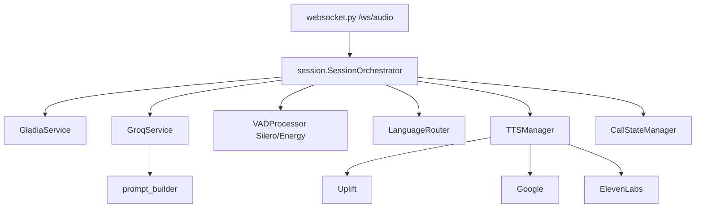

# AUDIT: Multilingual_AI_Voice_Agent_gittracked

**Audit date:** 2026-08-14
**Auditor:** Cursor (static analysis only — code not executed)
**Repo path:** `d:\PROJECTS\PASSION PROJECTS\VERTEX_voiceai\Multilingual_AI_Voice_Agent_gittracked`

## 1. Executive Overview & Architectural Topology

- **Core purpose & design philosophy:** A FastAPI WebSocket voice agent that hot-swaps language behavior via YAML `LanguageProfile`s (en/ur/ar/ms). Gladia transcribes with four-language code-switching; Groq streams a reply with a per-turn language directive; `TTSManager` routes Uplift/Google/ElevenLabs with timeout failover and a 60 s circuit breaker. Local VAD is a Silero pool with Energy-RMS fallback, adaptive noise gate, and a 700 ms barge-in verification window (pause → confirm → cancel or resume). The orchestrator still **constructs concrete** `GladiaService` and `GroqService` despite `Protocol` interfaces (`session.py:77–78` vs `interfaces.py:79–128`).

- **Execution model:** Asyncio event loop + thread-pool for Silero inference + a process-wide `SileroModelPool` with `threading.Lock` (`vad_service.py:42–87, 322–323`). FastAPI/uvicorn (`main.py:19–20, 177–184`). Per-session tasks: sender, pipeline (`gladia.start`), greeting, heartbeat (`websocket.py:34–53`). VAD has its own consumer task and `Queue(maxsize=200)` (`vad_service.py:372–406`). **NOT IMPLEMENTED / ABSENT:** actor model.

### Directory tree (source; `.git`/`logs`/`__pycache__` excluded)

```text
Multilingual_AI_Voice_Agent_gittracked/
├── README.md, DESIGN.md, Dockerfile, requirements.txt, .env.example
├── docs/architectural_documentation.md, HANDOFF.md, project_scope.md, …
├── frontend/
│   ├── index.html, app.js, styles.css, visualizer.js
│   └── old_index.html                    # unused predecessor UI
├── backend/app/
│   ├── main.py                           # FastAPI, CORS, /api/clerk-key, Silero pool init
│   ├── core/
│   │   ├── interfaces.py                 # STT/LLM/TTS Protocols + Transcript
│   │   ├── state_machine.py              # LISTENING/THINKING/SPEAKING (warns, still applies)
│   │   ├── config/config.py              # pydantic-settings
│   │   ├── config/language_registry.py   # YAML loader singleton
│   │   ├── config/languages/{en,ur,ar,ms}.yaml
│   │   └── prompts/base_system_prompt.md + language_directives/*.md
│   ├── orchestration/
│   │   ├── session.py                    # SessionOrchestrator
│   │   └── language_router.py            # debounce / 3-word switch
│   ├── services/
│   │   ├── stt/gladia_service.py
│   │   ├── llm/groq_service.py, prompt_builder.py
│   │   ├── tts/{tts_manager,uplift,google,elevenlabs}_service.py
│   │   └── vad/{vad_service.py, health.py}
│   └── transport/{websocket,audio_receiver,audio_sender,connection_manager}.py
└── backend/tests/                        # barge-in, arabic, groq, gladia, uplift, replayable iterator
```

### Dependency topology

| Consumer | Imports |
|---|---|
| `main.py` | `websocket.router`, `config`, `vad.health.set_silero_healthy`, `vad_service` pool init |
| `websocket.py` | `SessionOrchestrator`, `AudioReceiver/Sender`, `connection_manager`, `is_silero_healthy` |
| `session.py` | **concrete** Gladia + Groq + VADProcessor + TTSManager + LanguageRegistry/Router |
| `tts_manager.py` | Uplift, ElevenLabs, Google (all constructed per session) |
| `groq_service.py` | `prompt_builder.build_messages`, `LanguageProfile` |
| `gladia_service.py` | `interfaces.Transcript` (normalized) |



---

## 2. Complete Tech Stack & Provider Inventory

### Libraries + versions

| Library | Version | Purpose | Source file |
|---|---|---|---|
| aiohttp | `3.13.5` | TTS HTTP | `requirements.txt:1` |
| fastapi | `0.139.0` | ASGI | `requirements.txt:2` |
| ffmpeg_downloader | `0.5.2` | tests | `requirements.txt:3` |
| gladiaio_sdk | `1.0.4` | STT | `requirements.txt:4` |
| groq | `1.5.0` | LLM | `requirements.txt:5`; `groq_service.py:7` |
| pydantic_settings | `2.14.2` | env | `requirements.txt:6` |
| pydub | `0.25.1` | tests | `requirements.txt:7` |
| python-dotenv | `1.2.2` | env | `requirements.txt:8` |
| uvicorn | `0.51.0` | server | `requirements.txt:9` |
| websockets | `16.0` | declared | `requirements.txt:10` |
| pyyaml | `>=6.0` **unpinned** | language YAML | `requirements.txt:12`; `language_registry.py:5` |
| torch / numpy | **NOT IN requirements.txt** but imported | Silero VAD | `vad_service.py:12–13`. Dockerfile `pip install -r requirements.txt` (`Dockerfile:16`) therefore **does not install torch**. Runtime Silero depends on undeclared deps — **NOT VERIFIED** that the image can load Silero. |
| Python (Docker) | `3.11-slim` | container | `Dockerfile:2` |
| Lockfile | **NOT IMPLEMENTED / ABSENT** | — | — |

### Audio transport

| Item | Finding | Citation |
|---|---|---|
| Transport | FastAPI WebSocket binary PCM | `websocket.py:17, 71`; `app.js:11–13` |
| WebRTC / gRPC / SIP | **NOT IMPLEMENTED / ABSENT** | — |
| Prod WS URL | derived from `https://multilingual-ai-voice-agent-backend.onrender.com` | `app.js:7–13` |

### Audio processing constants

| Constant | Value | Citation |
|---|---|---|
| Mic | 16000 Hz Int16; Worklet decimation; **variable-length frames** (no 512-sample batching unlike v3) | `app.js:17, 99–116` |
| TTS / player | 22050 Hz | `app.js:18, 167`; all TTS `sample_rate_hz` 22050 |
| Protocol comment vs reality | `interfaces.py` documents “16kHz” for TTS (`interfaces.py:216–220`) but all providers yield 22050; orchestrator **asserts 22050** (`session.py:494`) |
| Receiver queue | maxsize 100, drop-oldest | `audio_receiver.py:9–25` |
| Sender queue | maxsize 200 | `audio_sender.py:9, 13` |
| Client prebuffer | 3 chunks | `app.js:21` |
| Uplift/EL/Google pop trim | `int(0.050 * 22050 * 2) & ~1` = 2204 bytes | `uplift_service.py:124`; `elevenlabs_service.py:84`; `google_service.py:111` |

### VAD & turn-taking

| Parameter | Value | Citation |
|---|---|---|
| Primary engine | Silero via torch hub at startup + JIT pool | `main.py:72–100`; `vad_service.py:42–87, 377–391` |
| Fallback | `EnergyVADProcessor` RMS + `AdaptiveNoiseGate` | `vad_service.py:392–404, 120–207` |
| Global threshold | `0.5` | `config.py:29`; `.env.example:20` |
| Speech onset | `250` ms | `config.py:30` |
| Silence UI (filler) | `200` ms | `config.py:31`; passed as `silence_duration_ms` `session.py:96` |
| Silence commit (env) | `600` ms **`vad_silence_commit_ms` is never read by session/VAD** | `config.py:32` vs `session.py:89–98` — **declared but unused** |
| Energy floor | `0.015` | `config.py:33` |
| Noise gate k / window | `3.0` / `50` | `config.py:34–35`; gate `max(0.005, floor * k)` `vad_service.py:115–117` |
| Silero frame | 512 samples / 32 ms | `vad_service.py:94, 236–237` |
| Energy frame | 20 ms | `vad_service.py:95` |
| Urdu/Arabic VAD override | `vad_silence_duration_ms: 800` | `ur.yaml:23–24`; `ar.yaml:16–17`; applied on language switch `session.py:404–410` |
| Connection gate | **rejects WS if Silero unhealthy** even though Energy fallback exists | `websocket.py:22–28` vs `vad_service.py:392–404` |
| Barge-in verify | sleep `0.7` s; min sustained speech `0.3` s | `session.py:255–256` |
| Text barge-in backup | final transcript > 3 words while THINKING/SPEAKING | `session.py:370–376` |

### STT pipeline

| Item | Finding | Citation |
|---|---|---|
| Provider | Gladia Live V2 `solaria-1`, streaming | `gladia_service.py:34–35` |
| Format | wav/pcm 16 kHz 16-bit mono | `gladia_service.py:36–38` |
| Languages | `["ur","en","ar","ms"]`, `code_switching=True` | `gladia_service.py:42–44` |
| Endpointing | `0.2` s | `gladia_service.py:40` |
| Punctuation config | **NOT IMPLEMENTED / ABSENT** as explicit Gladia punctuation field | `gladia_service.py:34–57` |
| Output type | `interfaces.Transcript` including `language` | `interfaces.py:33–67` |

### LLM orchestration

| Item | Finding | Citation |
|---|---|---|
| Provider | Groq `AsyncGroq` | `groq_service.py:19` |
| Default model | `"llama-3.1-8b-instant"` | `config.py:19` (README says Llama 3.1 8B Instant — matches) |
| `.env.example` default | `"llama3-8b-8192"` **differs from config.py default** | `.env.example:10` vs `config.py:19` |
| Streaming | `chat.completions.create(..., stream=True)` | `groq_service.py:106–114` |
| temperature / max_tokens | `0.7` / `150` hardcoded | `groq_service.py:110–111` |
| Prompt | `base_system_prompt.md` as history[0]; per-turn `lang_profile.llm_directive_text` injected immediately before user | `prompt_builder.py:13–30` |
| Chunking | language YAML delimiters; first chunk min 2 words | `groq_service.py:33–91`; `ur.yaml:18–21` |
| History | keep system + last `groq_max_history` (default 6) | `config.py:20`; `groq_service.py:135–136` |
| Tool-calling | **NOT IMPLEMENTED / ABSENT** | `groq_service.py:106–112` |

### TTS pipeline

| Item | Finding | Citation |
|---|---|---|
| Switchboard | `TTSManager` constructs Uplift + ElevenLabs + Google per session | `tts_manager.py:149–158` |
| Language primary | ur→uplift; en/ar/ms→google | `ur.yaml:7`; `en.yaml:4`; `ar.yaml:4`; `ms.yaml:4` |
| Failover | first-chunk timeout 3.5 s, subsequent 1.5 s; replay iterator | `tts_manager.py:108–141` |
| Circuit breaker | 2 consecutive failures → unhealthy 60 s | `tts_manager.py:176–184` |
| ur fallback | uplift ↔ google | `tts_manager.py:191–194` |
| en/ar/ms fallback | google ↔ elevenlabs if key not placeholder | `tts_manager.py:196–202` |
| Azure | config keys only; **no Azure TTS class** | `config.py:25–26`; grep `azure` only those lines |
| First-packet latency | metric `"TTS Latency"`; **NOT MEASURABLE VIA STATIC AUDIT** as wall-clock | `session.py:507–513` |

---

## 3. Detailed Workflow & Pipeline Lifecycle

### Handshake & session init

1. Client computes `WS_URL` from hostname (`app.js:7–13`). **No token on WS.**
2. Clerk: frontend `initClerk()` **hard-bypasses** auth (`app.js:377–386`). Backend `/api/clerk-key` returns publishable key with no auth (`main.py:130–132`). **WS auth: NOT IMPLEMENTED / ABSENT.**
3. If `is_silero_healthy()` is false, accept, send error, close (`websocket.py:22–28`). Flag set only if startup torch hub succeeds (`main.py:96–100`); default `_silero_healthy = False` (`health.py:1`).
4. `connection_manager.connect`, `AudioSender.send_loop`, `orchestrator.run()` → `GladiaService.start()`, `trigger_greeting()`, heartbeat every 20 s with `{type:control, action:ping}` (`websocket.py:33–53`).
5. Greeting is hardcoded per `LanguageRouter.current` (default `en`) (`session.py:181–218`; `language_router.py:11–13`).
6. No codec negotiation — rates hardcoded both sides.

### Active conversation loop

1. `receive_bytes` → `process_client_audio` (VAD queue) + `enqueue_chunk` (STT) (`websocket.py:71–75`).
2. VAD worker `process_audio` → Silero `_infer` in executor if above noise floor (`vad_service.py:289–350, 408–422`).
3. Speech start during agent playout: `pause()` sender, start 700 ms verification (`session.py:220–236, 249–285`).
4. Speech end in LISTENING: THINKING + comfort filler TTS (`session.py:238–247, 294–323`).
5. Gladia final transcript → `LanguageRouter.update` → VAD threshold update → `_run_turn` (`session.py:346–420`).
6. Groq stream → sentence callbacks → `_SentenceBridge` (maxsize 50) → TTS failover stream → `queue_output_chunk` (`session.py:25–27, 479–516`).
7. Sender updates `speaking_until` watermark (`audio_sender.py:70–75`).
8. Drain with 2 s timeout then LISTENING (`session.py:527–543`).
9. `[END_CALL]` → `{type:control, action:hangup}` + `ws.close()` (`session.py:327–331, 535–540`).

### Barge-in / interruption protocol

**IMPLEMENTED** (two paths):

**A. VAD verification (`session.py:220–285, 429–477`):** pause playout → 700 ms → if active or duration ≥ 0.3 s → resume then `_barge_in`; else resume (false alarm).

**B. `_barge_in`:** send `{type:control, action:barge_in}` first; `vad.reset()`; `audio_sender.flush()` (sets interrupt + `speaking_until=0`); `tts_manager.cancel_active()`; cancel filler/LLM/turn; state LISTENING. Re-entrancy guard `_barge_in_active` (`session.py:429–432`).

**C. Text backup:** final transcript word_count > 3 during THINKING/SPEAKING (`session.py:370–376`).

Client: Worklet `{flush:true}` (`app.js:82–92`). **Does not handle `hangup` or `ping` in `handleTextData`** (`app.js:38–93`).

### State management

| Item | Finding | Citation |
|---|---|---|
| FSM | `CallStateManager` LISTENING→THINKING→SPEAKING; any→LISTENING; SPEAKING→THINKING allowed | `state_machine.py:6–51` |
| Invalid transitions | **logged then still applied** (`if not valid: warning` then `_state = new_state`) | `state_machine.py:45–51` |
| Session memory | Groq `history` list in-process | `groq_service.py:26–27` |
| Persistence | **NOT IMPLEMENTED / ABSENT** | — |
| Prune | system + last 6 | `groq_service.py:135–136` |
| Token window guard | **NOT IMPLEMENTED / ABSENT** (`max_tokens=150` output only) | `groq_service.py:111` |
| Language debounce | short (<3 words) needs 2 consecutive detections; else immediate | `language_router.py:36–55` |

---

## 4. API, Endpoint & WebSocket Directory

### REST

| Method | Path | Auth | Request | Response | Source |
|---|---|---|---|---|---|
| GET | `/` | none | none | `{Status, message}` | `main.py:126–128` |
| GET | `/api/clerk-key` | none | none | `{publishable_key}` | `main.py:130–132` |
| GET | `/healthz` | **NOT IMPLEMENTED / ABSENT** | — | — | grep `@app.get` only those two |

### WebSocket `/ws/audio` (`websocket.py:17`)

| Event | Direction | Payload | Source |
|---|---|---|---|
| binary PCM | client→server | Int16 @ 16 kHz, variable length | `app.js:99–116`; `websocket.py:71` |
| binary PCM | server→client | Int16 @ 22050 Hz | `audio_sender.py:68` |
| `transcript` | s→c | `{type, speaker, text, is_final?}` | `session.py:201, 341, 363–368` |
| `metric` | s→c | Groq LLM / Gladia STT / TTS / Total | `session.py:338, 393, 512–513` |
| `error` | s→c | `{type, message}` | `websocket.py:26, 91`; `session.py:142` |
| `control`/`barge_in` | s→c | `{type:control, action:barge_in}` | `session.py:447` |
| `control`/`hangup` | s→c | `{type:control, action:hangup}` | `session.py:539` |
| `control`/`ping` | s→c | every 20 s | `websocket.py:42–47` |

Client→server JSON events: **NOT IMPLEMENTED / ABSENT**.

### Telephony

**NOT IMPLEMENTED / ABSENT.**

---

## 5. Failure Modes, Edge Cases & Latency Bottlenecks

### Code-switching / hallucination

- Gladia 4-language CS (`gladia_service.py:42–44`) + router debounce (`language_router.py:36–49`) reduces blip switches; unsupported codes ignored (`language_router.py:32–34`); missing code keeps current (`language_router.py:26–27`).
- Fallback language `'en'` if unknown (`language_registry.py:133–136`).
- Prompt still forbids invented prices (`base_system_prompt.md:14`) with no RAG.
- First-chunk 2-word TTS split (`groq_service.py:42–43`) can speak mid-code-switch fragment.
- Groq `max_tokens=150` (`groq_service.py:111`) vs v3 Gemini 1000 — shorter replies, truncation risk.

### Network / buffers

| Concern | Exists | Missing |
|---|---|---|
| WS disconnect cleanup | `websocket.py:77–110` | client reconnect **ABSENT** |
| Heartbeat ping | `websocket.py:42–47` | client pong **ABSENT** (`app.js:38–93`) |
| Receiver overflow | drop-oldest `audio_receiver.py:20–25` | — |
| VAD overflow | **drop newest** (put_nowait fail) `vad_service.py:435–437` | unlike v3 drop-oldest |
| SentenceBridge | maxsize 50 `session.py:27` | put can block LLM dispatcher |
| TTS failover/timeout | `tts_manager.py:108–141` | STT/LLM retry **ABSENT** (`groq_service.py:140–141`) |
| Drain timeout | 2.0 s `session.py:530` | — |
| Pause loop | `asyncio.sleep(0.05)` while paused `audio_sender.py:37–38` | — |

### Event-loop blocking

| Site | Risk | Citation |
|---|---|---|
| `GroqService.__init__` | sync `open(base_system_prompt.md)` | `groq_service.py:22–24` |
| `LanguageRegistry._load_all_languages` | sync YAML/MD reads at first construct | `language_registry.py:78–92` |
| Silero `_infer` | mitigated via executor | `vad_service.py:322–323` |
| `GoogleTTSService` URL embeds API key in query string at import | `_GOOGLE_TTS_URL = ...?key={settings.google_tts_api_key}` | `google_service.py:16` |
| Sentence callbacks | **fire-and-forget** `create_task` (protocol said MUST await) | `groq_service.py:146`; `interfaces.py:125–126, 186–187` |

### Memory

- Silero pool checkin on shutdown (`vad_service.py:271–274, 460–468`); `__del__` also checkin (`vad_service.py:276–280`).
- TTSManager holds 3 HTTP sessions per WebSocket session (`tts_manager.py:153–158`).
- Session log files no TTL (`session.py:61–72`).
- `ReplayableAsyncIterator._consumed` unbounded for a turn (`tts_manager.py:21`).

### Concurrency limits

**NOT IMPLEMENTED / ABSENT** — unbounded `ConnectionManager` (same pattern as v3). Model pool grows lazily unbounded (`vad_service.py:62–74`). WS reject-all if Silero startup failed (`websocket.py:22–28`).

---

## 6. Technical Debt, Code Smells & Modularity Rating

| Item | Citation |
|---|---|
| Interfaces exist but orchestrator still instantiates Gladia/Groq concretely | `session.py:77–78` vs `interfaces.py:9–13` |
| Azure keys unused | `config.py:25–26` |
| `vad_silence_commit_ms` unused | `config.py:32` |
| torch/numpy undeclared in requirements / Docker | `requirements.txt`; `vad_service.py:12–13`; `Dockerfile:16` |
| Clerk bypassed | `app.js:377–378` |
| State machine does not enforce guards | `state_machine.py:45–51` |
| `old_index.html`, `old_retail_prompt.md` | present, unused by `main`/`app.js` |
| Google TTS key in URL | `google_service.py:16` |
| `.env.example` Groq model ≠ `config.py` default | `.env.example:10` vs `config.py:19` |
| TODO/FIXME/HACK | **ABSENT** (grep 0) |
| Bare `except:` | **ABSENT** |
| LLM/STT retry | **NOT IMPLEMENTED / ABSENT** |
| Tests present | `backend/tests/test_barge_in_verification.py`, `test_orchestrator_arabic.py`, `test_replayable_iterator.py`, `test_arabic_tts.py`, pipeline scripts |

### Modularity Score: 7/10

Justification:

1. **Real hot-swap surface:** YAML profiles + `LanguageRegistry` + `TTSManager` failover (`language_registry.py`, `tts_manager.py:204–227`) — adding a language is a YAML+directive, not an orchestrator rewrite for TTS/chunking/VAD overrides.
2. **Protocols are documented and used at TTS boundary** (`interfaces.py:196–274`; `FailoverTTSProvider` implements `TTSProvider`).
3. **STT/LLM still hardcoded** in `SessionOrchestrator.__init__` (`session.py:77–78`); audio ingest is explicitly out of `STTProvider` (`interfaces.py:92–96`), so Gladia cannot be swapped without session edits.

### RAG & MCP Readiness

- MCP / tools: **NOT IMPLEMENTED / ABSENT**.
- RAG: **NOT IMPLEMENTED / ABSENT**.
- Injection points: `build_messages` (`prompt_builder.py:7–30`) is the cleanest — insert a retrieved-context system/user message beside `ephemeral_directive`. Alternatively before `generate_reply` (`session.py:486`). Groq `create()` has no `tools=` today (`groq_service.py:106–112`).

Distance from North Star: closest of the first three repos to pluggable TTS + multilingual CS, still single-tenant browser-WS, no telephony, no MCP, Clerk not enforced.
