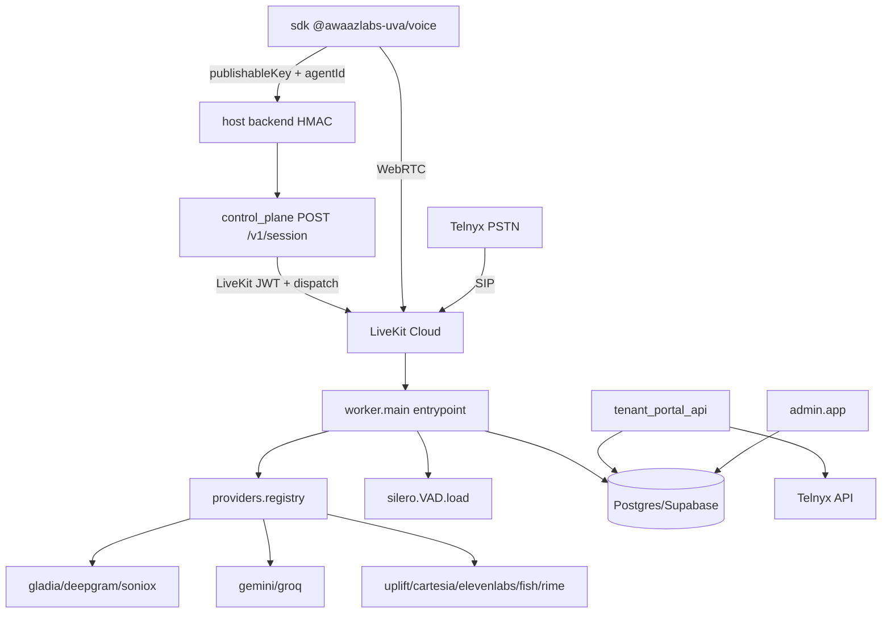

# AUDIT: habiba-sdk-agent

**Audit date:** 2026-08-14
**Auditor:** Cursor (static analysis only — code not executed)
**Repo path:** `d:\PROJECTS\PASSION PROJECTS\VERTEX_voiceai\habiba-sdk-agent`

> Protocol known-strength claimed “Dual-layer telephony (SIP/Twilio/Asterisk) + web/WS orchestrator.” Repo-wide grep of `twilio|asterisk|Twilio|Asterisk` in `*.py`/`*.ts`/`*.md` returned **0 matches**. Telephony present is **Telnyx + LiveKit SIP**, not Twilio/Asterisk. Browser path is **LiveKit WebRTC**, not a custom PCM WebSocket like repos 1 and 3.

## 1. Executive Overview & Architectural Topology

- **Core purpose & design philosophy:** A multi-tenant Voice-Agent-as-a-Service. Host backends HMAC-sign `POST /v1/session`; the control plane mints a 120 s LiveKit JWT, increments quota, and **explicitly dispatches** a named agent worker into the room (`control_plane/app.py:337–348, 369–378`; `control_plane/mint.py:3–8, 27–28`). One LiveKit worker serves all tenants: room metadata / SIP attributes resolve `{tenant_id, agent_id}`, RLS-scoped `AgentConfig` is loaded, and `worker/providers/registry.py` builds STT/LLM/TTS. Tenant prompt is framed as DATA in a separate `chat_ctx` system message, never concatenated into `SYSTEM_INSTRUCTIONS` (`worker/main.py:26–72`). Browser clients use `@awaazlabs-uva/voice` (zero secrets). PSTN uses Telnyx trunks into LiveKit SIP (`worker/telephony_runtime.py`; `tenant_portal_api/telephony_routes.py`).

- **Execution model:** Hybrid. Control plane FastAPI with **sync** handlers so psycopg runs in the threadpool (`control_plane/app.py:7–8, 441`). Worker is LiveKit `cli.run_app(WorkerOptions(entrypoint_fnc=entrypoint))` (`worker/main.py:666–674`) — job processes (or Windows threads; documented in `prewarm` docstring `worker/main.py:535–556`). DB reads for agent config use `asyncio.to_thread` (`worker/main.py:106`). VAD/STT/LLM/TTS run inside `livekit.agents.AgentSession`. **NOT IMPLEMENTED / ABSENT:** custom asyncio PCM loop like v3/multilingual.

### Directory tree (source; `.git`/`node_modules`/`__pycache__` excluded)

```text
habiba-sdk-agent/
├── README.md, requirements.txt, package.json, schema.sql, pytest.ini, Makefile
├── .env.example
├── .github/workflows/{ci,deploy-staging,deploy-prod,release-sdk,refresh-voice-previews}.yml
├── docker/{worker,control-plane,admin,tenant-portal-api}.Dockerfile
├── control_plane/          # FastAPI mint: app.py, mint.py, secrets.py, secrets_db.py
├── worker/                 # LiveKit agent: main.py, config.py, tools.py, usage.py,
│                           # telephony_runtime.py, providers/{registry,stt,llm,tts,capabilities}
├── tenant_portal_api/      # Tenant JWT + machine HMAC + Telnyx telephony
├── admin/                  # Super-admin FastAPI (TOTP, tenants, usage)
├── sdk/                    # @awaazlabs-uva/voice (browser LiveKit client)
├── sdk-server/             # @awaazlabs-uva/agents (backend HMAC agent CRUD)
├── telephony/              # @awaazlabs-uva/telephony (backend Telnyx machine client)
├── dashboard/, voice-picker/, examples/{web-client,host-backend}
├── tests/                  # 60+ pytest modules
├── scripts/, supabase/, docs/, state/, services/
└── client-submission_v2/, client-test-app/   # packaged handoff copies
```

**Dockerfile at repo root:** `NOT IMPLEMENTED / ABSENT` (glob 0). Images live under `docker/`.

### Dependency topology



---

## 2. Complete Tech Stack & Provider Inventory

### Libraries + versions (`requirements.txt` is fully pinned; no poetry.lock)

| Library | Version | Purpose | Source file |
|---|---|---|---|
| fastapi | `0.139.0` | control plane / portal / admin | `requirements.txt:4` |
| uvicorn | `0.51.0` | ASGI | `requirements.txt:32` |
| livekit-agents | `1.6.5` | AgentSession pipeline | `requirements.txt:7`; `worker/main.py:64–71, 132` |
| livekit | `1.1.13` | JWT/API | `requirements.txt:20` |
| livekit-api | `1.2.0` | dispatch | `requirements.txt:8`; `control_plane/app.py:27, 338` |
| livekit-plugins-silero | `1.6.5` | VAD | `requirements.txt:18`; `worker/main.py:212–215` |
| livekit-plugins-gladia | `1.6.5` | STT | `requirements.txt:13`; `worker/providers/stt/gladia.py:15–28` |
| livekit-plugins-deepgram | `1.6.5` | STT en | `requirements.txt:10` |
| livekit-plugins-google | `1.6.5` | Gemini LLM | `requirements.txt:14`; `worker/providers/llm/gemini.py:19–24` |
| livekit-plugins-groq | `1.6.5` | Groq LLM | `requirements.txt:15` |
| livekit-plugins-upliftai | `1.6.5` | Urdu TTS | `requirements.txt:19` |
| livekit-plugins-cartesia / elevenlabs / fishaudio / rime | `1.6.5` each | en TTS | `requirements.txt:9,11,12,17` |
| google-genai | `2.12.1` | declared; Gemini via LiveKit google plugin | `requirements.txt:5` |
| openai | `2.45.0` | groq plugin peer path | `requirements.txt:23` |
| aiohttp | `3.14.1` | HTTP | `requirements.txt:2` |
| httpx | `0.28.1` | HTTP | `requirements.txt:6` |
| psycopg / psycopg-binary | `3.3.4` | Postgres | `requirements.txt:24–25` |
| supabase | `2.31.0` | storage scripts | `requirements.txt:31` |
| PyJWT | `2.13.0` | JWT | `requirements.txt:1` |
| cryptography | `50.0.0` | crypto | `requirements.txt:3` |
| python-dotenv | `1.2.2` | env | `requirements.txt:28` |
| python-socketio | `5.16.3` | Uplift probe/tests only, **not worker runtime** | `requirements.txt:29`; used `tests/smoke_uplift_ws.py:18`, `scratch/probe_uplift_phrase_config.py:11` |
| numpy | `2.5.1` | numeric | `requirements.txt:22` |
| loguru | `0.7.3` | logging | `requirements.txt:21` |
| sentry-sdk | `2.22.0` | optional APM | `requirements.txt:34`; `control_plane/app.py:94–101` |
| pytest / pytest-asyncio | `9.1.1` / `1.4.0` | tests | `requirements.txt:26–27` |
| ruff | `0.15.21` | lint | `requirements.txt:30` |
| websockets | `15.0.1` | WS stack | `requirements.txt:33` |
| livekit-client (JS) | `^2.0.0` | browser SDK | `sdk/package.json:40–41` |
| @awaazlabs-uva/voice | `0.1.0` | public SDK | `sdk/package.json:2–3` |
| Python (CI/Docker) | `3.12` | runtime | `.github/workflows/ci.yml:18–21`; `docker/worker.Dockerfile:1` |

### Audio transport

| Path | Mechanism | Citation |
|---|---|---|
| Browser | LiveKit WebRTC (`livekit-client` Room) | `sdk/src/index.ts:264–311`; `sdk/README.md:31–34` |
| Control-plane return | `{token, wsUrl, roomName}` where `wsUrl` is `LIVEKIT_URL` | `control_plane/app.py:250–258, 311–312`; mint docstring `mint.py:62` |
| Custom FastAPI `/ws/audio` PCM | **NOT IMPLEMENTED / ABSENT** | no `@app.websocket` in `control_plane/` |
| PSTN | Telnyx → LiveKit SIP participant | `worker/telephony_runtime.py:33–80`; `tenant_portal_api/telephony_webhooks.py:298` |
| Twilio / Asterisk | **NOT IMPLEMENTED / ABSENT** | grep 0 |

### Audio processing (sample rate / chunk / codec)

**LiveKit plugin internals are not in this repo.** This codebase does **not** define PCM sample-rate/chunk-size constants for the live path. Values inside `livekit-plugins-*` (venv) are **out of scope (Rule 5)** → **NOT VERIFIED** at frame level.

What *is* in-repo:

- Worker Docker sets `OMP_NUM_THREADS=1` etc. (`docker/worker.Dockerfile:20–24`).
- SDK plays subscribed LiveKit audio tracks (`sdk/src/index.ts:299–311`).
- Uplift fixture/record mode exists for offline TTS (`worker/providers/tts/uplift.py`; `.env.example` `UPLIFT_MODE=fixture`).

### VAD & turn-taking

| Item | Value | Citation |
|---|---|---|
| Engine | `livekit.plugins.silero.VAD.load()` **no kwargs** | `worker/main.py:212–215` |
| Silero numeric threshold/hysteresis | **NOT VERIFIED** (plugin defaults; not set in this repo) | — |
| Interruption mode | `"adaptive"` forced (not prod auto-detect) | `worker/main.py:142–197` |
| `false_interruption_timeout` | `0.7` s | `worker/main.py:191–194` |
| `resume_false_interruption` | `False` | `worker/main.py:194` |
| Endpointing `min_delay` | `0.2` s | `worker/main.py:196` |
| Compatibility note | requires streaming STT + `aligned_transcript` + VAD; else WARNING fallback to VAD interrupt | `worker/main.py:151–160` |
| Gladia CS for ur | `code_switching=False`, `languages=[language]` | `worker/providers/stt/gladia.py:17–28` |

### STT pipeline

| Language | Providers (capability state) | Citation |
|---|---|---|
| `ur` | gladia `enabled` only | `capabilities.py:101–108` |
| `en` | gladia + deepgram `nova-3` both `enabled` | `capabilities.py:121–131` |
| soniox | adapter exists; prewarm gated on `STT_PROVIDER=soniox`; **not in CAPABILITIES** | `registry.py:41–44`; `worker/main.py:615–624` |

Streaming vs chunked: delegated to LiveKit plugins (`gladia.STT(...)` `gladia.py:28`). Punctuation tuning in this repo: **NOT IMPLEMENTED / ABSENT**.

### LLM orchestration

| Item | Finding | Citation |
|---|---|---|
| ur | gemini only; Groq **structurally absent** from `ur.llm` | `capabilities.py:88–91, 109–114` |
| en | gemini + groq (models listed including `llama-3.3-70b-versatile` default) | `capabilities.py:133–151` |
| Gemini adapter | `google.LLM(model=...)`; remaps deprecated `gemini-2.5-flash` → env `GEMINI_LLM_MODEL` or `"gemini-3.1-flash-lite"` | `gemini.py:10–24` |
| Capability table still lists `gemini-2.5-flash` as ur/en default model | **mismatch with adapter remap** | `capabilities.py:111–113` vs `gemini.py:10–23` |
| System prompt | fixed `SYSTEM_INSTRUCTIONS` + language directive; tenant prompt in separate persona `chat_ctx` | `worker/main.py:27–72` |
| Streaming tokens | LiveKit AgentSession (plugin) — sentence chunker **NOT IMPLEMENTED / ABSENT** in this repo |
| Tool-calling | **IMPLEMENTED:** `end_conversation_summary`, `escalate_to_human` | `worker/tools.py:52–116` |
| MCP | **NOT IMPLEMENTED / ABSENT** | grep no MCP client |

### TTS pipeline

| Lang | Providers | Citation |
|---|---|---|
| ur | uplift `enabled` | `capabilities.py:116–118` |
| en | elevenlabs, cartesia, rime `enabled`; fish_audio `testing` | `capabilities.py:153–158` |
| Voice ID | internal `voices.id` resolved to `voices.provider_voice_id` | `worker/main.py:75–101, 114–117` |
| First-packet latency | **NOT MEASURABLE VIA STATIC AUDIT** (LiveKit session; tests exist `tests/test_latency.py`) | — |
| Sentence chunking in-repo | **NOT IMPLEMENTED / ABSENT** (LiveKit TTS plugins consume LLM stream) | — |

---

## 3. Detailed Workflow & Pipeline Lifecycle

### Handshake & session init (browser)

1. Browser SDK `connect({agentId})` POSTs `{publishableKey, agentId}` to **host** `sessionEndpoint` (`sdk/README.md:109–115`; `sdk/src/index.ts` session fetch ~187).
2. Host signs HMAC (`tenant_id.ts.nonce.agent_id`) (`mint.py:40–44`; README HMAC 60 s window).
3. `POST /v1/session` headers `X-Tenant-Id`, `X-Timestamp`, `X-Nonce`, `X-Signature` (`control_plane/app.py:441–448`).
4. Mint gates: HMAC, 60 s replay + nonce, tenant active, agent ownership, origin allowlist, concurrent + monthly quota (`mint.py:3–8, 27–28, 67–127`).
5. JWT: room=uuid4, identity=uuid4, TTL **120 s**, `room_join` only (`mint.py:28, 138` area; docstring lines 5–6).
6. Rate limit 120 req/min/tenant in-process (`control_plane/app.py:62, 262–269`).
7. `_dispatch_agent` LiveKit `CreateAgentDispatchRequest` (`app.py:337–348`); on failure rollback session+quota (`351–366`).
8. SDK joins LiveKit room with token (`sdk/src/index.ts:264+`).
9. Worker `entrypoint`: `ctx.connect()`, `wait_for_participant()`, resolve metadata (dispatch job → SIP DB → JWT metadata) (`worker/main.py:218–286`).
10. `build_session` → `AgentSession.start` → `generate_reply` greeting (`worker/main.py:288–524`).

**Auth on audio media:** LiveKit room JWT. Browser never holds provider keys (`sdk/README.md:147–152`).

### Active conversation loop (audio frame)

Exact codec/frame sizes: **NOT VERIFIED** (LiveKit internals). Logical path:

1. Mic → LiveKit client publish (`sdk/src/index.ts` TrackSubscribe path inverse).
2. LiveKit SFU/room delivers audio to worker `AgentSession`.
3. `silero.VAD.load()` + STT plugin (`gladia`/`deepgram`) (`worker/main.py:132–136, 212–215`).
4. Turn handling adaptive interruption + 0.2 s endpointing (`worker/main.py:190–197`).
5. LLM plugin (`google.LLM` / groq) with tools (`worker/main.py:70–71, 132–134`).
6. TTS plugin → LiveKit publish → SDK `TrackSubscribed` attach (`sdk/src/index.ts:299–311`).
7. Transcripts via LiveKit transcription events → SDK `transcript` (`sdk/src/index.ts:279–284`).
8. Hangup: tool `session.shutdown(drain=True)` or participant disconnect → `session.on("close")` → `ctx.shutdown` → quota/transcript (`worker/tools.py:84–86`; `worker/main.py:486–506, 302–441`).

### Barge-in / interruption protocol

**IMPLEMENTED via LiveKit AgentSession**, not custom queue flush:

- `turn_handling.interruption.mode = "adaptive"` (`worker/main.py:191–192`).
- `false_interruption_timeout = 0.7` (`worker/main.py:193`).
- `resume_false_interruption = False` — do not resume old sentence after false interrupt (`worker/main.py:169–179, 194`).
- In-flight TTS cancel is LiveKit’s interruption detector, **not** an in-repo `_barge_in()` / `AudioSender.flush()`.

Custom PCM barge-in control message: **NOT IMPLEMENTED / ABSENT**.

### State management

| Item | Finding | Citation |
|---|---|---|
| Session row | Postgres `sessions` opened at mint, closed on job shutdown | `worker/main.py:351–356`; mint transaction docstring `mint.py:6–8` |
| Chat history | LiveKit `session.history`; persisted user/assistant turns as JSONB | `worker/main.py:326–340` |
| History prune in-repo | **NOT IMPLEMENTED / ABSENT** (LiveKit context) | — |
| Quota | `quota_state.concurrent_now`, `minutes_this_month` | `worker/main.py:358–411`; `mint.py:70, 127` |
| Multi-tenant isolation | RLS `set local role authenticated` + JWT claim on agent load | `worker/config.py:60–76` |
| Persona isolation | untrusted prompt in separate system message | `worker/main.py:67–68` |

---

## 4. API, Endpoint & WebSocket Directory

### Control plane REST (`control_plane/app.py`)

| Method | Path | Auth | Request | Response | Source |
|---|---|---|---|---|---|
| GET | `/healthz` | none | — | `{status, service}` | `app.py:124–127` |
| GET | `/healthz/deep` | none | — | DB+LiveKit readiness; 200/503 | `app.py:130–155` |
| GET | `/v1/voices` | none | — | voice catalogue or hardcoded fallback list | `app.py:158–234` |
| POST | `/v1/session` | HMAC headers | `{agent_id}` | `{token, wsUrl, roomName, refreshUrl, expiresIn}` or 4xx | `app.py:441–471` |
| POST | `/v1/session/dev-mint` | looks up tenant from agent; auto-reset concurrent quota | `{agentId, publishableKey?}` | same as mint | `app.py:474–482` |
| POST | `/v1/session/refresh` | Bearer LiveKit JWT or body.token | `{token?}` | new JWT 120 s | `app.py:485–497`; `TTL_SEC=120` `mint.py:28` |

### Admin REST (`admin/app.py`)

| Method | Path | Auth | Source |
|---|---|---|---|
| GET | `/healthz` | none | `admin/app.py:88` |
| POST | `/admin/login` | TOTP (portal) | `114` |
| GET | `/admin/tenants`, `/admin/agents`, `/admin/sessions`, `/admin/usage`, `/admin/quota`, `/admin/concurrency`, `/admin/blockers` | admin JWT | `129–196` |
| POST | `/admin/tenants/{tenant_id}/rotate-secret` | admin JWT | `206` |
| GET | `/admin/tenants/{tenant_id}/credentials` | admin JWT | `232` |

Exact request/response schemas: **NOT VERIFIED** line-by-line beyond decorator list (handlers not fully re-read).

### Tenant portal REST (partial; agents + health)

| Method | Path | Auth | Source |
|---|---|---|---|
| GET | `/healthz` | none | `tenant_portal_api/app.py:208` |
| POST | `/portal/login` | credentials → tenant JWT | `213` |
| GET/POST | `/portal/agents` | tenant JWT | `227, 234` |
| PATCH | `/portal/agents/{agent_id}` | tenant JWT | `262` |
| GET | `/portal/provider-capabilities` | tenant JWT | `299` |

### Telephony REST

Portal JWT routes and parallel `/machine/telephony/*` HMAC routes are enumerated in `tenant_portal_api/telephony_routes.py:239–1152` (connect/rotate/numbers/SIP/outbound-calls/etc.). SDK contract table: `telephony/src/routes.ts:3–31`.

Webhook:

| Method | Path | Auth | Source |
|---|---|---|---|
| POST | `/webhooks/telephony/telnyx` | Telnyx public key (env) | `telephony_webhooks.py:298`; `.env.example:48` |

TwiML: **NOT IMPLEMENTED / ABSENT**.

### WebSocket / realtime event catalog (SDK, not FastAPI WS)

LiveKit room events mapped in `sdk/src/index.ts`:

| Event | Direction | Payload | Source |
|---|---|---|---|
| `connected` | server→client (SDK emit) | none | `sdk/src/index.ts:33–39, 264` |
| `disconnected` / `ended` | s→c | LiveKit reason | `269` |
| `transcript` | s→c | `{id, text, final, speaker}` | `279–284` |
| `speaking` | s→c | boolean | `289–292` area |
| `agent_speaking` | s→c | boolean | `292` |
| `metrics_updated` | s→c | passthrough object | `sdk/README.md:96`; `index.ts:323–328` DataReceived |
| `error` | s→c | `AwaazLabsUvaVoiceError` | README `99–107` |

Client→server custom JSON events: **NOT IMPLEMENTED / ABSENT** (media via WebRTC).

---

## 5. Failure Modes, Edge Cases & Latency Bottlenecks

### Code-switching / phonetic hallucination

- Urdu Gladia **explicitly disables** code_switching; comment cites CER 0.14 vs 0.43 with ur+en (`gladia.py:17–27`). Zero-shot CS in this worker: **NOT IMPLEMENTED / ABSENT** for ur.
- English path may use Deepgram nova-3 (`capabilities.py:127–130`) — CS behavior **NOT VERIFIED** in adapter beyond `build(language)`.
- Language directive forces response language regardless of persona text (`worker/main.py:43–52, 69`).

### Network / WS / SIP

| Concern | Exists | Missing |
|---|---|---|
| JWT refresh | `/v1/session/refresh` 120 s TTL | `app.py:485`; `mint.py:28` |
| Mint HMAC replay | 60 s + nonce | `mint.py:27, 88–103` |
| Dispatch failure rollback | session end + quota dec | `app.py:351–366` |
| Participant disconnect → job shutdown | `session.on("close")` | `worker/main.py:464–506` |
| Packet reorder / PCM underrun in-repo | LiveKit | custom handling **ABSENT** |
| In-process mint rate limit | dict `_hits` **not distributed** | `app.py:238, 262–269` — multi-replica **NOT IMPLEMENTED / ABSENT** |

### Event-loop blocking

| Site | Risk | Citation |
|---|---|---|
| Control plane mint | sync `def` — FastAPI threadpool by design | `app.py:7–8, 441` |
| `load_agent_config` | sync psycopg via `asyncio.to_thread` | `worker/main.py:106`; `config.py:9–11` |
| `_resolve_provider_voice_id` | sync psycopg via `to_thread` | `worker/main.py:115–116` |
| Tools | **sync** `psycopg.connect` inside `async def` tool handlers | `tools.py:64, 102` — **blocks worker event loop** |
| `_release_quota_slot` | sync psycopg in async shutdown | `worker/main.py:348` |

### Memory

- `gc.collect()` after session (`worker/main.py:441–443, 650–652`).
- Docker `MALLOC_TRIM_THRESHOLD_` (`worker.Dockerfile:25`).
- `_hits` rate-limit lists grow per tenant then prune 60 s (`app.py:262–265`).
- Transcript JSONB unbounded per session (`worker/main.py:336–340`) — no max-turn cap in this write.

### Concurrency / multi-session

**IMPLEMENTED:** `max_concurrent` + `minutes_this_month` at mint (`mint.py:70, 127`); decrement on shutdown (`worker/main.py:358–363`). Missing `tenant_id` still closes session row (`worker/main.py:318–322`). Horizontal mint rate-limit: **NOT IMPLEMENTED / ABSENT** (in-memory).

---

## 6. Technical Debt, Code Smells & Modularity Rating

| Item | Citation |
|---|---|
| Twilio/Asterisk claimed vs Telnyx actual | grep 0 vs `telephony_routes.py` |
| `gemini-2.5-flash` in capabilities vs adapter remap to `gemini-3.1-flash-lite` | `capabilities.py:111–113`; `gemini.py:10–23` |
| `POST /v1/session/dev-mint` auto-resets concurrent quota | `app.py:474–482, 381–434` |
| `/v1/voices` swallows DB errors and returns demo catalogue | `app.py:189–234` |
| Sync DB inside async tools | `tools.py:64, 102` |
| `python-socketio` unused by worker | `requirements.txt:29` vs worker imports |
| Nested `client-submission_v2/` duplicate SDK | directory listing |
| TODO/FIXME/HACK in `*.py` | **ABSENT** (grep 0) |
| CI | `.github/workflows/ci.yml` pytest + SDK |
| Tests | `tests/` 60+ files including `test_interruption.py`, `test_mint.py`, telephony, isolation |

### Modularity Score: 8/10

Justification:

1. **True provider registry** with no silent fallback (`registry.py:11–12, 24–81`) and language capability table (`capabilities.py:100–160`).
2. **Transport split:** HMAC control plane vs LiveKit media vs Telnyx machine API vs zero-secret browser SDK.
3. Residual coupling: `sys.path.insert` to `scripts/dbconn` from worker (`config.py:23–24`; `main.py:87–93`); LiveKit `AgentSession` is the orchestrator (hard to run without LiveKit).

### RAG & MCP Readiness

- MCP: **NOT IMPLEMENTED / ABSENT**.
- RAG: **NOT IMPLEMENTED / ABSENT**.
- Tool injection point: `FIXED_TOOLS` passed to `Agent(...)` (`worker/main.py:70–71`; `tools.py:116`). Additional retrieval tools would register beside `end_conversation_summary` / `escalate_to_human`. Persona/RAG context could be extra `chat_ctx` messages next to `_PERSONA_FRAME` (`worker/main.py:67–68`) without concatenating into `SYSTEM_INSTRUCTIONS`.

Distance from North Star: **closest** of the four to multi-tenant dual-transport VaaS. Gaps vs North Star: no MCP, no real-time RAG, no in-repo zero-shot CS for Urdu (deliberately off), no custom PCM WS, no Twilio/Asterisk, Silero knobs not exposed.
