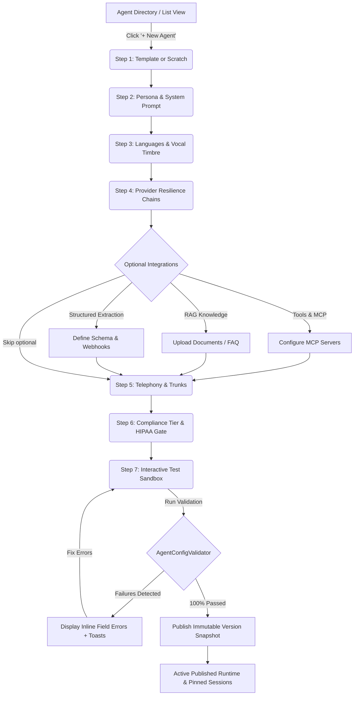
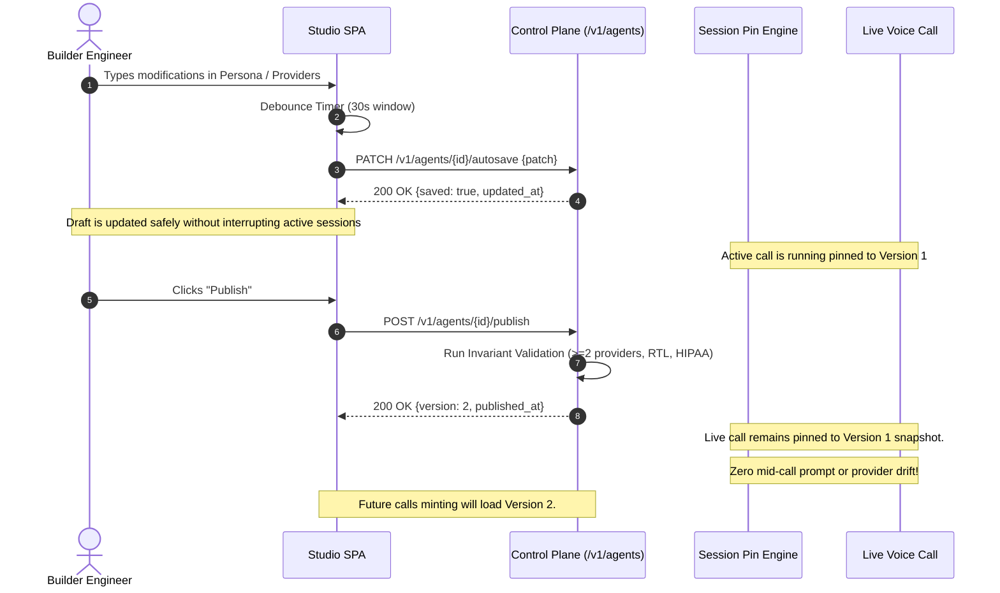
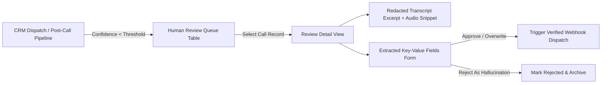

# UCVE Agent Studio — Wireflows & Interaction Architecture

## 1. Primary Agent Builder Wizard Wireflow

The Agent Studio guides developers and tenant admins through a sequential, state-validated creation and publishing journey.

---

## 2. Draft Autosave & Concurrent Edit State Flow

---

## 3. Human Review Queue Navigation Flow

