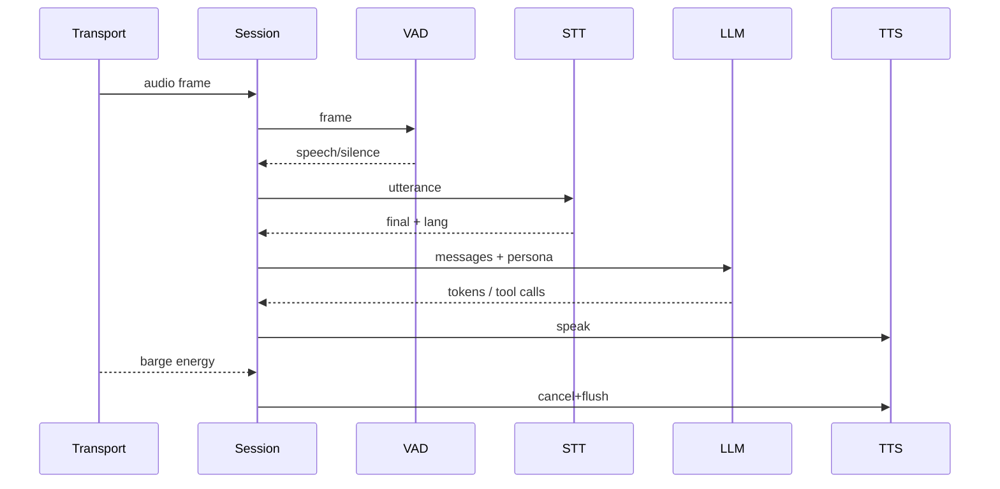

# Target Unified Core Voice Engine

> Aspirational blueprint. Does **not** exist yet. Living doc — adapt freely during build (see `cursor_rules_and_skills.md`).

## 1. Target Architecture

```
                    ┌─────────────────────────────────────┐
                    │         Agent Config (JSON)         │
                    │  persona · langs · tools · CRM schema│
                    └─────────────────┬───────────────────┘
                                      ▼
┌──────────────┐   ┌──────────────────────────────────────────┐
│  Transports  │──▶│              Session Runtime               │
│  (pluggable) │   │  state machine · barge-in · language route │
└──────────────┘   └────────────┬─────────────┬────────────────┘
                                │             │
              ┌─────────────────┘             └─────────────────┐
              ▼                                                   ▼
┌─────────────────────────┐                     ┌─────────────────────────────┐
│ Path A: Cascaded        │                     │ Path B: Dual S2S            │
│ STT → LLM → TTS         │                     │ Speech-to-Speech (provider) │
│ (harvest V3/MULTI/HAB)  │                     │ (future; feature-flagged)   │
└─────────────────────────┘                     └─────────────────────────────┘
              │                                                   │
              └─────────────────────┬─────────────────────────────┘
                                    ▼
                    ┌───────────────────────────────┐
                    │ Post-Call Intelligence + CRM  │
                    │ extract · summarize · vector  │
                    │ memory · webhooks             │
                    └───────────────────────────────┘
```

### Cascaded pipeline (MVP)
1. **Ingress** PCM/Opus frames via transport adapter
2. **VAD** — MULTI hybrid (Silero pool + Energy + AdaptiveNoiseGate); V3 numbers as defaults (0.55 / 250ms / 512)
3. **STT** — Gladia (ur: CS=False per HAB CER; multi-lang packs from MULTI YAML)
4. **LanguageRouter** — MULTI consecutive-detection rules
5. **LLM** — pluggable (Gemini/Groq); HAB `_PERSONA_FRAME` isolation; MULTI `prompt_builder`
6. **TTS** — MULTI `tts_manager` failover + circuit breaker; V3 Uplift stream framing
7. **Barge-in** — MULTI verified pause (700ms / 0.3s sustain) + V3 cancel/flush; **fix D4** (use barge final as next turn)
8. **Egress** — audio + control events (`barge_in`, `language_changed`, `end_call`)

### Dual S2S (phase 2)
- Parallel path behind feature flag; same transport + session state
- Shared barge-in / end-call / tools surface
- Fallback to cascaded on S2S failure



---

## 2. Pluggable Transport Layer

Interface (sketch): `TransportGateway` — `connect`, `send_audio`, `send_control`, `on_audio`, `on_control`, `close`.

| Adapter | Role | Harvest from |
|---------|------|--------------|
| `LiveKitWebRTC` | Browser/mobile rooms, agent dispatch | HAB mint + SDK + worker |
| `NativeWebSocket` | Raw PCM 16k (lab/demo) | V3/MULTI `/ws/audio` |
| `TwilioMediaStream` | PSTN via Twilio WS media | **NEW** (absent today) |
| `DirectSIP` | SIP trunking | HAB Telnyx/LiveKit SIP patterns |

Rules:
- Session Runtime **must not** import transport SDKs directly
- Auth at gateway edge (HAB HMAC/JWT for LiveKit; token for WS)
- Codec negotiation per adapter (PCM16 vs Opus)

---

## 3. Post-Call CRM & Intelligence Spec

Triggered on `call_ended` / tool `end_conversation_summary`.

| Stage | Spec |
|-------|------|
| **Entity extraction** | Schema-driven JSON (AWAZ `extraction.ts` pattern); provider Groq/Gemini |
| **Appointment validation** | Declarative rules in agent JSON (required fields, timezone, conflict hooks) |
| **Summarization** | Structured summary + disposition + sentiment optional |
| **Longitudinal memory** | Vector store per `tenant_id` + `contact_id` (ABSENT today — new) |
| **Webhook dispatch** | Signed webhooks → tenant CRM; WhatsApp optional (AWAZ Green API) |
| **Persistence** | HAB-style transcript JSONB + `usage_events` metering |

Minimal event envelope:
```json
{
  "tenant_id": "", "session_id": "", "agent_id": "",
  "started_at": "", "ended_at": "",
  "transcript": [], "entities": {}, "summary": "",
  "disposition": "", "usage": {"stt_s":0,"tts_s":0,"llm_tok":0}
}
```

---

## 4. Omnichannel / Multi-Tenant Model

### Declarative Agent Builder (JSON)
```json
{
  "agent_id": "",
  "tenant_id": "",
  "persona": {"name":"", "system":"", "locale_default":"ur"},
  "languages": ["ur","en"],
  "pipeline": {"mode":"cascaded"|"s2s", "stt":"", "llm":"", "tts":""},
  "vad": {"threshold":0.55, "min_speech_ms":250, "min_silence_ms":250},
  "tools": [{"name":"", "mcp_server":"", "schema":{}}],
  "crm_schema": {},
  "webhooks": [{"url":"", "events":["call_ended"]}],
  "quota": {"max_minutes_month":0}
}
```

### MCP tool execution
- ABSENT in all 4 repos today → add MCP client in Session Runtime
- Tools from agent JSON + HAB-style built-ins (`escalate_to_human`, `end_conversation_summary`)
- Never block event loop (fix HAB D9 — async DB)

### Client SDK boundaries
| Surface | Owns |
|---------|------|
| `@vertex/voice` (evolve HAB SDK) | Room join, mic publish, control events, reconnect |
| Control plane | Mint, quota, agent CRUD, telephony provision |
| Worker | Pipeline only — no tenant secrets in browser |
| Dashboard | Clerk UI (AWAZ patterns) — never trusts client `x-role` (fix D13) |

### Tenancy invariants
- HMAC mint + short JWT (HAB)
- Distributed rate limit (Redis — replace in-memory `_hits`)
- Persona isolation (HAB `_PERSONA_FRAME`)
- Capability matrix with **no silent fallback** (HAB registry)
