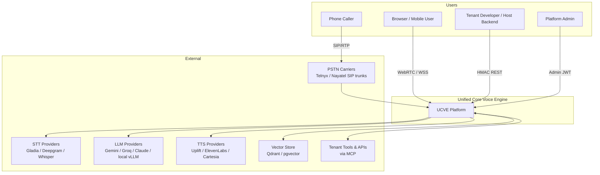
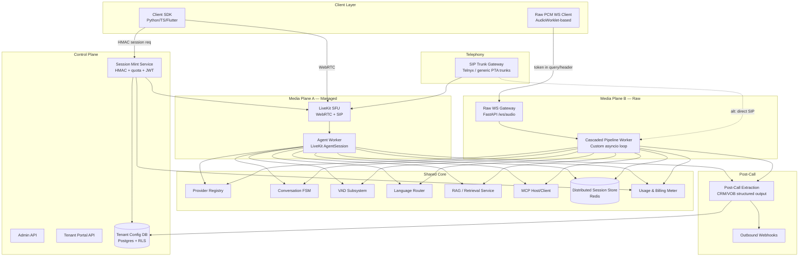
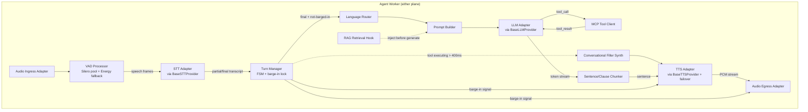

# 01 — System Topology & Architecture

**Codename:** Unified Core Voice Engine (UCVE)
**Status:** Master blueprint, synthesized from `AUDIT_01`–`AUDIT_05` of four legacy codebases (`AI_voice_agent_v3 - gemini`, `awaazlabs`, `Multilingual_AI_Voice_Agent_gittracked`, `habiba-sdk-agent`).
**Reading order:** This is File 1 of 9. Read alongside `09_DEVELOPER_IMPLEMENTATION_ROADMAP_AND_AUTONOMY_RULES.md` for how this topology gets built in phases, and see that file's closing **Autonomy & Non-Dogmatic Directive** — these 9 files are a strategic blueprint, not immutable dogma; the implementing agent (Cursor) has explicit license to adapt them against ground truth found in the real codebases.

> Every design decision below is annotated with which legacy repo it's harvested from, or flagged `[NEW]` if it fills a gap that AUDIT_05 §3 found absent in all four. This is not aspirational hand-waving — it is a build plan grounded in inspected code.

---

## 1. Why this topology (in one page)

The audits converged on a clear picture: **no single legacy repo is the unified engine, but their union covers almost everything needed.**

- `habiba-sdk-agent` (Modularity 8/10) already has the shape of a multi-tenant control plane: HMAC-signed session minting, quota, RLS-scoped tenant config, a real provider registry, and dual transport (LiveKit WebRTC + Telnyx SIP). This becomes the **skeleton** of UCVE's control plane and worker.
- `Multilingual_AI_Voice_Agent_gittracked` (Modularity 7/10) has the most complete **in-process pipeline**: a Silero pool with energy-VAD fallback, a language router with debounce, and a TTS failover manager with a circuit breaker. This becomes the reference implementation for UCVE's **cascaded pipeline mode** (as opposed to the LiveKit-delegated mode habiba uses).
- `AI_voice_agent_v3 - gemini` (Modularity 3/10) is architecturally the weakest (concrete construction, no interfaces) but has the **cleanest, most explicit barge-in lock protocol** of the four — worth extracting as a pattern even though the surrounding code isn't portable wholesale.
- `awaazlabs` (Modularity 5/10) turned out **not to be a voice pipeline at all** (AUDIT_02 §1 scope note) — it's a Retell-AI post-call operations CRM. It contributes the **post-call structured-extraction and CRM/webhook pattern**, not any part of the real-time audio path.

UCVE therefore has two coexisting execution planes, not one:

1. **Managed transport plane** — LiveKit-mediated WebRTC + SIP, à la habiba. Best for browser/mobile clients and PSTN, gets jitter buffering, SFU, and interruption detection "for free" from LiveKit.
2. **Raw transport plane** — a direct FastAPI WebSocket PCM loop, à la v3/multilingual. Kept alive deliberately for: embedded/IoT clients that can't do WebRTC, ultra-low-overhead single-tenant deployments, and as the reference implementation for teams who don't want a LiveKit dependency.

Both planes terminate in the **same** pluggable pipeline core (File 3), the **same** FSM (File 2), and the **same** provider registry — this is the actual point of "unification."

---

## 2. C4 Model

### 2.1 Context diagram



**Provenance:** the Tenant/HMAC boundary and Admin plane are lifted directly from `habiba-sdk-agent/control_plane/` and `admin/` (AUDIT_04 §4). VectorDB and Tools/MCP are `[NEW]` — AUDIT_05 §3 confirms zero RAG/MCP implementation across all four repos.

### 2.2 Container diagram



**Provenance map:**

| Container | Source pattern | Audit citation |
|---|---|---|
| Mint | `control_plane/mint.py` + `app.py` HMAC/quota/dispatch | AUDIT_04 §3, §4 |
| ConfigStore (RLS) | `worker/config.py` RLS tenant load | AUDIT_04 §3 state |
| LiveKitCloud + WorkerLK | `worker/main.py` `AgentSession` | AUDIT_04 §1, §3 |
| GatewayWS + WorkerRaw | `transport/websocket.py` SessionOrchestrator pattern | AUDIT_01 §1, §3; AUDIT_03 §1, §3 |
| Registry | `worker/providers/registry.py` | AUDIT_04 §6 modularity |
| VADCore | `services/vad/vad_service.py` pool + energy fallback | AUDIT_03 §2 VAD |
| LangRouter | `orchestration/language_router.py` | AUDIT_03 §1, §3 language |
| SIPGw | `worker/telephony_runtime.py` + `tenant_portal_api/telephony_routes.py` | AUDIT_04 §4 telephony |
| Extractor | `transcript-crm-poc/`, `transcript-vob-poc/` Groq extraction | AUDIT_02 §1, §2 LLM |
| Webhooks | Green API WhatsApp pattern generalized | AUDIT_02 §4 telephony-specific |
| SessionStore (Redis), RAGSvc, MCPHost | — | `[NEW]` — AUDIT_05 §3 gap analysis |
| UsageMeter | habiba `usage.py` / admin usage path, generalized cross-plane | AUDIT_04 §1 tree (`usage.py`), §4 admin; AUDIT_05 §3 (usage metering is **not** a four-repo gap — habiba emits it; Redis/shared cross-replica metering is `[NEW]`) |

### 2.3 Component diagram — inside a Worker (either plane)



**Provenance:** VAD dual-engine + pool from AUDIT_03 §2 VAD; TurnMgr barge-in lock semantics from AUDIT_01 §3 (`_barge_in` sequence) merged with AUDIT_03 §3 (700ms verification window — more robust, adopted as default); LangR from AUDIT_03 §2/§3; RAGHook/MCPClient/Filler are `[NEW]`, positioned at the exact injection points each audit's §6 RAG section already identified as viable (e.g., AUDIT_01 §6: "before `generate_reply` builds `gemini_contents`"; AUDIT_03 §6: `build_messages`).

---

## 3. Core Engine Design Pattern

### 3.1 Execution model

**Decision:** Async event-driven pipeline, asyncio-native, with a bounded thread-pool for CPU-bound inference (VAD) — not an actor model, not a raw multi-process worker pool per session.

**Rationale:** All four legacy repos independently converged on asyncio + `run_in_executor` for Silero (AUDIT_01 §1, AUDIT_03 §1, implicitly AUDIT_04 via LiveKit's own job-process model). None used actors. Reinventing an actor model would add complexity with no evidenced benefit over the pattern already proven in three of four codebases. LiveKit's job-process-per-session model (AUDIT_04 §1: `cli.run_app(WorkerOptions(entrypoint_fnc=entrypoint))`) is kept as-is for the managed plane since it already gives process isolation per tenant session for free.

### 3.2 Worker pools

| Pool | Purpose | Sizing | Provenance |
|---|---|---|---|
| Silero inference pool | CPU-bound VAD frame inference off the event loop | `min(4, cpu_count())` workers, model instances checked out/in — not one model per session | AUDIT_03 §1 `SileroModelPool` with `threading.Lock` (pool also referenced in AUDIT_03 §2 VAD), superior to AUDIT_01's per-session `torch.hub.load` (flagged as blocking risk, AUDIT_01 §5) |
| DB I/O pool | Sync psycopg calls off the event loop | `asyncio.to_thread` per call, not a dedicated pool — matches habiba's pattern | AUDIT_04 §1 `asyncio.to_thread`; **note the anti-pattern to avoid**: habiba's `tools.py:64,102` does sync `psycopg.connect` *inside* `async def` tool handlers without `to_thread` — AUDIT_04 §5 flags this as blocking the worker loop. UCVE must not repeat it. |
| HTTP client pool | STT/LLM/TTS provider calls | `aiohttp.TCPConnector(limit=20)` per provider client, one client per process not per session | AUDIT_01 §2 TTS (`uplift_service.py` `limit=20`) — good pattern; AUDIT_03 §5 flags the anti-pattern of *3 HTTP sessions per WebSocket session* in `TTSManager` — UCVE pools at the process level instead |

### 3.3 Distributed state management

**Gap identified:** AUDIT_05 §3 confirms no Redis/distributed store in any of the four repos — session state is either in-process (v3, multilingual: lost on crash/restart) or Postgres-only (awaazlabs, habiba: correct for durable state but too slow/heavy for hot per-turn conversational state and completely absent for the mint rate-limiter, which AUDIT_04 §5 documents as an in-process `_hits` dict that breaks under horizontal scaling).

**Decision `[NEW]`:**

- **Postgres** (habiba pattern, AUDIT_04 §3): source of truth for `sessions`, `agents`, `tenants`, `usage_events`, transcripts (durable, RLS-scoped).
- **Redis** (new): hot conversational state (turn history for context assembly, FSM state, rate-limit counters, mint nonce replay cache — replacing habiba's in-process 60s replay window, AUDIT_04 §3 handshake step 4, with a shared TTL key so it works across replicas), and pub/sub for barge-in signals if a session's ingress and egress ever live on different processes.

### 3.4 Pluggable Transport Gateway `[NEW — supersedes the fixed two-plane split above]`

The two-plane split in §1–2 (managed LiveKit plane vs. raw WS plane) is real and stays, but it should not be hardcoded as "only two options forever." Both planes are implementations of a single abstraction so a third, fourth, or fifth transport can be added without touching pipeline core, FSM, or provider registry.

```python
class BaseTransportGateway(ABC):
    """Every transport adapter normalizes to this surface. The pipeline core
    (VAD → STT → LLM → TTS, File 2/3) never imports a transport-specific type."""

    @abstractmethod
    async def accept_session(self, session_ctx: SessionContext) -> None: ...

    @abstractmethod
    async def stream_in(self) -> AsyncIterator[AudioFrame]:
        """Yields normalized 16kHz mono PCM16 frames regardless of wire format."""

    @abstractmethod
    async def stream_out(self, frame: AudioFrame) -> None:
        """Accepts normalized PCM from TTS; adapter handles resample/transcode/codec."""

    @abstractmethod
    async def send_control(self, event: ControlEvent) -> None:
        """control.barge_in, control.hangup, control.ping, transcript, metric —
        same control vocabulary across all transports (unifies AUDIT_01/03's
        legacy control/barge_in wire shape and AUDIT_04's SDK events into one
        enum; canonical names in File 8 §3)."""

    @abstractmethod
    async def close(self, reason: str) -> None: ...
```

| Adapter | Wraps | Provenance | Wire format normalized from |
|---|---|---|---|
| `LiveKitWebRTCTransport` | LiveKit `AgentSession` | AUDIT_04 §1, §3 | Opus/WebRTC via LiveKit SFU |
| `NativeWebSocketTransport` | Raw FastAPI `/ws/audio` | AUDIT_01 §2/§4; AUDIT_03 §2/§4 | PCM16LE binary frames (512-sample chunks per AUDIT_01 §2, variable-length per AUDIT_03 §2 — adapter normalizes both) |
| `TwilioMediaStreamTransport` | Twilio `<Stream>` WS | `[NEW]` — grep-confirmed absent in all four repos (AUDIT_01/02/03/04 telephony sections) | 8kHz μ-law base64 JSON frames → resampled to 16kHz PCM16 |
| `DirectSIPTransport` | Telnyx / generic SIP trunk via RTP | AUDIT_04 §4 telephony (Telnyx pattern), generalized beyond LiveKit-mediated SIP | G.711 μ-law/A-law RTP → PCM16 |

**Why this matters even though only two adapters exist in the harvested code today:** AUDIT_04's header note explicitly caught the original protocol's assumption of "Twilio/Asterisk" when the actual code was Telnyx+LiveKit SIP (AUDIT_04 §1 scope note) — i.e., the legacy naming was already aspirational versus real. Building the abstraction now means the *next* transport (Twilio, Asterisk/FreeSWITCH direct, a future WebTransport-based client) is a new adapter class, not a pipeline rewrite.

### 3.5 Multi-tenant session isolation

Adopted wholesale from habiba (AUDIT_04 §1, §3, Modularity 8/10 justification #2 — transport/control-plane split; justification #1 is the provider registry, File 3): HMAC-signed session mint → short-TTL JWT (120s) → explicit named-agent dispatch → RLS `set local role authenticated` on tenant config load (`worker/config.py:60–76`). Extended `[NEW]` to also gate the raw-PCM plane (v3/multilingual had **zero** auth on `/ws/audio` — AUDIT_01 §3 handshake step 2, AUDIT_03 §3 handshake — this is fixed in UCVE, not inherited).

---

## 4. Latency Budget Breakdown

Target: **<450ms end-to-end** from user speech-end to first audio byte played (TTFB), matching the mandate in the master prompt. This is stricter than anything *measured* in the audits — all four repos explicitly could not have real-world latency verified statically (AUDIT_01 §2 TTS: "NOT MEASURABLE VIA STATIC AUDIT"; same in AUDIT_04 §2 TTS). The budget below is therefore a **design target**, not a claim about legacy performance, and must be validated against File 9 §3's benchmarking harness once built.

| Stage | Budget (ms) | Notes | Provenance |
|---|---|---|---|
| Network (client→edge) | 30–60 | WebRTC via LiveKit SFU or raw WS; varies by client network | LiveKit path: AUDIT_04 §2 transport |
| VAD end-of-speech confirmation | 20–50 | Silero frame (32ms per AUDIT_01 §2) + hysteresis; multilingual's 250ms speech-onset is *onset* not *offset* latency | AUDIT_01 §2 VAD (512-sample/32ms window); AUDIT_03 §2 VAD |
| STT finalization | 150–250 | Gladia endpointing `0.2s` in v3 + multilingual; habiba's analogous LiveKit `endpointing.min_delay=0.2s` (not Gladia) | AUDIT_01 §2 STT; AUDIT_03 §2 STT; AUDIT_04 §2 VAD (`endpointing.min_delay`) |
| LLM time-to-first-token | 100–200 | Provider-dependent; Groq/Cerebras favored for TTFT-sensitive paths per provider abstraction (File 3) | Groq usage in AUDIT_03 §2 LLM, AUDIT_04 §2 LLM (en path) |
| Sentence chunker | <5 | In-process regex/heuristic split, negligible — v3's chunker splits at 10-word fallback, multilingual's at 2-word first-chunk override for low TTFT | AUDIT_01 §2 LLM (chunker); AUDIT_03 §2 (first chunk min 2 words); AUDIT_05 §2 (TTFT override rationale) |
| TTS time-to-first-byte | 100–200 | Provider-dependent; Uplift/Cartesia/ElevenLabs streaming | AUDIT_01 §2 TTS; AUDIT_03 §2 TTS failover |
| Playback buffer / jitter | 20–50 | Client-side prebuffer; v3/multilingual use a 3-chunk (~280ms) prebuffer which is **too conservative** for the 450ms target and should be reduced to 1–2 chunks with adaptive jitter compensation | AUDIT_01 §2 (client jitter prebuffer 3 chunks); AUDIT_03 §2 (same, 3 chunks) |
| **Total (cascaded pipeline)** | **~420–815** | Upper bound exceeds target under provider latency variance — this is *why* File 3 mandates a fallback-routing SLA (auto-switch provider past a latency threshold) | `[NEW]` synthesis of above |
| **Alternative: S2S multimodal path** | **~200–350** | Direct speech-to-speech (Gemini Multimodal Live / OpenAI Realtime) skips discrete STT→LLM→TTS hops entirely | `[NEW]` — no legacy repo implements S2S; see File 3 §5 |

**Design implication:** the cascaded pipeline realistically lands in the 450–800ms range on the low-latency end of provider variance, not reliably under 450ms. UCVE's provider abstraction (File 3) must support **both** cascaded and S2S multimodal paths behind the same interface, with S2S as the preferred path for pure-conversation turns and cascaded pipeline retained for turns requiring tool-calling/RAG (where intermediate text is needed for tool routing) and for languages/voices not yet supported by S2S providers (e.g., Uplift Urdu TTS, AUDIT_01 §2 TTS, AUDIT_04 §2 TTS ur-path — no S2S provider covers this today).

---

## 5. Directory-Tree Skeleton (preview — full tree in File 9 §1)

> Corrected during finalization pass: previously said "File 8"; canonical monorepo tree lives in File 9 §1 (File 8 is Agent Builder & SDK).

```text
unified-core-voice-engine/
├── control-plane/       # habiba-pattern: mint, quota, RLS config, admin
├── worker-managed/       # LiveKit AgentSession worker (managed transport plane)
├── worker-raw/            # Cascaded-pipeline worker (raw PCM WS plane)
├── core/                  # Shared: registry, FSM, VAD, language router, RAG, MCP host
├── telephony-gateway/      # SIP/Telnyx bridge, transcoding
├── sdk/{python,typescript,flutter}/
├── post-call/              # Structured extraction (awaazlabs-pattern), webhooks
├── admin-dashboard/
├── tests/
└── infra/                  # Docker, Helm, Terraform
```

---

## 6. Cross-File Index

| Concern | File |
|---|---|
| Audio buffers, FSM, barge-in protocol detail | `02_CORE_AUDIO_ENGINE_AND_STATE_MACHINE.md` |
| Provider interfaces, hot-swap, S2S | `03_PLUGGABLE_PROVIDER_ABSTRACTION.md` |
| Code-switching, phoneme normalization | `04_MULTILINGUAL_AND_CODE_SWITCHING_ENGINE.md` |
| Post-call extraction, CRM dispatch, longitudinal RAG | `05_POST_CALL_INTELLIGENCE_AND_CRM_PIPELINE.md` |
| MCP + real-time RAG detail | `06_MCP_SERVER_AND_REALTIME_RAG_SPEC.md` |
| Telephony, transcoding, WebRTC/SIP/Twilio signaling | `07_TELEPHONY_AND_TRANSPORT_INFRASTRUCTURE.md` |
| Agent builder schema, API, SDK method signatures | `08_UNIVERSAL_AGENT_BUILDER_AND_SDK_SPEC.md` |
| Directory tree, sprints, benchmarks, deployment, autonomy directive | `09_DEVELOPER_IMPLEMENTATION_ROADMAP_AND_AUTONOMY_RULES.md` |
