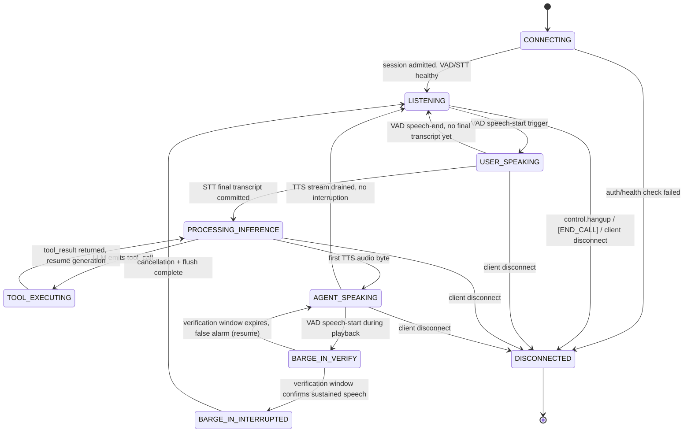

# 02 — Core Audio Engine & State Machine

File 2 of 9. Depends on `01_SYSTEM_TOPOLOGY_AND_ARCHITECTURE.md` for the transport gateway abstraction that feeds this engine normalized PCM regardless of wire transport.

---

## 1. Audio Buffer Management

### 1.1 Ring buffers & queue sizing

Every legacy repo used bounded `asyncio.Queue`s at transport boundaries — this pattern is retained and standardized. The audits also surfaced **inconsistent overflow policy** between repos, which UCVE resolves explicitly rather than by accident.

| Buffer | Legacy default | Legacy overflow policy | UCVE policy | Rationale |
|---|---|---|---|---|
| Inbound (mic→VAD/STT) | maxsize 100 | drop-oldest | **drop-oldest**, maxsize 100 | AUDIT_01 §5, AUDIT_03 §5 both use drop-oldest here — correct choice, since stale mic audio is worse than a gap |
| VAD queue | maxsize 50 (v3) / 200 (multilingual) | drop-oldest (v3) / **drop-newest** (multilingual, `put_nowait` fails silently) | **drop-oldest**, maxsize 100 | AUDIT_03 §5 explicitly flags multilingual's drop-newest as inconsistent with v3 — UCVE standardizes on drop-oldest everywhere inbound so VAD always sees the most recent audio |
| Outbound (TTS→client) | maxsize 200 | **blocking put** (backpressure) | **blocking put**, maxsize 200 | AUDIT_01 §5: "Sender backpressure — `await queue.put` blocks TTS" — correct: dropping *outgoing speech* would create audible corruption; better to backpressure the TTS producer |
| Transcript queue (STT→turn manager) | **unbounded** in v3 (`_transcript_queue`); multilingual Gladia transcript queue maxsize 50 | n/a / put can block | **bounded**, maxsize 200, drop-oldest-partial/keep-all-final | Live: v3 `gladia_service.py:131` `asyncio.Queue()` (no maxsize); MULTI `gladia_service.py` transcript callbacks + session path are bounded. Do **not** conflate this with `_SentenceBridge` — that is LLM-sentence→TTS (`websocket.py:33–36` unbounded in v3; MULTI `session.py:25–27` maxsize 50). Finals are never dropped (policy in this cell); only partials are subject to the bound. |

### 1.2 Resampling

Legacy repos ran two fixed rate pairs: 16kHz in / 22050Hz out (v3, multilingual — AUDIT_01 §2, AUDIT_03 §2), and an opaque LiveKit-internal rate (habiba — AUDIT_04 §2, explicitly "NOT VERIFIED at frame level" since those constants live in the vendored plugin). Telephony introduces an 8kHz μ-law leg that none of the four repos handle at all (AUDIT_05 §3 gap: Twilio Media Streams / TwiML absent in all four).

**UCVE internal canonical rate: 16kHz mono PCM16.** All adapters resample to/from this at the transport boundary (File 1 §3.4).

```python
class Resampler:
    """Wraps a small linear/polyphase resampler. Not a from-scratch DSP
    implementation — bind to a proven library (e.g. `soxr` or `resampy`)
    rather than reinventing filter design."""

    SUPPORTED_RATES = {8000, 16000, 22050, 24000, 44100, 48000}

    def __init__(self, source_rate: int, target_rate: int = 16000):
        assert source_rate in self.SUPPORTED_RATES
        assert target_rate in self.SUPPORTED_RATES
        self.source_rate = source_rate
        self.target_rate = target_rate

    def process(self, pcm16_bytes: bytes) -> bytes: ...
```

| Leg | Source rate | Target (canonical) | Codec conversion needed | Provenance |
|---|---|---|---|---|
| Browser mic (raw WS plane) | 44.1/48kHz native, worklet-decimated to 16kHz client-side | 16kHz | none (client already resamples) | AUDIT_01 §2 (`sampleRate / 16000` decimation), AUDIT_03 §2 |
| Browser mic (LiveKit plane) | Opus, variable | 16kHz | Opus decode + resample | `[NEW]` — not in-repo per AUDIT_04 §2 |
| Telephony (SIP/Twilio) | 8kHz μ-law/A-law | 16kHz | μ-law→PCM16 expand + 8→16kHz upsample | `[NEW]` — see File 7 §2 for exact transcoding math |
| TTS output (Uplift) | 22050Hz PCM16 | passthrough to client, or 16kHz for re-ingestion (e.g. echo cancellation reference) | conditional | AUDIT_01 §2 TTS, AUDIT_03 §2 TTS |
| TTS output (ElevenLabs/Cartesia) | provider-dependent (commonly 24kHz/44.1kHz) | conditional | resample per provider capability table (File 3) | AUDIT_04 §2 TTS (en providers) |

### 1.3 Audio chunk packaging

```python
@dataclass(frozen=True)
class AudioFrame:
    pcm16: bytes           # canonical 16kHz mono PCM16LE
    sample_rate: int       # always 16000 post-adapter-normalization
    timestamp_ms: float    # monotonic clock, for jitter/latency measurement
    sequence: int          # for reorder detection — NONE of the 4 legacy repos
                            # implement RTP-style sequence numbers (AUDIT_01 §5:
                            # "no RTP sequence numbers"); UCVE adds this at the
                            # canonical-frame level regardless of transport.
```

Recommended frame size: **512 samples / 32ms** at 16kHz — this matches v3's mic chunking (AUDIT_01 §2: "512 samples = 32ms = 1024 bytes") and Silero's native window (AUDIT_01 §2 VAD: "Window size 512 samples"), avoiding the resampling-then-rebatching cost that multilingual's variable-length frames incur (AUDIT_03 §2: "variable-length frames (no 512-sample batching unlike v3)").

---

## 2. Finite State Machine

### 2.1 States



**Provenance and deltas from legacy:**

- `LISTENING`/`THINKING`/`SPEAKING` is the three-state core used by v3 (AUDIT_01 §3: "Call FSM `LISTENING`/`THINKING`/`SPEAKING`") and multilingual (AUDIT_03 §3: `CallStateManager`). UCVE renames `THINKING`→`PROCESSING_INFERENCE` and splits it to expose `TOOL_EXECUTING` as a distinct sub-state — neither legacy repo has tool-calling in the raw-PCM path to model (only habiba does, via LiveKit's own session internals, AUDIT_04 §2 LLM: "Tool-calling: IMPLEMENTED"), so this is `[NEW]` but directly serves File 6's MCP filler-utterance requirement (play "let me check that..." only while in `TOOL_EXECUTING`).
- `BARGE_IN_VERIFY` as an explicit state (rather than an inline sleep) is adopted from multilingual's two-path design (AUDIT_03 §3: "VAD verification: pause playout → 700ms → if active or duration ≥0.3s → resume then `_barge_in`; else resume"), which is more robust than v3's design, where the barge-in gate is a boolean check rather than a state (AUDIT_01 §2: "Barge-in gate: trigger AND (`THINKING`/`SPEAKING` OR `time < _speaking_until`)" — no explicit verification window, i.e. any VAD trigger during playback immediately barges in, which is more prone to false positives from background noise).
- **`CONNECTING` as an explicit gate state is `[NEW]`.** v3 rejects the WS connection outright if Silero is unhealthy (AUDIT_01 §3 handshake step 5) and multilingual does the same even though it has an energy-VAD fallback available (AUDIT_03 §2 VAD: "Connection gate: rejects WS if Silero unhealthy even though Energy fallback exists" — flagged as an inconsistency). UCVE's `CONNECTING` state explicitly permits degraded admission (fall back to energy VAD, surface a `degraded: true` flag to the client) rather than hard-rejecting, closing that gap.

### 2.2 Invalid transition handling

**Bug fixed from legacy:** multilingual's state machine logs a warning on an invalid transition but **applies it anyway** (AUDIT_03 §3 state table: "Invalid transitions: logged then still applied — `if not valid: warning` then `_state = new_state`"; AUDIT_03 §6 restates as "State machine does not enforce guards"). This is a state-machine correctness bug — a logged warning that doesn't actually prevent the bad transition provides zero real protection.

**UCVE fix:** invalid transitions raise `InvalidStateTransitionError`, are logged with full context (session id, from-state, to-state, triggering event), and the FSM remains in its prior state. Callers must handle the exception or catch a defined "was this transition legal?" check before triggering side effects (e.g., don't start TTS playback before confirming the state actually moved to `AGENT_SPEAKING`).

---

## 3. Barge-in & Cancellation Protocol

This is the single most load-bearing pattern harvested from the audits — v3's explicit lock-based sequence (Modularity 3/10 overall, but AUDIT_05's Best-of-Breed Harvest still calls out its barge-in constants and lock protocol as portable, AUDIT_05 §2 VAD) merged with multilingual's verification window (AUDIT_03 §3) and reconciled with habiba's LiveKit-delegated approach (AUDIT_04 §3) for the managed transport plane.

### 3.1 Sequence (raw-PCM / cascaded pipeline plane)

```mermaid
sequenceDiagram
    participant VAD
    participant TurnMgr as Turn Manager
    participant LLM as LLM Task
    participant TTS as TTS Task
    participant Sender as Audio Sender
    participant Client

    VAD->>TurnMgr: speech-start trigger during AGENT_SPEAKING
    TurnMgr->>TurnMgr: enter BARGE_IN_VERIFY, pause (not cancel) TTS playout
    Note over TurnMgr: wait up to 700ms (multilingual constant, AUDIT_03 §3)
    alt sustained speech >= 300ms
        TurnMgr->>TurnMgr: enter BARGE_IN_INTERRUPTED
        TurnMgr->>TurnMgr: _interrupt_event.set() (shared atomic flag)
        TurnMgr->>LLM: cancel in-flight generation task
        TurnMgr->>TTS: cancel active synthesis (cancel_active())
        TurnMgr->>Sender: flush() — drain outbound queue
        TurnMgr->>Client: send control.barge_in
        TurnMgr->>VAD: reset()
        TurnMgr->>TurnMgr: _speaking_until = 0; state -> LISTENING
    else false alarm (<300ms or speech stops)
        TurnMgr->>TurnMgr: resume TTS playout, state -> AGENT_SPEAKING
    end
```

**Provenance, line by line:**

| Step | Legacy source | Citation |
|---|---|---|
| Shared atomic interrupt flag | v3 `_interrupt_event.set()`, shared between orchestrator and `AudioSender` | AUDIT_01 §3 barge-in step 1 |
| Cancel + await LLM/turn tasks before proceeding | v3 `_barge_in` sequence | AUDIT_01 §3 barge-in step 3 |
| `audio_sender.flush()` drains outbound queue | v3 | AUDIT_01 §3 barge-in step 4; multilingual same pattern, AUDIT_03 §3 path B |
| Explicit legacy `{type:control, action:barge_in}` message to client (UCVE wire name: `control.barge_in`, File 8 §3) | v3 + multilingual, identical payload shape | AUDIT_01 §4 WS catalog; AUDIT_03 §4 WS catalog |
| `vad.reset()` | v3 + multilingual | AUDIT_01 §3 step 6; AUDIT_03 §3 path B |
| 700ms verification window + 300ms sustained-speech threshold before committing to interruption | multilingual only — v3 has no verification window (immediate barge-in on any VAD trigger) | AUDIT_03 §3 path A: "pause 700ms → if active or duration ≥0.3s" |
| Re-entrancy guard (`_barge_in_active` flag preventing double-fire) | multilingual | AUDIT_03 §3: "Re-entrancy guard `_barge_in_active`" |
| Text-based backup trigger (final transcript >3 words during THINKING/SPEAKING, in case VAD misses it) | multilingual | AUDIT_03 §3 path C |

**Deliberate fix, not inherited:** v3 has a documented gap where the *utterance that triggered the barge-in* is discarded — `_on_transcript` ignores final transcripts arriving during `_speaking_until`, so the user has to repeat themselves (AUDIT_01 §3: "the barge-in utterance that triggered VAD is **not** used as the next turn's user text"). UCVE's Turn Manager explicitly buffers the STT stream through the barge-in transition and re-submits the first post-interruption final transcript as the new turn's input — this is a correctness fix, not a legacy pattern.

### 3.2 Sequence (managed transport / optional SFU plane)

When an optional LiveKit (or other SFU) adapter is in use, **media** interruption may use the SFU's detector — habiba's LiveKit knobs (AUDIT_04 §3: "IMPLEMENTED via LiveKit AgentSession, not custom queue flush"):

| Parameter | Value | Provenance |
|---|---|---|
| `interruption.mode` | `"adaptive"` | AUDIT_04 §2 VAD |
| `false_interruption_timeout` | `0.7s` (matches multilingual's 700ms independently) | AUDIT_04 §2 VAD |
| `resume_false_interruption` | `False` — don't resume the old sentence after a false interrupt | AUDIT_04 §3 |
| `endpointing.min_delay` | `0.2s` | AUDIT_04 §2 VAD |

Those knobs are **hints to the media adapter**, not a substitute for File 2's FSM. UCVE's Turn Manager still owns `BARGE_IN_VERIFY` / `control.barge_in` (File 1 §3.6 Tier 0; vocabulary File 8 §3). If the SFU is down, the sovereign plane already runs the full v3/MULTI lock protocol (§3.1). Do not inherit habiba's "hard to run without LiveKit" coupling (AUDIT_04 §6).

### 3.3 Atomicity guarantee

**Requirement:** cancellation must be atomic with respect to audio delivery — no audio frame generated *after* the cancel signal may reach the client. This is the failure mode a partial implementation would produce (agent keeps talking for one more sentence after the user starts speaking).

**Mechanism:** the `_interrupt_event` (or transport-native equivalent) is checked at three independent points, not just one, closing races that a single check-point design could hit:

1. **Producer side (TTS task):** `iter_chunked` loop checks the cancel token before each yield (v3 pattern: `uplift.cancel()` sets `_cancel_evt`, aborting the HTTP stream mid-read — AUDIT_01 §3 barge-in step 2).
2. **Queue side (Sender):** the send loop drops already-dequeued chunks if the interrupt flag is set, even if they were enqueued before the flag flipped (AUDIT_01 §5: "Send loop drops already-dequeued chunks if interrupt is set").
3. **Transport side:** the client-side player also honors an explicit `flush: true` signal and discards any in-flight binary frame that arrives after it (AUDIT_01 §3: "Client sets `bargeInActive`, Worklet `{flush:true}`, discards in-flight binary").

This three-point check is a direct synthesis of v3 and multilingual's independently-converged designs (AUDIT_01 §3, AUDIT_03 §3 path B) — both arrived at "check in more than one place" without an explicit interface for it; UCVE makes it a documented contract (`CancellationToken`, checked at producer/queue/transport) rather than an emergent property of three separate ad hoc checks.

---

## 4. State Management (Session Memory)

| Concern | Legacy pattern | UCVE decision | Provenance |
|---|---|---|---|
| Turn history storage | In-process Python list, lost on crash (v3: `GeminiService.history`; multilingual: `GroqService.history`) | Redis-backed, TTL'd per session, checkpointed to Postgres at turn boundaries | AUDIT_01 §3 state; AUDIT_03 §3 state; gap fix per File 1 §3.3 |
| History pruning | List-length based: v3 keeps last 6 *entries* not 6 turns (AUDIT_01 §3: "default 6 messages, not 6 turns" — a naming/semantics bug); multilingual keeps "system + last 6" (AUDIT_03 §3) | Token-budget-aware pruning (actual context window accounting), not a fixed entry count | `[NEW]` fix — both legacy repos lack a token-window guard (AUDIT_01 §3, AUDIT_03 §3 both: "Context-window token guard: NOT IMPLEMENTED / ABSENT") |
| Persistence across reconnect | Absent in v3/multilingual (in-process only); habiba persists to Postgres `sessions` + transcript JSONB (AUDIT_04 §3) | Habiba pattern adopted as default for all planes | AUDIT_04 §3 state |
| Language-switch state | multilingual's `LanguageRouter` debounce (2-in-a-row for short utterances, immediate for ≥3 words) | Adopted as-is, detailed in File 4 | AUDIT_03 §3 language; AUDIT_05 §2 (Best-of-Breed: "Language router debounce") |

---

## 5. Anti-Patterns Explicitly Rejected (with citation)

This section exists because the audits found specific bugs that a naive re-synthesis would silently reproduce. Do not repeat these:

### 5.1 Sync blocking on the event loop at session init
**Synchronous blocking calls on the event loop at session-init time.** v3 does synchronous `open(prompt_path)` and a full `torch.hub.load` per session on the event loop (AUDIT_01 §5 blocking table). UCVE loads all such resources once at process startup (model pool, File 1 §3.2) or via `asyncio.to_thread`.

### 5.2 Fire-and-forget on must-await callbacks
**Fire-and-forget task creation for callbacks that must be awaited.** Multilingual's sentence-dispatch callback uses `create_task` where its own `Protocol` interface says it MUST be awaited (AUDIT_03 §5; live `groq_service.py:143–146` and the same break on Gladia transcript callbacks at `gladia_service.py:375–378`). UCVE's callback contracts are enforced with `await`, and any deliberate fire-and-forget use is explicitly named (`spawn_background_task`) so it's never accidental.

### 5.3 Secrets embedded in URLs
**Secrets embedded in URLs.** Multilingual's Google TTS request URL embeds the API key in the query string (AUDIT_03 §5 cited `google_service.py:16`, which is a dead module-level constant; the live request is `google_service.py:75`). UCVE never places credentials in a URL; always header-based auth via the provider adapter (File 3).

### 5.4 Unbounded per-session resource construction
**Unbounded per-session resource construction.** v3 constructs a fresh Silero model + Uplift HTTP client per session (AUDIT_01 §5; live `websocket.py:70–71`). Multilingual **does** pool Silero process-wide (`SileroModelPool`) but still constructs three TTS HTTP sessions per WebSocket session (`tts_manager.py:153–158`). UCVE pools at the process level (File 1 §3.2) and enforces habiba-style quota admission (File 1 §3.5) on every plane, not just the managed one.

> Corrected during finalization pass: renumbered as §5.1–§5.4 so File 9 §5 anti-pattern checklist links resolve.
