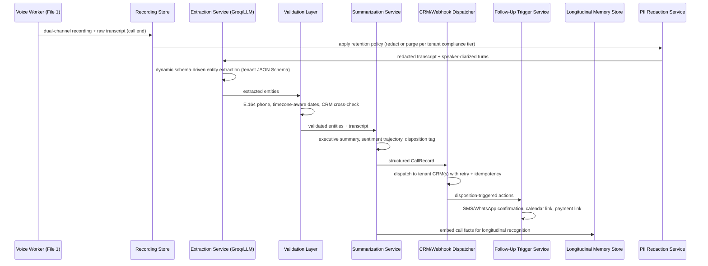

# 05 — Post-Call Intelligence & CRM Pipeline

File 5 of 9. This entire file's foundation is `awaazlabs`, which — despite being catalogued in the original audit protocol as an "enterprise VAD/turn-taking" repo — turned out on inspection to contain **zero** real-time voice pipeline code (AUDIT_02 scope note / preamble: "Static search of `silero|barge.?in|VoiceActivity|turn.?taking|pcm|AudioWorklet` across this tree returned 0 matches"). What it actually is turns out to be exactly what this file needs: a voice-AI **operations CRM** built around Retell AI webhooks, Supabase persistence, and Groq-based structured extraction (AUDIT_02 §1: "receives Retell HTTP webhooks... persists bookings/transcripts in Supabase, runs Groq JSON extraction for CRM and VOB"). None of the other three repos have any post-call pipeline at all — this is awaazlabs' unique contribution to the unified engine, generalized from a single clinic-domain implementation to a domain-agnostic one.

---

## 1. Pipeline Overview



**This is the pattern awaazlabs already runs, generalized:** its `retell-webhook` receives `call_started/transcript_updated/call_ended/call_analyzed` events (AUDIT_02 §4 telephony-specific), forwards to `transcript-crm-poc` and `transcript-vob-poc` Groq extraction functions (AUDIT_02 §1 dependency topology), persists to Supabase, and dispatches WhatsApp via Green API (AUDIT_02 §4: "Post-call WhatsApp — Green API `sendSmart`"). UCVE keeps this shape but makes the extraction schema, CRM target, and follow-up channel all tenant-configurable instead of hardcoded to one clinic's Dentrix-style workflow.

---

## 2. Dual-Channel Recording & Diarized Transcription

```python
class DiarizedTurn(BaseModel):
    speaker: Literal["agent", "user"]
    text: str
    start_ms: int
    end_ms: int
    confidence: float | None = None
    language: str | None = None            # per-turn, since a call can code-switch
                                             # (File 4) — no legacy repo tags this
                                             # at the post-call transcript level;
                                             # awaazlabs' Retell transcripts are
                                             # vendor-formatted, not diarized
                                             # in-repo (AUDIT_02 §1)


class CallRecording(BaseModel):
    call_id: str
    tenant_id: str
    recording_url: str                     # awaazlabs pattern: stored from Retell
                                             # `recording_url` variants (AUDIT_02 §4),
                                             # proxied for playback rather than stored
                                             # raw (AUDIT_02 §1: "recordings are fetched
                                             # by URL proxy for playback in the UI")
    dual_channel: bool = True               # agent/user on separate channels where
                                             # the transport supports it (telephony
                                             # legs typically do; browser WebRTC
                                             # single-stream calls fall back to
                                             # diarization-by-turn-boundary instead)
    turns: list[DiarizedTurn]
    duration_seconds: float
```

**Note on what's realistic:** true hardware dual-channel recording requires the telephony/transport leg to actually deliver separate agent/user audio streams. UCVE's `worker` (File 1) already has per-speaker turn boundaries from its own FSM (agent turns = `AGENT_SPEAKING` state spans, user turns = `USER_SPEAKING`/STT-final spans) — so diarization here is largely "free," reconstructed from the FSM's own state transition log rather than requiring a separate diarization model, which is a meaningfully simpler approach than the general "diarize an unlabeled mono recording" problem.

---

## 3. Dynamic JSON Schema-Driven Entity Extraction

**Provenance:** awaazlabs runs two fixed-schema Groq extraction paths — one for CRM patient fields, one for VOB (verification of benefits) insurance fields (AUDIT_02 §1: "runs Groq JSON extraction for CRM and VOB"). Both are hardcoded to the clinic domain. UCVE generalizes this to a tenant-supplied JSON Schema so the same extraction service serves dental clinics, real estate, e-commerce, automotive, or financial-services tenants without a code change per vertical.

```python
class ExtractionSchemaField(BaseModel):
    field_name: str
    field_type: Literal["string", "number", "boolean", "date", "phone", "enum"]
    description: str                        # used as the extraction prompt hint
    enum_values: list[str] | None = None
    required: bool = False


class TenantExtractionSchema(BaseModel):
    """Tenant-authored via the Agent Builder (File 8). Examples across
    verticals — all served by the SAME extraction service, unlike
    awaazlabs' hardcoded clinic-only CRM/VOB pair (AUDIT_02 §2 LLM,
    'transcript-crm-poc' / 'transcript-vob-poc')."""
    schema_id: str
    tenant_id: str
    domain_label: str                        # e.g. "dental_intake", "real_estate_lead"
    fields: list[ExtractionSchemaField]


# Example instantiations (not code — illustrative of the domain-agnostic mandate)
DENTAL_EXAMPLE = TenantExtractionSchema(
    schema_id="dental_intake_v1", tenant_id="...", domain_label="dental_intake",
    fields=[
        ExtractionSchemaField(field_name="patient_name", field_type="string", description="Full name of the patient", required=True),
        ExtractionSchemaField(field_name="appointment_datetime", field_type="date", description="Requested or confirmed appointment time"),
        ExtractionSchemaField(field_name="symptoms", field_type="string", description="Reported symptoms or reason for visit"),
        ExtractionSchemaField(field_name="insurance_id", field_type="string", description="Insurance member ID if mentioned"),
    ],
)
REAL_ESTATE_EXAMPLE = TenantExtractionSchema(
    schema_id="re_lead_v1", tenant_id="...", domain_label="real_estate_lead",
    fields=[
        ExtractionSchemaField(field_name="budget", field_type="number", description="Stated budget in local currency"),
        ExtractionSchemaField(field_name="preferred_area", field_type="string", description="Neighborhood or area of interest"),
        ExtractionSchemaField(field_name="deal_stage", field_type="enum", enum_values=["inquiry", "viewing_scheduled", "offer_made", "closed"], description="Current stage in the pipeline"),
    ],
)


class ExtractionService:
    """Generalizes awaazlabs' Groq extraction pattern (transcript-crm-poc/
    index.ts, AUDIT_02 §1) **through File 3's FailoverRouter**, not a
    hardcoded Groq client. Awaazlabs is Groq-only with no retry
    (AUDIT_02 §5–6) — that is the lock-in to avoid. Validation-on-output
    already exists in awaazlabs and is retained: 'validation exists
    (transcript-crm-poc/index.ts:74-76) and alerts on errors' (AUDIT_02 §5)."""

    async def extract(
        self, transcript: list[DiarizedTurn], schema: TenantExtractionSchema
    ) -> dict:
        """LLM call constrained to the tenant schema (JSON mode / structured
        output). Fields not mentioned in the call are returned null, never
        invented — this is the same non-hallucination discipline both v3
        and multilingual's system prompts already enforce for live
        conversation ('never invent price/stock', File 1 harvest notes on
        AUDIT_01/03 §6 RAG), extended here to the post-call extraction step."""
```

---

## 4. Data Recalibration & Verification Layer

**Gap identified and fixed:** awaazlabs validates extraction *output shape* (does the JSON parse, are required fields present) but does **not** cross-check extracted values against ground truth — e.g. `save-booking` returns `{result:"saved"}` with HTTP 200 when `call_id` is missing **without persisting a row** (live `save-booking/index.ts:15–16`; AUDIT_02 §6). That is a false-success / idempotency bug, not a silent insert of a partial record. UCVE adds a distinct verification pass after extraction, before the record is considered final:

```python
class VerificationIssue(BaseModel):
    field_name: str
    issue_type: Literal["format_invalid", "out_of_range", "crm_mismatch", "low_confidence"]
    detail: str


class VerificationService:
    async def verify(self, extracted: dict, schema: TenantExtractionSchema, tenant_id: str) -> list[VerificationIssue]:
        """
        1. Phone numbers -> E.164 normalization; reject/flag if unparseable.
        2. Dates -> resolve against the CALL's timezone (not server UTC by
           default). Call-event timestamps in awaazlabs are UTC ISO from
           epoch (`retell-webhook/index.ts:378–381`); appointment *slot*
           parsing is clinic-zone anchored (`appointment-time.ts` +
           `location.timezone`, typically America/Chicago). UCVE requires
           an explicit timezone on every extracted datetime — do not
           inherit epoch-UTC for appointment-like fields. Check
           plausibility (not in the past for a future appointment request,
           etc).
        3. CRM cross-check: if `insurance_id` or similar is extracted,
           look it up against the tenant's existing CRM/database record
           (where integration exists) rather than trusting the transcript
           blindly — this directly targets the hallucination risk the
           dental/VOB use case implies but which awaazlabs' `save-booking`
           does not itself guard against (AUDIT_02 §6).
        4. Low-confidence flag: fields extracted from a low-STT-confidence
           span of the transcript (File 3 §2 Transcript.confidence, when
           the provider supplies it — AUDIT_01 §5 notes unused confidence
           threshold / unread `language` on GladiaTranscript) are flagged
           for human review rather than auto-committed.
        """
```

---

## 5. Conversation Summarization & Insights

```python
class SentimentPoint(BaseModel):
    turn_index: int
    sentiment_score: float   # -1.0 to 1.0


class CallDisposition(str, Enum):
    APPOINTMENT_BOOKED = "appointment_booked"
    NEEDS_FOLLOWUP = "needs_followup"
    ESCALATED_HUMAN = "escalated_human"
    WRONG_NUMBER = "wrong_number"
    NOT_INTERESTED = "not_interested"
    RESOLVED = "resolved"
    VOICEMAIL = "voicemail"


class CallSummary(BaseModel):
    call_id: str
    executive_summary: str                  # 2-3 sentence summary, not a
                                               # full transcript reproduction
    key_objections: list[str] = Field(default_factory=list)
    sentiment_trajectory: list[SentimentPoint]
    sentiment_delta: float                    # end - start, single headline number
    csat_estimate: float | None = None        # 1-5 scale, model-estimated
    disposition: CallDisposition
```

**Provenance note:** this entire section is `[NEW]` relative to the audits — awaazlabs' Groq extraction is field-extraction only (patient data, VOB data), not summarization or sentiment (AUDIT_02 §1: "runs Groq JSON extraction for CRM and VOB"; AUDIT_02 §2 LLM documents Groq extraction models/paths; no summarization endpoint appears in its function list, AUDIT_02 §1 directory tree). This closes a real gap rather than generalizing an existing pattern.

---

## 6. Universal CRM & Webhook Dispatcher

**Provenance:** awaazlabs already has the shape of this — Retell webhooks fan out to CRM persistence and WhatsApp messaging (AUDIT_02 §1 dependency topology diagram) — but its actual reliability characteristics are the opposite of "universal" or "resilient":

| Awaazlabs finding | Citation | UCVE fix |
|---|---|---|
| Forwarding fetch to extraction functions has **no retry**; throws on non-OK | AUDIT_02 §5: "`retell-webhook/index.ts:280-289` throws on non-OK" | Exponential backoff retry queue, dead-letter after N attempts |
| `background()` swallows errors via `p.catch(console.error)` | AUDIT_02 §5 | Errors routed to a monitored dead-letter queue, not just logged |
| `checkSecret` **fails open** if `RETELL_SHARED_SECRET` is unset (`_shared/supa.ts:23–27`); CRM poc local copy is fail-closed (`transcript-crm-poc/index.ts:281–285`) but VOB poc local copy is fail-**open** (`transcript-vob-poc/index.ts:215–217`) | AUDIT_02 §6 (shared/CRM); VOB split found live | All webhook dispatch/receipt secrets fail **closed** by default; explicit opt-out flag required, logged loudly |
| Idempotency: `save-booking` returns `{result:"saved"}` when `call_id` is missing (ACK-without-persist, `index.ts:15–16`) | AUDIT_02 §6; live confirmed | Every dispatched/received webhook carries a mandatory idempotency key; duplicate keys are deduped at the dispatcher, not left to the receiving CRM |

```python
class WebhookTarget(BaseModel):
    tenant_id: str
    url: str
    secret: str                              # HMAC-signed payloads, fail-closed
    crm_type: Literal["hubspot", "salesforce", "zoho", "dentrix", "athenahealth", "custom_rest", "n8n"]
    retry_policy: "RetryPolicy"


class RetryPolicy(BaseModel):
    max_attempts: int = 5
    base_backoff_seconds: float = 1.0
    max_backoff_seconds: float = 300.0
    dead_letter_after_max_attempts: bool = True


class WebhookDispatcher:
    async def dispatch(self, target: WebhookTarget, payload: "CallRecord", idempotency_key: str) -> None:
        """Exponential backoff per retry_policy. Idempotency key = call_id +
        payload_version, checked against a dedupe store before send."""
```

---

## 7. Automated Follow-Up Action Triggers

```python
class FollowUpAction(BaseModel):
    action_type: Literal["sms", "whatsapp", "calendar_link", "payment_link"]
    trigger_disposition: list[CallDisposition]
    template_id: str


class FollowUpService:
    """Generalizes awaazlabs' WhatsApp-only follow-up (Green API `sendSmart`,
    AUDIT_02 §4) to a configurable action set per disposition, and adds
    calendar/payment links which awaazlabs does not implement at all."""

    async def trigger(self, call: "CallRecord", actions: list[FollowUpAction]) -> None:
        """
        - sms/whatsapp: confirmation via Twilio/Meta API (Green API kept as
          one supported channel, generalized to also support Twilio/Meta
          directly rather than being locked to Green API as awaazlabs is)
        - calendar_link: Google Calendar / Cal.com booking link generation,
          keyed off the extracted appointment_datetime field (File 5 §3)
        - payment_link: Stripe payment link, keyed off an extracted amount
          field where the tenant schema defines one (e.g. a deposit amount
          in a real-estate or automotive schema)
        """
```

---

## 8. Longitudinal Memory & Historical Call RAG

**Gap identified:** all four repos are stateless across calls at the *voice engine* level. Awaazlabs' dashboard has a `knowledge` route folder in its UI but the audit is explicit that this is a **UI surface only** — "live RAG injection into a speech LLM is not in this repo" (AUDIT_02 §6 RAG). No repo remembers a returning caller.

```python
class CallerMemoryRecord(BaseModel):
    caller_identifier: str                   # phone number (E.164) or tenant-
                                               # scoped account ID
    tenant_id: str
    embedding: list[float]                    # summary embedding, not raw
                                               # transcript embedding (cheaper,
                                               # more targeted retrieval)
    key_facts: list[str]                      # e.g. "prefers evening appointments",
                                               # "budget ~$400k", extracted from
                                               # CallSummary.key_objections +
                                               # extracted entities over time
    last_call_id: str
    last_call_at: datetime


class LongitudinalMemoryService:
    async def upsert_after_call(self, call: "CallRecord", summary: "CallSummary") -> None: ...

    async def retrieve_for_caller(self, caller_identifier: str, tenant_id: str, top_k: int = 3) -> list[CallerMemoryRecord]:
        """Called at session start (File 1 §3 component diagram RAGHook,
        before the greeting is generated) so a returning caller can be
        greeted with context — e.g. 'Welcome back, following up on your
        appointment request from last week.' This is the live-conversation
        consumption side of what this file produces; see File 6 for the
        general RAG retrieval mechanics this reuses."""
```

Storage: **pgvector in platform Postgres by default** (File 6 §3.1, File 1 §3.6). Qdrant is an optional scale-out adapter behind the same retriever — not a second source of truth.

---

## 9. Compliance & PII Redaction

**Gap identified:** none of the four repos implement automated PII/PHI redaction. Awaazlabs handles clinic (HIPAA-adjacent) data — patient names, insurance IDs, symptoms — with **no redaction layer visible in the audit**; its main protective mechanism is role-gated dashboard access (Clerk auth) and a `mock/` fixture layer for PHI gating in the UI (AUDIT_02 §1 directory tree: "mock/ # fixture data-access (PHI gating)"), which is a UI-level mitigation, not data-level redaction of stored recordings/transcripts.

```python
class ComplianceTier(str, Enum):
    STANDARD = "standard"
    HIPAA = "hipaa"
    GDPR = "gdpr"
    PCI_DSS = "pci_dss"


class RedactionPolicy(BaseModel):
    tenant_id: str
    compliance_tier: ComplianceTier
    redact_pii_in_transcript: bool = True
    redact_pii_in_recording_audio: bool = False   # audio redaction (bleeping
                                                     # detected PII spans) is
                                                     # materially harder than
                                                     # text redaction — flagged
                                                     # as a later-phase capability
                                                     # in File 9, not a day-one
                                                     # requirement
    retention_days: int | None = None              # null = zero-retention,
                                                     # purge after processing
    pii_categories: list[str] = Field(
        default_factory=lambda: ["name", "phone", "email", "ssn", "credit_card", "medical_condition"]
    )


class RedactionService:
    async def redact_transcript(self, turns: list[DiarizedTurn], policy: RedactionPolicy) -> list[DiarizedTurn]:
        """Runs BEFORE extraction (see §1 sequence diagram) for zero-retention
        tenants, so unredacted PII never reaches the extraction LLM call
        unless the tenant's compliance tier explicitly requires the raw
        field (e.g. extracting `insurance_id` itself is unavoidable for a
        VOB workflow — the policy scopes redaction per-field-purpose, not
        as a blanket strip that would break the extraction it's meant to
        support)."""
```

**Why this belongs at the front of the pipeline, not the end:** §1's sequence diagram deliberately places `Redact` immediately after recording capture and *before* the extraction LLM call, not as a final cleanup step — because a "redact after extraction" design would mean PII already transited through a third-party LLM API call before being scrubbed, which defeats the purpose for HIPAA/GDPR/PCI-DSS tenants.
