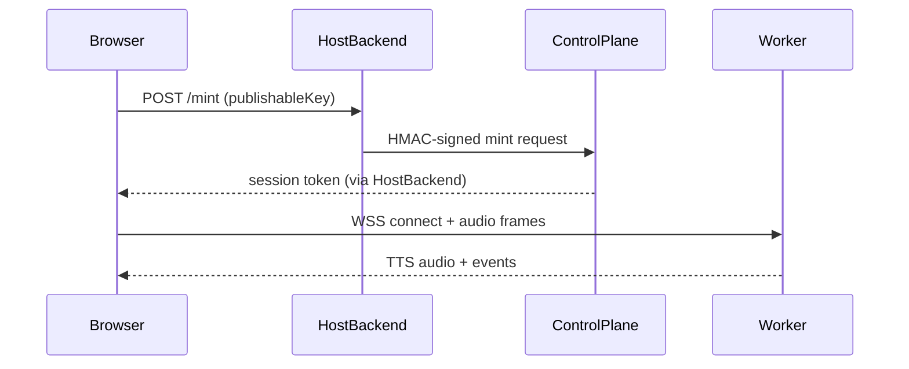

# Quickstart: Host Backend (15 minutes)

Integrate UCVE from your server using the zero-secret mint pattern (Phase 28).

## Prerequisites

- Docker Compose stack running ([COMPOSE_QUICKSTART.md](../deploy/COMPOSE_QUICKSTART.md))
- Tenant API key stored server-side only (Phase 09 vault in production)

## Steps

1. **Copy the mint proxy example**

   ```bash
   cp -r examples/host-backend ./my-mint-proxy
   cp docs/developer/env/.env.example my-mint-proxy/.env
   ```

2. **Configure env** — set `UCVE_CONTROL_PLANE_URL`, `UCVE_TENANT_API_KEY`, `UCVE_MINT_HMAC_SECRET` (see [env/.env.example](env/.env.example)).

3. **Start mint proxy** — calls the control plane `POST /v1/session` (HMAC) or `POST /v1/session/mint` (tenant API key with `session:mint`) and returns short-lived session tokens. Full HMAC flow: [../sdk/HOST_BACKEND_MINT_GUIDE.md](../sdk/HOST_BACKEND_MINT_GUIDE.md).

4. **Browser or SDK client** — pass `publishableKey` + mint URL to `@ucve/voice` (TypeScript) or `UCVEVoiceClient` (Python). Client never sees provider keys.

5. **Test call** — connect native WS → send synthetic PCM → receive TTS audio. Reference implementation: `examples/host-backend/`.



## Verify

- Open control-plane `/docs` and confirm `POST /v1/session/mint` succeeds with your API key.
- Hear TTS on a 3-turn mock conversation (Phase 17 sovereign path).

## Next

- [INTEGRATION_PATTERNS.md](INTEGRATION_PATTERNS.md)
- [TROUBLESHOOTING.md](TROUBLESHOOTING.md)
