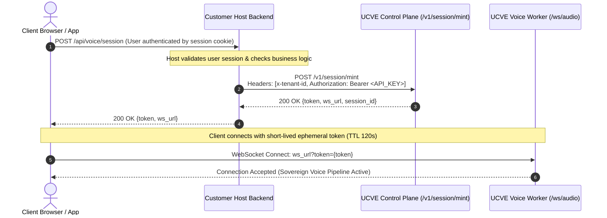

# UCVE Host Backend Minting Guide (Zero-Secret Client Architecture)

## 1. The Zero-Secret Security Invariant
**Strict Rule**: Client applications (browsers, iOS, Android, Flutter) must **NEVER** possess or store raw tenant API keys or HMAC minting secrets.

---

## 2. Token Minting Sequence



---

## 3. Reference Host Backend Implementation (FastAPI)

```python
import httpx
from fastapi import FastAPI, Depends, HTTPException

app = FastAPI()
UCVE_CONTROL_PLANE = "http://localhost:8080"
TENANT_API_KEY = "sk_prod_xxxxxxxxxxxx"
TENANT_ID = "00000000-0000-0000-0000-000000000001"
AGENT_ID = "00000000-0000-0000-0000-0000000000a1"

@app.post("/api/voice/token")
async def get_voice_token(current_user = Depends(auth_user)):
    # 1. Authorize user in your system
    headers = {
        "x-tenant-id": TENANT_ID,
        "Authorization": f"Bearer {TENANT_API_KEY}",
    }
    payload = {
        "tenant_id": TENANT_ID,
        "agent_id": AGENT_ID,
        "caller_id": current_user.id,
    }
    async with httpx.AsyncClient() as client:
        resp = await client.post(f"{UCVE_CONTROL_PLANE}/v1/session/mint", json=payload, headers=headers)
        if resp.status_code != 200:
            raise HTTPException(status_code=502, detail="Voice engine minting failed")
        return resp.json()  # Returns {token, ws_url, session_id}
```
