# 🎙️ Urdu & Minglish AI Voice Agent

A real-time, full-duplex conversational AI voice agent optimized for Urdu and Minglish customer support. Built specifically for computer retail & repair storefronts (such as Finova Computers), this pipeline features ultra-low latency, instant local Voice Activity Detection (VAD) for real-time barge-in, sentence-chunked LLM processing, and custom Web Audio player buffers.

---

## 🛠️ Technology Stack

| Layer | Component / Technology | Purpose |
| :--- | :--- | :--- |
| **Ingestion & Web Server** | [FastAPI](https://fastapi.tiangolo.com/) + Asyncio + WebSockets | Low-overhead transport gateway for binary audio & JSON telemetry. |
| **Local VAD** | [Silero VAD](https://github.com/snakers4/silero-vad) (PyTorch running locally) | Instant speech transition detection executing in a background thread executor. |
| **Cloud STT** | [Gladia Live V2 API](https://www.gladia.io/) (Official SDK) | Bilingual transcription featuring Urdu/English code-switching and 200ms VAD endpointing. |
| **Core LLM** | [Google Gemini API](https://ai.google.dev/) (Gemini 3.1 Flash Lite) | Streaming responses driven by a custom Urdu customer support retail persona. |
| **Cloud TTS** | [Uplift AI TTS API](https://uplift.ai/) | High-fidelity streaming speech synthesis returning mono 22050Hz PCM-16LE. |
| **Configuration** | `pydantic-settings` | Fail-fast environment variable validation at application load time. |
| **Client Frontend** | HTML5, Vanilla JavaScript, Web Audio API | Mic capture, latency dashboard, and gapless PCM player using AudioWorklets. |

---

## 📁 Repository Layout

```text
AI_voice_agent/
├── backend/
│   ├── app/
│   │   ├── core/
│   │   │   ├── config/
│   │   │   │   ├── __init__.py
│   │   │   │   └── config.py          # pydantic-settings configuration & fail-fast validator
│   │   │   ├── prompts/
│   │   │   │   ├── old_retail_prompt.md
│   │   │   │   └── retail_prompt.md   # Zara (زرا) persona rules, tone guidelines & constraints
│   │   │   ├── __init__.py
│   │   │   └── logging_config.py      # Multi-destination logging router (session & VAD)
│   │   ├── services/
│   │   │   ├── __init__.py
│   │   │   ├── gladia_service.py      # Gladia Live V2 streaming wrapper & event binding
│   │   │   ├── gemini_service.py      # Gemini streaming completion & sentence-boundary builder
│   │   │   ├── silero_service.py      # Local PyTorch Silero VAD state machine
│   │   │   └── uplift_service.py      # Uplift TTS client with connection pooling & byte-alignment
│   │   ├── transport/
│   │   │   ├── __init__.py
│   │   │   ├── audio_receiver.py      # Inbound FIFO queue with overflow drop-protection
│   │   │   ├── audio_sender.py        # Outbound queue with backpressure & interruption checks
│   │   │   ├── connection_manager.py  # Central WebSocket mapping & registration
│   │   │   └── websocket.py           # SessionOrchestrator and main WebSocket API router
│   │   ├── __init__.py
│   │   └── main.py                    # Application lifespans, CORS middleware, and entrypoint
│   └── tests/
│       ├── audio_converter.py         # Utility tool converting WAV files into raw PCM binary
│       ├── test_gladia_pipeline.py    # Gladia STT cloud integration test
│       ├── test_gemini_pipeline.py    # Gemini LLM integration and stress test checks
│       ├── test_uplift_pipeline.py    # Uplift TTS audio synthesis integration test
│       └── ...
├── frontend/
│   └── index.html                     # Live mic capturer, telemetry dashboard, & PCM AudioWorklets
├── requirements.txt                   # Production package manifests
└── README.md                          # Repository documentation
```

---

## 🔄 System Architecture & Data Flow

The architecture operates as a full-duplex session, separating incoming microphone audio ingestion, voice activity calculations, cloud transcription, sentence-level LLM streaming, speech synthesis, and outbound playout.

```mermaid
sequenceDiagram
    autonumber
    actor User as 👤 User (Browser)
    participant WS as 🔌 WebSocket Gateway
    participant VAD as 🎙️ Local Silero VAD (Thread)
    participant STT as 🎧 Gladia STT (Cloud V2)
    participant Orchestrator as 🧠 Session Orchestrator
    participant LLM as 💭 Gemini LLM (Gemini 3.1 Flash Lite)
    participant TTS as 🗣️ Uplift TTS (Cloud)
    participant Sender as 📤 Outbound Audio Sender

    %% Inbound Audio Flow
    User->>WS: Stream Mic Audio (16kHz mono PCM)
    WS->>Orchestrator: Forward raw bytes
    Orchestrator->>STT: Stream audio (Official SDK)
    Orchestrator->>VAD: Enqueue to VAD queue

    %% Speech Detection & Interruption
    rect rgb(45, 15, 15)
        Note over VAD, Orchestrator: If speech start is detected during thinking/speaking:
        VAD->>Orchestrator: Speech Transition Triggered
        Orchestrator->>Orchestrator: Set interruption flags, cancel LLM/TTS tasks
        Orchestrator->>Sender: Flush outbound audio queue
        Orchestrator->>WS: Send {"type": "control", "action": "barge_in"}
        WS->>User: Wipe browser play buffers instantly
    end

    %% Standard response loop
    Note over STT, Orchestrator: STT yields final transcript
    STT->>Orchestrator: "بھائی، لیپ ٹاپ کی ریم کتنی ہے؟" (is_final=True)
    Orchestrator->>LLM: generate_reply(text)
    
    %% LLM & TTS Pipeline
    LLM->>LLM: Stream tokens, split at sentence end (.?!۔؟)
    LLM->>Orchestrator: Push complete sentence (via Callback)
    Orchestrator->>WS: Send AI transcript to UI
    Orchestrator->>TTS: Stream sentence text to stream_audio()
    TTS->>TTS: Synth sentence, strip 2KB pop noise, align bytes
    TTS->>Sender: Queue output chunk (PCM-16LE 22050Hz)
    Sender->>WS: Stream binary PCM bytes to client
    WS->>User: Custom AudioWorklet (pcm-player) streams gaplessly
```



### 1. Inbound Audio Ingestion & Resampling
- Microphone capture inside the browser runs via the Web Audio API. 
- A custom `AudioWorklet` ([index.html:L166-L186](file:///d:/FinovaSolution/AI_voice_agent_v3%20-%20gemini/frontend/index.html#L166-L186)) resamples the native capture rate (usually 44.1kHz or 48kHz) down to **16kHz mono PCM-16LE**.
- The resampled binary packets are streamed down the WebSocket connection to the backend.

### 2. Double-Track Processing (STT + Local VAD)
The backend routes incoming audio packets to two independent engines concurrently:
- **Gladia Live V2**: Streams audio bytes straight to Gladia's bilingual models for transcription.
- **Local Silero VAD**: Feeds audio blocks into a local instance of Silero VAD ([silero_service.py](file:///d:/FinovaSolution/AI_voice_agent_v3%20-%20gemini/backend/app/services/silero_service.py)). 
  - To prevent PyTorch inference from blocking FastAPI's async event loop, the calculation runs in a background executor thread via `loop.run_in_executor()`.
  - Speech threshold, window size, and minimum duration filters are configured inside `.env`.

### 3. Real-Time Interruption (Barge-in)
If the user starts speaking while the AI agent is thinking or playing audio:
1. **Silero VAD** transitions to the speaking state and flags a speech start trigger.
2. The [SessionOrchestrator](file:///d:/FinovaSolution/AI_voice_agent_v3%20-%20gemini/backend/app/transport/websocket.py) executes `_barge_in()`:
   - Sets the session-level `_interrupt_event` flag.
   - Triggers `uplift.cancel()` to abort any active TTS requests.
   - Cancels the active LLM generation task (`_llm_task`) and the active turn wrapper (`_turn_task`).
   - Flushes the backend [AudioSender](file:///d:/FinovaSolution/AI_voice_agent_v3%20-%20gemini/backend/app/transport/audio_sender.py) queue synchronously to discard trailing audio frames.
3. The backend sends a control JSON message to the client: `{"type": "control", "action": "barge_in"}`.
4. The client's HTML UI:
   - Sets the local `bargeInActive` flag.
   - Sends a message to the custom playout `AudioWorklet` to instantly flush its internal audio circular queue.
   - Discards any incoming binary audio frames that were already in flight prior to the barge-in handshake.

### 5. Sentence-Chunked Generation Pipeline
- Once Gladia finishes speech endpointing, it returns a final transcript.
- The transcript is processed by [GeminiService](file:///d:/FinovaSolution/AI_voice_agent_v3%20-%20gemini/backend/app/services/gemini_service.py), which queries Gemini 3.1 Flash Lite.
- As tokens arrive from Gemini, they are accumulated inside a string buffer. A regular expression splits the buffer on sentence boundaries (including Urdu punctuation rules like `۔` and `؟`).
- As soon as a sentence is completed, it is dispatched to [UpliftTTSService](file:///d:/FinovaSolution/AI_voice_agent_v3%20-%20gemini/backend/app/services/uplift_service.py). This allows speech synthesis to run in parallel with the remainder of the LLM generation.

### 5. Resilient Audio Synthesis & Playout
- **Connection Pooling**: `UpliftTTSService` manages persistent HTTP keep-alive connections using `aiohttp.ClientSession` with a TCP connector pool, bypassing TCP/TLS setup overheads for every sentence.
- **Pop-Artifact Suppression**: The service automatically discards the first `2048` bytes of each synthesized audio stream to bypass the signature "pop" sound generated at the start of Uplift TTS responses.
- **Byte Alignment**: Yielded binary chunks are buffered and padded to guarantee that they are aligned to even-byte boundaries (required for 16-bit PCM streaming).
- **Client Playback**: The frontend stores incoming chunks inside a pre-buffer (`PREBUFFER_CHUNKS = 3`, equivalent to ~280ms of audio). Once met, the `pcm-player` AudioWorklet starts streaming the PCM blocks to the sound card gaplessly.

---

## 📊 Live Latency Telemetry

Every conversation turn calculates and streams latency metrics to the client UI:
- **Gladia STT Latency**: Time elapsed from user speech finish to final transcription payload receipt.
- **Gemini LLM Latency**: Time elapsed from sending user prompt to Gemini until the first sentence boundary is generated.
- **Uplift TTS Latency**: Time elapsed from first sentence token generation until the first synthesised audio bytes are generated.
- **Total Response Time**: Complete round-trip turn time (STT + LLM + TTS start). Highlighted in green on the dashboard.

---

## 📝 Structured Logging System

The backend writes to three distinct destinations depending on the log type:

1. **Console**: Kept at `INFO` level. Prints high-signal event messages (e.g. session start, final transcripts, state changes, error traces) to keep terminals readable.
2. **`logs/app.log`**: Standard rotating file containing all system debug information (`DEBUG` level).
3. **`logs/vad_frames.log`**: Isolated rotating file containing frame-by-frame Silero VAD probability scores, RMS amplitudes, and transitions. Suppressed from standard application logs to prevent performance degradation.
4. **`logs/sessions/<session_id>.log`**: Created dynamically upon connection. **Every single log message** emitted during that session (across all service files, transport files, and VAD logs) is mirrored here. This is the main file to inspect when debugging a specific call's telemetry or barge-in flow.

---

## ⚙️ Configuration (.env)

Create a `.env` file in the project root directory. The application validates this dynamically on startup using Pydantic Settings.

```env
# Required API Credentials
GLADIA_API_KEY=your_gladia_live_api_key
GEMINI_API_KEY=your_gemini_api_key
UPLIFT_API_KEY=your_uplift_api_key
UPLIFT_VOICE_ID=your_chosen_voice_uuid_or_name

# Core LLM Tuning (Optional)
GEMINI_MODEL=gemini-3.1-flash-lite
GEMINI_MAX_HISTORY=6

# Logging Level (DEBUG, INFO, WARNING, ERROR)
LOG_LEVEL=INFO

# CORS Configuration
CORS_ORIGINS=http://localhost:3000,http://127.0.0.1:5500,http://localhost:8000

# Silero Voice Activity Detection (VAD) Tuning
VAD_THRESHOLD=0.55             # Speech probability threshold (0.0 to 1.0)
MIN_SPEECH_DURATION_MS=250      # Minimum duration of speech to trigger speech state
MIN_SILENCE_DURATION_MS=250     # Minimum duration of silence to return to silent state
VAD_SAMPLE_RATE=16000          # Required sampling rate for Silero (16000Hz)
VAD_WINDOW_SIZE_SAMPLES=512    # Frame chunk size (samples). Must be 512, 1024 or 1536
```

---

## 🚀 Installation & Setup

### Prerequisites
- Python 3.11+ installed.
- FFmpeg (Required only if converting media fixtures for test cases).

### Backend Installation

1. Clone the repository and navigate to the project root.
2. Create and activate a Python virtual environment:
   ```powershell
   python -m venv .venv
   .\.venv\Scripts\Activate.ps1
   ```
3. Install the package dependencies:
   ```powershell
   pip install -r requirements.txt
   ```
4. Create your `.env` file according to the [Configuration](#-configuration-env) guide.

---

## 🏃 Run Instructions

### 1. Starting the Backend

Run the FastAPI application from the **project root folder**:

*   **Uvicorn hot-reload (Recommended for Development):**
    ```powershell
    uvicorn backend.app.main:app --host 0.0.0.0 --port 8000 --reload
    ```
*   **Standard Python execution:**
    ```powershell
    python backend/app/main.py
    ```

Once loaded:
- The backend performs a startup health check on Silero VAD. If Silero fails to load, the app exits with a critical error.
- Health Check Endpoint: `GET http://localhost:8000/`
- WebSocket Ingestion Endpoint: `ws://localhost:8000/ws/audio`

### 2. Starting the Frontend

For security reasons, web browsers require websites to be served over an HTTP protocol to access user media devices (microphones):

*   **Node.js / Live Server (Recommended - Autorefresh):**
    ```powershell
    cd frontend
    npx live-server --port=3000
    ```
*   **Python http.server (Alternative):**
    ```powershell
    cd frontend
    python -m http.server 3000
    ```

Open `http://localhost:3000` in your web browser, click **▶ Start Call**, and grant microphone access to begin.

---

## ☁️ Render Deployment

The backend service is configured for direct deployment to Render using the [render.yaml](file:///d:/FinovaSolution/AI_voice_agent_v3%20-%20gemini/render.yaml) blueprint specification.

### Deployment Steps:
1. Push this repository to your GitHub account.
2. Log in to the [Render Dashboard](https://dashboard.render.com/).
3. Click **New +** and select **Blueprint**.
4. Connect your GitHub repository. Render will automatically detect the `render.yaml` configuration file.
5. In the blueprint setup, you will be prompted to input values for the manual secrets:
   - `GLADIA_API_KEY`: Your Gladia STT API key.
   - `GEMINI_API_KEY`: Your Google Gemini API key.
   - `UPLIFT_API_KEY`: Your Uplift TTS API key.
6. Click **Approve** to build and deploy.

The blueprint configures a Python web service running FastAPI via `uvicorn` and binds to the Render-allocated port automatically.

---

## 🧪 Integration Testing

The `backend/tests/` folder contains isolated integration scripts that connect directly to cloud APIs (no mocks). To run them:

1. Activate your virtual environment.
2. Run the specific test script:
   ```powershell
   # Test Gladia Live V2 Speech-to-Text streaming
   python backend/tests/test_gladia_pipeline.py

   # Test Gemini streaming LLM completions
   python backend/tests/test_gemini_pipeline.py

   # Test Uplift TTS synthesis & audio file streaming
   python backend/tests/test_uplift_pipeline.py
   ```