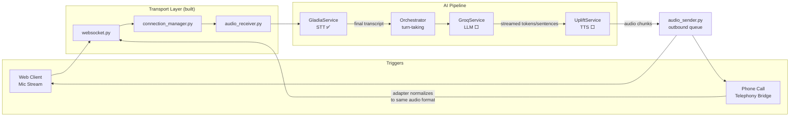

# 🎙️ MASTER MVP BLUEPRINT
## Ultra-Low Latency Urdu AI Voice Agent

**Status:** Phases 1–2 built and verified. Phases 3–5 below extend your existing codebase to production.
**Stack (confirmed):** Gladia AI (STT) → Groq/Llama (LLM) → Uplift AI (TTS) → FastAPI/ASGI + WebSockets
**Target:** <800ms time-to-first-audio, bilingual Urdu/English ("Minglish") support, dual trigger (Web + Phone) on one backend.

---

## PHASE 0: WHERE YOU ARE RIGHT NOW

| Layer | Status | Files |
|---|---|---|
| Transport (WebSocket gateway, connection manager, audio queues) | ✅ Built | `transport/websocket.py`, `connection_manager.py`, `audio_receiver.py`, `audio_sender.py` |
| STT (Gladia, code-switching, VAD endpointing) | ✅ Built | `services/gladia_service.py` |
| LLM (Groq/Llama reasoning + Urdu prompt engineering) | ⬜ Next | `services/groq_service.py` |
| TTS (Uplift AI streaming synthesis) | ⬜ Next | `services/uplift_service.py` |
| Orchestrator (wires STT→LLM→TTS, manages turn-taking) | ⬜ Next | `core/orchestrator.py` |
| Phone Trigger (telephony bridge) | ⬜ Next | `transport/telephony.py` |
| Frontend test client | ⬜ Next | `client/` |
| Deployment | ⬜ Next | `Dockerfile`, `.github/workflows/` |

Everything below is written to slot directly onto what you already have — no rewrites to Phase 1/2.

---

## PHASE 1: TECH STACK EVALUATION (LOCKED VS. ALTERNATIVES)

### STT Layer

| Option | Latency | Cost | Urdu/Code-Switch Support | Verdict |
|---|---|---|---|---|
| **Gladia (chosen)** | ~300–400ms partials | Usage-based, competitive | Native `ur`/`en` code-switching | ✅ Best fit — already integrated |
| Deepgram Nova-2 | Very low (~250ms) | Cheaper at scale | Weaker Urdu accuracy | Backup if Gladia degrades on noisy lines |
| Azure Speech | Moderate (~400–600ms) | Higher, enterprise pricing | Decent Urdu, poor Minglish handling | Only if enterprise SLA required |

### LLM Layer

| Option | Latency (TTFT) | Cost | Urdu Fluency | Verdict |
|---|---|---|---|---|
| **Groq (Llama 3.1/3.3-70B or 8B)** | 50–150ms TTFT, extremely fast token/sec | Very low | Good, needs prompt scaffolding for Roman/Nastaliq Urdu | ✅ Best fit for real-time |
| OpenAI GPT-4o-mini | 300–600ms TTFT | Moderate | Strong Urdu | Fallback if Groq rate-limited |
| Together AI (Llama) | 150–300ms TTFT | Low | Comparable to Groq | Secondary provider for redundancy |

### TTS Layer

| Option | Latency | Cost | Urdu Voice Quality | Verdict |
|---|---|---|---|---|
| **Uplift AI (chosen)** | Streaming-capable, low | Regional pricing advantage | Native Urdu voices, natural prosody | ✅ Best fit — purpose-built for Urdu |
| ElevenLabs | Low, streaming | Higher, USD billing | Good but accented Urdu | Fallback for English-heavy sessions |
| Azure Neural TTS | Moderate | Enterprise pricing | Decent Urdu | Only if compliance mandates Azure |

### Backend Framework

| Option | Verdict |
|---|---|
| **FastAPI (chosen)** | ✅ Native async, first-class WebSocket support, minimal overhead — correct choice |
| Node.js/Express + ws | Comparable perf, but loses Python's ML/NLP ecosystem for future features |
| Go (Fiber/Gin) | Best raw concurrency, but slower iteration speed for an MVP |

### `[⚙️ HUMAN INTERVENTION]`
- Confirm Groq rate limits (requests/min and tokens/min) for your account tier — this determines your concurrent call ceiling.
- Confirm Uplift AI's supported sample rate/encoding matches what `audio_sender.py` expects (avoid a resampling step in the hot path).
- Decide telephony provider for the phone-number trigger. **Twilio has no local Pakistani numbers**; evaluate **Twilio (international number + SIP trunk into Pakistan)**, **Vonage**, or **Exotel** for actual in-market reachability before committing.

---

## PHASE 2: DATA FLOW & ARCHITECTURE (UPDATED)



**Key principle:** both triggers (web mic, phone call) terminate at the *same* `websocket.py` entrypoint. The telephony bridge (Phase 4) is just an adapter that converts phone audio (typically μ-law 8kHz) into the same raw PCM 16kHz format Gladia expects — everything downstream is identical code.

---

## PHASE 3: FULL FILE HIERARCHY (EXTENDED)

```text
urdu_ai_agent/
│
├── backend/
│   ├── app/
│   │   ├── api/
│   │   │   ├── __init__.py
│   │   │   ├── health.py            # GET /health, /ready
│   │   │   └── call_routes.py       # POST /calls/inbound (telephony webhook)
│   │   │
│   │   ├── transport/
│   │   │   ├── websocket.py         # ✅ built
│   │   │   ├── connection_manager.py# ✅ built
│   │   │   ├── audio_receiver.py    # ✅ built
│   │   │   ├── audio_sender.py      # ✅ built
│   │   │   └── telephony.py         # ⬜ NEW — Twilio/Vonage adapter, μ-law <-> PCM
│   │   │
│   │   ├── services/
│   │   │   ├── gladia_service.py    # ✅ built
│   │   │   ├── groq_service.py      # ⬜ NEW — LLM streaming client
│   │   │   └── uplift_service.py    # ⬜ NEW — TTS streaming client
│   │   │
│   │   ├── core/
│   │   │   ├── orchestrator.py      # ⬜ NEW — wires STT→LLM→TTS, barge-in logic
│   │   │   ├── config.py            # ⬜ NEW — pydantic Settings, loads .env
│   │   │   ├── logging_config.py    # ⬜ NEW — structured JSON logging
│   │   │   └── prompts.py           # ⬜ NEW — system prompt templates (Urdu persona)
│   │   │
│   │   ├── models/
│   │   │   └── schemas.py           # ⬜ NEW — Pydantic request/response/event models
│   │   │
│   │   └── main.py                  # ⬜ Update — mount all routers, CORS, startup/shutdown
│   │
│   ├── tests/
│   │   ├── test_transport.py
│   │   ├── test_gladia_service.py
│   │   ├── test_groq_service.py
│   │   ├── test_uplift_service.py
│   │   └── test_e2e_pipeline.py
│   │
│   ├── .env.example                 # ⬜ NEW
│   ├── requirements.txt
│   ├── Dockerfile                   # ⬜ NEW
│   └── project_scope.md
│
├── client/
│   ├── index.html                   # ⬜ NEW — minimal mic-capture test page
│   ├── recorder.js                  # ⬜ NEW — AudioWorklet, PCM16 encoding
│   └── player.js                    # ⬜ NEW — streamed audio playback
│
└── .github/
    └── workflows/
        └── deploy.yml                # ⬜ NEW — CI/CD
```

### File Responsibilities (new files only)

| File | Responsibility |
|---|---|
| `transport/telephony.py` | Receives Twilio/Vonage Media Stream WebSocket, decodes μ-law→PCM16, pushes into the same `AudioReceiver` queue used by web clients. Also encodes outbound PCM back to μ-law. |
| `services/groq_service.py` | Streams LLM completions token-by-token via Groq's API; sentence-boundary chunking so TTS can start before the full reply is generated. |
| `services/uplift_service.py` | Opens a persistent connection/stream to Uplift AI; converts incoming text chunks into audio chunks with minimal buffering. |
| `core/orchestrator.py` | The conversation state machine: listens for Gladia `final` transcripts, triggers Groq, streams to Uplift, handles **barge-in** (user interrupts AI mid-sentence → cancel TTS/LLM tasks). |
| `core/config.py` | Centralized `pydantic.BaseSettings` — all API keys, sample rates, endpointing thresholds pulled from `.env`. Nothing hardcoded. |
| `core/logging_config.py` | JSON structured logs with `session_id` on every line — essential for debugging concurrent calls. |
| `core/prompts.py` | System prompt defining agent persona, tone, and explicit instruction to respond in Roman Urdu/Urdu script (your choice) with code-switch tolerance. |
| `models/schemas.py` | Typed contracts between layers (e.g., `TranscriptEvent`, `LLMChunk`, `AudioFrame`) so every service speaks the same shape. |

### `.env.example`
```env
# STT
GLADIA_API_KEY=

# LLM
GROQ_API_KEY=
GROQ_MODEL=llama-3.3-70b-versatile

# TTS
UPLIFT_API_KEY=
UPLIFT_VOICE_ID=

# Telephony
TELEPHONY_PROVIDER=twilio
TWILIO_ACCOUNT_SID=
TWILIO_AUTH_TOKEN=

# App
ENV=development
LOG_LEVEL=INFO
CORS_ORIGINS=http://localhost:3000
```

### `[⚙️ HUMAN INTERVENTION]`
- Decide script: reply in Roman Urdu, Urdu (Nastaliq) script, or mirror the user's script choice — this changes `prompts.py` and must match what Uplift's voice model expects as input text.

---

## PHASE 4: LAYER-BY-LAYER BUILD (REMAINING LAYERS)

### 4.1 — LLM Layer (`groq_service.py`)

**Core Logic:**
- Maintain a rolling conversation history (last N turns) per `session_id`, capped to control token cost/latency.
- On receiving a `final` transcript from `GladiaService`, call Groq with `stream=True`.
- Buffer streamed tokens and flush to the TTS layer at **sentence boundaries** (on `.`, `?`, `!`, or Urdu equivalents `۔`, `؟`) rather than waiting for the full response — this is what gets you under 800ms perceived latency.

**Pseudo-code:**
```python
class GroqService:
    def __init__(self, session_id: str, on_sentence_ready):
        self.history = []
        self.on_sentence_ready = on_sentence_ready
        self.buffer = ""

    async def generate_reply(self, user_text: str):
        self.history.append({"role": "user", "content": user_text})
        stream = await groq_client.chat.completions.create(
            model=settings.GROQ_MODEL,
            messages=[SYSTEM_PROMPT, *self.history],
            stream=True,
        )
        async for chunk in stream:
            token = chunk.choices[0].delta.content or ""
            self.buffer += token
            if ends_sentence(self.buffer):
                await self.on_sentence_ready(self.buffer)
                self.history.append({"role": "assistant", "content": self.buffer})
                self.buffer = ""
```

**Integration:** `orchestrator.py` subscribes to `GladiaService.on_transcript()`; when `is_final=True`, it calls `GroqService.generate_reply()`. Each emitted sentence is immediately pushed into `UpliftService`.

**`[⚙️ HUMAN INTERVENTION]`**
- Generate Groq API key, confirm which Llama model tier your account has access to.
- Tune conversation history window size (start with last 6 turns).

**`[🧪 TESTING MILESTONE]`**
- *Tools:* Postman (REST, non-streaming sanity check), a Python script using `groq` SDK directly for streaming validation.
- *What to check:* Time-to-first-token (target <200ms), sentence-chunking correctness (no chunk sent mid-word), history correctly capped.
- *Expected outcome:* A test transcript ("Mera order kahan hai?") produces a coherent, on-topic Urdu/Minglish reply, streamed in ≥2 chunks for any reply >1 sentence.
- *Edge cases:* Empty transcript (silence false-positive from Gladia), Groq rate-limit 429 (must retry/backoff, not crash the session), extremely long user input (truncate history gracefully).

---

### 4.2 — TTS Layer (`uplift_service.py`)

**Core Logic:**
- Receives text chunks (sentences) from `GroqService`.
- Streams each chunk to Uplift AI and receives audio back in chunks — push each audio chunk immediately into `audio_sender.py`'s outbound queue rather than waiting for the whole sentence's audio.
- Must support **cancellation** mid-synthesis (for barge-in).

**Pseudo-code:**
```python
class UpliftService:
    def __init__(self, session_id: str, on_audio_chunk):
        self.on_audio_chunk = on_audio_chunk
        self._current_task: asyncio.Task | None = None

    async def synthesize(self, text: str):
        self._current_task = asyncio.current_task()
        async for audio_chunk in uplift_client.stream_tts(
            text=text,
            voice_id=settings.UPLIFT_VOICE_ID,
            sample_rate=16000,
        ):
            await self.on_audio_chunk(audio_chunk)

    def cancel(self):
        if self._current_task:
            self._current_task.cancel()
```

**Integration:** Output chunks feed directly into the existing `audio_sender.py` queue — no new transport code needed.

**`[⚙️ HUMAN INTERVENTION]`**
- Generate Uplift AI API key, select/confirm the Urdu voice ID to use.
- Confirm Uplift's output audio format (sample rate/encoding) — resample only if it doesn't already match `audio_sender.py`'s expectation.

**`[🧪 TESTING MILESTONE]`**
- *Tools:* Postman/`wscat` against Uplift's endpoint directly, then an end-to-end manual listen test through the web client.
- *What to check:* Audio starts playing before full sentence synthesis completes (streaming, not batch), no audio artifacts at chunk boundaries.
- *Expected outcome:* Natural-sounding Urdu audio, first audio byte arrives <300ms after first text chunk is sent.
- *Edge cases:* Very short text ("Haan"), text with English words injected mid-sentence, cancellation mid-stream (barge-in) leaves no residual audio playing.

---

### 4.3 — Orchestrator (`core/orchestrator.py`)

**Core Logic:** the conversation state machine per session.

```python
class Orchestrator:
    def __init__(self, session_id):
        self.gladia = GladiaService(session_id, on_transcript=self.handle_transcript)
        self.groq = GroqService(session_id, on_sentence_ready=self.handle_sentence)
        self.uplift = UpliftService(session_id, on_audio_chunk=self.handle_audio)
        self.state = "listening"

    async def handle_transcript(self, transcript: GladiaTranscript):
        if transcript.is_final:
            self.state = "thinking"
            await self.groq.generate_reply(transcript.text)

    async def handle_sentence(self, sentence: str):
        self.state = "speaking"
        await self.uplift.synthesize(sentence)

    async def handle_audio(self, chunk: bytes):
        await audio_sender.enqueue(chunk)

    async def handle_barge_in(self):
        # Triggered when Gladia detects new speech while state == "speaking"
        self.uplift.cancel()
        self.state = "listening"
```

**`[🧪 TESTING MILESTONE]`**
- *What to check:* Full round-trip latency (user stops speaking → first AI audio byte) is measured end-to-end, not per-layer.
- *Expected outcome:* <800ms on a stable connection.
- *Edge cases:* User interrupts AI mid-sentence (barge-in must cleanly cancel Groq+Uplift tasks without leaking asyncio tasks).

---

### 4.4 — Phone Trigger (`transport/telephony.py`)

**Core Logic:**
- Telephony provider (Twilio/Vonage) opens a Media Streams WebSocket to your server on an inbound call.
- Incoming audio arrives base64-encoded μ-law @ 8kHz — decode and upsample to PCM16 @ 16kHz before pushing into the same `AudioReceiver` queue web clients use.
- Outbound: downsample AI audio from 16kHz PCM back to 8kHz μ-law before sending to the call.

**Integration:** This is purely an adapter — it does not duplicate any STT/LLM/TTS logic. Same `connection_manager.py`, same `orchestrator.py` per session.

**`[⚙️ HUMAN INTERVENTION]`**
- Register the telephony provider account, configure the inbound number's webhook to point at `POST /calls/inbound`.
- Confirm audio codec support (most providers default to μ-law; confirm before writing conversion code).

**`[🧪 TESTING MILESTONE]`**
- *Tools:* Provider's console test-call feature, `ngrok`/tunnel for local webhook testing.
- *What to check:* Codec conversion correctness (no pitch distortion), call connects and both directions of audio flow.
- *Expected outcome:* A real phone call to the test number produces the same conversational behavior as the web client.
- *Edge cases:* Call dropped mid-conversation (must trigger the same cleanup path as WebSocket disconnect in `connection_manager.py`), poor cellular network (packet loss/jitter handling).

---

### 4.5 — Frontend Test Interface (`client/`)

**Core Logic:** minimal page — mic capture via `AudioWorklet`, PCM16 encoding, WebSocket send/receive, playback via `AudioContext`. No framework needed for an MVP test harness.

**`[🧪 TESTING MILESTONE]`**
- *What to check:* Mic permission flow, correct PCM16/16kHz encoding sent over WebSocket, smooth gapless playback of streamed AI audio.
- *Expected outcome:* A full voice conversation is possible entirely from the browser.

---

## PHASE 5: FINAL AUDIT & PRODUCTION READINESS

### 5.1 — Efficiency Audit
- Confirm **every** I/O-bound call (Gladia, Groq, Uplift, DB if added later) is `await`ed, never blocking the event loop.
- Confirm audio is always handled as streamed chunks end-to-end — no layer buffers a full utterance before passing it on.
- Profile with `asyncio` debug mode (`PYTHONASYNCIODEBUG=1`) locally to catch any accidental blocking calls.

### 5.2 — Scalability & Security
| Concern | Action |
|---|---|
| Concurrent calls | Load-test with multiple simulated WebSocket sessions (`locust` or a custom async script) before assuming capacity |
| Connection leaks | Verify `connection_manager.py` removes sessions on both graceful and abrupt disconnects |
| Rate limiting | Add per-IP/per-session limits on `api/call_routes.py` and the web WebSocket endpoint |
| Secrets | All API keys in `.env`, never committed; use your host's secret manager in production |
| CORS | Lock `CORS_ORIGINS` to your actual frontend domain(s) before going live |

### 5.3 — Deployment Roadmap
1. **Containerize:** `Dockerfile` — slim Python base image, install `requirements.txt`, run with `uvicorn`/`gunicorn` + Uvicorn workers.
2. **CI/CD:** GitHub Actions workflow — on push to `main`: run `pytest`, build Docker image, push to registry, deploy.
3. **Hosting:** Prefer a host with **persistent WebSocket support** and low network latency to Pakistan (e.g., a region close to South/Central Asia) — evaluate Render, Railway, Fly.io, or a VPS (DigitalOcean/Linode) with manual Nginx+Uvicorn setup for full control over WebSocket timeouts.
4. **Observability:** Ship structured logs (from `logging_config.py`) to a log aggregator; add a `/health` endpoint for uptime checks.

### `[⚙️ HUMAN INTERVENTION]`
- Choose hosting region based on measured latency to Pakistan, not just price — this materially affects your <800ms target.
- Decide whether Nginx (for WebSocket-aware reverse proxying/SSL termination) sits in front of Uvicorn, or if the host handles that natively.

### `[🧪 TESTING MILESTONE]` — Go-Live Checklist
- [ ] End-to-end latency measured and logged across 10+ real conversation turns
- [ ] Barge-in tested and confirmed clean (no overlapping audio)
- [ ] Concurrent call test (minimum 5 simultaneous sessions) with no cross-talk between sessions
- [ ] Phone + web trigger both verified against the same orchestrator logic
- [ ] All secrets confirmed absent from git history
- [ ] Graceful degradation tested: what happens if Groq/Uplift/Gladia returns an error mid-call (must fail safely, not crash the session)

---

*This blueprint extends your existing Phase 1 (Transport) and Phase 2 (STT) implementation with zero rework — Phases 3–5 are additive.*
