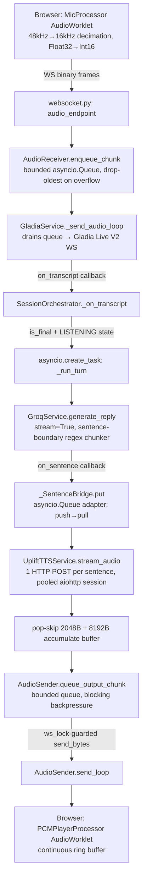

# HANDOFF.md — Urdu AI Voice Agent

## 1. Pipeline Architecture

**Task topology per session (`audio_endpoint`):**
- `sender_task` — `AudioSender.send_loop()`, runs for connection lifetime
- `pipeline_task` — `SessionOrchestrator.run()` → `GladiaService.start()`, runs for connection lifetime
  - internally spawns `_audio_task` (Gladia audio upload loop) + `_receive_task` (Gladia transcript loop) via `asyncio.gather`
- `_turn_task` — one per conversational turn, created in `_on_transcript`, wraps `_run_turn`
  - `_llm_task` — child of `_turn_task`, wraps `GroqService.generate_reply`

## 2. Latency & Race Condition Handling

**Latency minimization:**
- Sentence-level (not full-reply) chunking at the LLM layer — `GroqService._is_sentence_end` regex `[.?!۔؟]\s*$` — lets TTS start on sentence N while the LLM is still generating sentence N+1.
- Sentence-level (not turn-level) requests to Uplift — first audio byte arrives after the *first sentence* synthesizes, not the whole reply.
- `_synthesize_sentence` streams via `resp.content.iter_chunked(4096)` rather than buffering the full HTTP response.
- Bounded queues throughout (`AudioReceiver(maxsize=100)`, `AudioSender(maxsize=200)`) prevent queueing delay from growing unbounded under backpressure.
- Per-turn latency telemetry is instrumented directly in `SessionOrchestrator` (`_turn_start_time`, `_llm_first_token_time`) and pushed to the client as `{"type":"metric", ...}` JSON frames — STT latency, LLM TTFB, TTS TTFB, and total turn time are all live-measurable per call.

**Race condition prevention:**
- **The shared-WebSocket race:** `AudioSender.send_loop()` (binary audio frames) and `SessionOrchestrator` (JSON text frames: transcripts, metrics, control messages) both write to the *same* Starlette `WebSocket` object from independent concurrent asyncio tasks. Starlette does not serialize concurrent `send_*` calls on one connection internally. **Fix implemented:** a single `asyncio.Lock` (`ws_lock`), created once per connection in `audio_endpoint` and threaded into both `AudioSender.__init__` and `SessionOrchestrator.__init__`. Every `send_bytes`/`send_text` call in both classes is wrapped `async with self._ws_lock: ...`.
- **Turn-trigger race:** `_on_transcript`'s state check (`if self._state != CallState.LISTENING: return`) prevents two near-simultaneous `is_final` transcripts from both spawning `_run_turn`.
- **Barge-in vs. turn-completion race:** `_run_turn`'s `finally` block only resets state to `LISTENING` `if self._state == CallState.SPEAKING` — this prevents a turn's own natural completion from clobbering a state that a concurrent `_barge_in()` call already reset.
- **Stale-cancel guard:** `UpliftTTSService._reset_cancel()` runs at the top of every `stream_audio()` call, so a `cancel()` from a *previous* barge-in can't block a brand-new turn.

## 3. Advanced Mechanisms

### VAD / Barge-in
- **Location:** `websocket.py`, `SessionOrchestrator._on_transcript` (trigger) + `_barge_in` (execution).
- **VAD source:** server-side, via Gladia's `endpointing=0.5` (`gladia_service.py:_build_live_init_request`) — 500ms of silence marks a final transcript.
- **Sensitivity filter (prevents false-positive interruption from noise):** any transcript event arriving while `_state in (THINKING, SPEAKING)` is evaluated against `word_count > 1 or len(cleaned_text) >= 2` — single-character/breath-length transcripts are logged and ignored (`logger.debug(...)`), not treated as barge-in.
- **Execution order in `_barge_in`:** `UpliftTTSService.cancel()` → cancel+await `_llm_task` → cancel `_turn_task` → `await self._audio_sender.flush()` → send `{"type":"control","action":"barge_in"}` (ws_lock-guarded) → reset `_state = LISTENING`.
- **Frontend buffer clear:** `frontend/index.html`, `PCMPlayerProcessor.port.onmessage` — a `{flush: true}` message zeroes `this._buf = new Float32Array(0)` inside the AudioWorklet, discarding any audio that arrived but hadn't played yet.

### Chunking & Jitter Buffering
- **Location:** `uplift_service.py`, `UpliftTTSService.stream_audio`.
- **Pop-artifact removal:** `bytes_to_skip = 2048` initialized once per `stream_audio()` call (i.e., once per **turn**, not per sentence) — the first 2048 bytes of raw audio are discarded before any bytes are yielded, removing a leading click/pop artifact from Uplift's stream start.
  - ⚠️ **Note for maintainers:** because `bytes_to_skip` is scoped to the whole turn rather than reset per sentence, only the *first* sentence of a multi-sentence reply gets the pop-skip applied. If Uplift produces the same pop artifact at the start of every individual sentence request (each sentence is its own HTTP call), sentences 2+ in a reply may retain an audible pop. Worth verifying empirically with a multi-sentence reply capture.
- **8192-byte accumulation buffer:** raw 4096-byte HTTP-stream chunks (post pop-skip) are accumulated into a `leftover` buffer and only `yield`ed once `len(leftover) >= 8192`, at turn-end the remainder is flushed regardless of size. This is a **server-side** batching step — it reduces the number of discrete WebSocket messages sent to the client (steadier, larger packets) rather than being a frontend jitter buffer itself.
- **Odd-byte alignment guard:** since output is 16-bit PCM (2 bytes/sample), both the pop-skip and the 8192 flush paths check `len(leftover) % 2 != 0` and hold back a single trailing byte rather than ever yielding a buffer that splits a sample in half (which would corrupt every subsequent sample's byte alignment on the frontend's `Int16Array` decode).
- **Frontend-side jitter absorption:** separately, `frontend/index.html`'s `PCMPlayerProcessor` (AudioWorklet) maintains its own continuous ring buffer and a `PREBUFFER_CHUNKS` pre-roll before starting playback — this is what actually prevents `AudioContext` underruns from network jitter; the backend's 8192-byte batching reduces message frequency but the frontend ring buffer is what makes underruns silent (zero-padded) instead of audible clicks.

### State Management
- **Definition:** `websocket.py`, `class CallState(enum.Enum)`: `LISTENING`, `THINKING`, `SPEAKING`.
- **Transitions:**
  | From | To | Trigger | Location |
  |---|---|---|---|
  | `LISTENING` | `THINKING` | `is_final` transcript received while `state == LISTENING` | `_on_transcript` |
  | `THINKING` | `SPEAKING` | `_run_turn` begins execution | `_run_turn` (redundantly also set at top of `_on_transcript`'s turn-trigger branch) |
  | `SPEAKING`/`THINKING` | `LISTENING` (via interrupt) | barge-in detected | `_barge_in` |
  | `SPEAKING` | `LISTENING` (via natural completion) | `_run_turn`'s `finally`, guarded by `if self._state == CallState.SPEAKING` | `_run_turn` |
- **Note:** state is set to `THINKING` in two places (`_on_transcript` before task creation, and again at the top of `_run_turn`) — functionally harmless (idempotent) but redundant; a future cleanup could remove one.